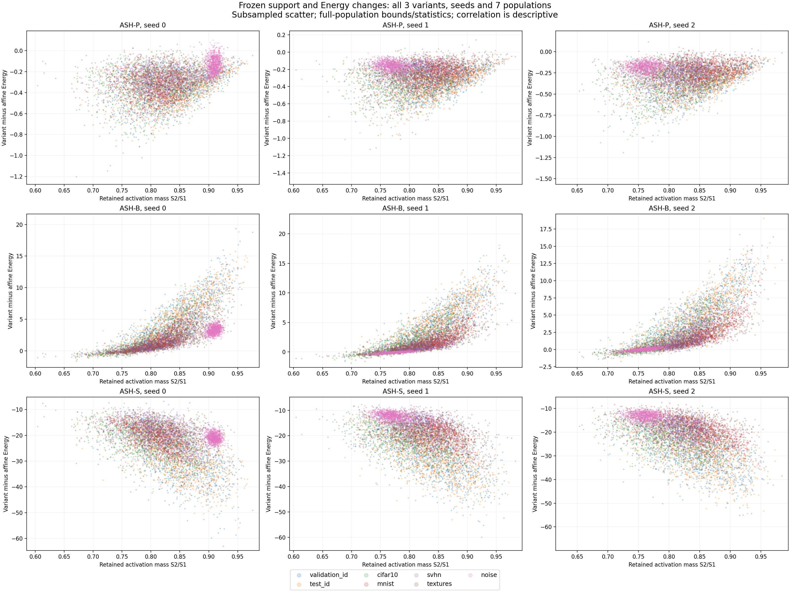
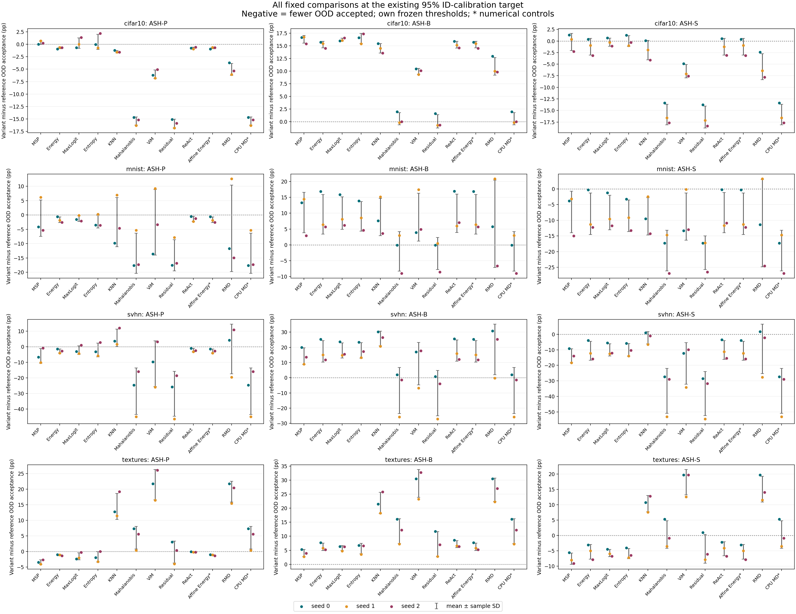

# Frozen ASH support, scale, classification and decision diagnostics

Post-result descriptive analysis of every fixed p=65 ASH variant, three frozen seeds and seven separate scoring populations. All twelve old reference columns and four existing targets remain intact. No feature extraction, detector fit, percentile/temperature change or threshold calculation occurred.

Values are mean ± sample SD across seeds 0/1/2. Population SD uses ddof=0; all quantiles/covariances and full rows remain in raw/summary archives. Seed SD is descriptive, not CI. Means/correlations and acceptance transitions cannot establish a causal mechanism for AUROC.

## Activation support and scale

q=S2/S1 is the retained fraction of activation mass, distinct from 179/512 retained coordinates. r=S1/S2 and c=exp(r) are fixed sample definitions, not fitted parameters. Every row satisfies q*r=1. B fills retained coordinates with S1/179; S uses the actual exponential.

| Population | n per seed | Mean retained fraction q | Mean ratio r | Mean exp(r) | Mean binary fill |
|---|---:|---:|---:|---:|---:|
| validation_id | 5,000 | 0.842 ± 0.000 | 1.192 ± 0.001 | 3.305 ± 0.002 | 0.867 ± 0.007 |
| test_id | 10,000 | 0.842 ± 0.001 | 1.192 ± 0.001 | 3.306 ± 0.003 | 0.866 ± 0.008 |
| cifar10 | 10,000 | 0.802 ± 0.001 | 1.252 ± 0.002 | 3.509 ± 0.008 | 0.875 ± 0.009 |
| mnist | 10,000 | 0.832 ± 0.020 | 1.205 ± 0.030 | 3.343 ± 0.101 | 0.833 ± 0.052 |
| svhn | 26,032 | 0.815 ± 0.005 | 1.230 ± 0.008 | 3.429 ± 0.029 | 0.839 ± 0.029 |
| textures | 1,880 | 0.828 ± 0.001 | 1.214 ± 0.002 | 3.380 ± 0.007 | 0.888 ± 0.012 |
| noise | 10,000 | 0.812 ± 0.084 | 1.240 ± 0.122 | 3.475 ± 0.408 | 0.903 ± 0.068 |

Validation/test ID are separate. Noise remains synthetic and is excluded from every natural macro.

## Signed Energy changes and correlation

All Energy vectors are copied from frozen phase 5. Each delta is variant minus the original affine Energy numeric control, keeping both signs. Pearson is computed between retained fraction q and that signed delta; a zero-variance population is explicitly undefined. These scales differ by variant, and negative delta is not a ranking or acceptance guarantee.

| Population | Variant | Mean delta Energy | Pearson(q,delta Energy) |
|---|---|---:|---:|
| validation_id | ASH-P | -0.364 ± 0.005 | 0.411 ± 0.024 |
| validation_id | ASH-B | 4.958 ± 0.028 | 0.830 ± 0.002 |
| validation_id | ASH-S | -29.129 ± 0.254 | -0.562 ± 0.008 |
| test_id | ASH-P | -0.365 ± 0.006 | 0.413 ± 0.009 |
| test_id | ASH-B | 4.954 ± 0.064 | 0.835 ± 0.003 |
| test_id | ASH-S | -29.176 ± 0.350 | -0.561 ± 0.012 |
| cifar10 | ASH-P | -0.336 ± 0.010 | 0.156 ± 0.043 |
| cifar10 | ASH-B | 1.739 ± 0.020 | 0.746 ± 0.010 |
| cifar10 | ASH-S | -21.668 ± 0.310 | -0.425 ± 0.035 |
| mnist | ASH-P | -0.274 ± 0.058 | 0.093 ± 0.135 |
| mnist | ASH-B | 1.791 ± 0.388 | 0.800 ± 0.023 |
| mnist | ASH-S | -19.752 ± 0.752 | -0.549 ± 0.082 |
| svhn | ASH-P | -0.258 ± 0.030 | 0.177 ± 0.010 |
| svhn | ASH-B | 1.310 ± 0.207 | 0.674 ± 0.049 |
| svhn | ASH-S | -17.612 ± 1.373 | -0.359 ± 0.082 |
| textures | ASH-P | -0.259 ± 0.006 | 0.394 ± 0.021 |
| textures | ASH-B | 2.067 ± 0.066 | 0.748 ± 0.011 |
| textures | ASH-S | -19.860 ± 0.425 | -0.341 ± 0.020 |
| noise | ASH-P | -0.164 ± 0.026 | -0.011 ± 0.182 |
| noise | ASH-B | 1.082 ± 1.929 | 0.621 ± 0.285 |
| noise | ASH-S | -15.440 ± 4.816 | -0.188 ± 0.110 |

All saved logits satisfy z_S=c*z_P+(1-c)*b with the original bias. Thus positive scaling of the pruned feature does not guarantee unchanged P/S argmax in this biased head. The independent auditor also reconstructs every P/B/S head and audits its frozen Energy without replacing any score.

## Full population mean differences

Each mean difference is formed within the same seed. All eighteen component differences are in summary.json; the table keeps retained fraction and all three signed Energy-delta changes. No population or variant is selected for a favorable result.

| Population minus test ID | Delta retained fraction | Delta P Energy change | Delta B Energy change | Delta S Energy change |
|---|---:|---:|---:|---:|
| validation_id_minus_test_id | 0.000 ± 0.001 | 0.001 ± 0.001 | 0.004 ± 0.037 | 0.047 ± 0.113 |
| cifar10_minus_test_id | -0.041 ± 0.001 | 0.029 ± 0.004 | -3.216 ± 0.067 | 7.509 ± 0.045 |
| mnist_minus_test_id | -0.010 ± 0.021 | 0.091 ± 0.058 | -3.164 ± 0.445 | 9.425 ± 0.585 |
| svhn_minus_test_id | -0.028 ± 0.005 | 0.107 ± 0.026 | -3.645 ± 0.203 | 11.564 ± 1.036 |
| textures_minus_test_id | -0.014 ± 0.002 | 0.107 ± 0.005 | -2.887 ± 0.077 | 9.316 ± 0.176 |
| noise_minus_test_id | -0.030 ± 0.084 | 0.202 ± 0.023 | -3.872 ± 1.865 | 13.736 ± 4.565 |

## Separate intermediate classification transitions

These compare each shaped prediction with the original classifier. Gains/losses refer to correctness, with each population denominator. Argmax changes additionally include changed predictions that remain incorrect. OOD has no correctness label. Validation is reused validation. Every rejection-risk endpoint still uses the original classifier correctness.

| Population | Variant | Original accuracy % | Shaped accuracy % | Shaped-only correct % | Original-only correct % | Accuracy change (pp) | Argmax changes per seed |
|---|---|---:|---:|---:|---:|---:|---|
| test_id | ASH-P | 75.770 ± 0.297 | 75.657 ± 0.362 | 0.387 ± 0.042 | 0.500 ± 0.046 | -0.113 ± 0.078 | [168, 160, 173] |
| test_id | ASH-B | 75.770 ± 0.297 | 71.770 ± 0.448 | 2.237 ± 0.154 | 6.237 ± 0.059 | -4.000 ± 0.187 | [1344, 1332, 1300] |
| test_id | ASH-S | 75.770 ± 0.297 | 75.673 ± 0.326 | 0.397 ± 0.047 | 0.493 ± 0.035 | -0.097 ± 0.067 | [166, 160, 180] |
| validation_id | ASH-P | 75.233 ± 0.313 | 75.060 ± 0.334 | 0.327 ± 0.081 | 0.500 ± 0.020 | -0.173 ± 0.095 | [90, 87, 85] |
| validation_id | ASH-B | 75.233 ± 0.313 | 70.967 ± 0.061 | 2.120 ± 0.140 | 6.387 ± 0.241 | -4.267 ± 0.371 | [690, 673, 679] |
| validation_id | ASH-S | 75.233 ± 0.313 | 75.053 ± 0.323 | 0.313 ± 0.064 | 0.493 ± 0.023 | -0.180 ± 0.087 | [90, 86, 88] |

P/S disagreements per seed, test ID / validation ID: [19, 9, 23] / [10, 3, 7].


## Exhaustive fixed-threshold decision transitions

The primary 95% ID-calibration target is shown below because it was already the fixed primary operating point. Every 80/90/95/99% target is saved in summary.json. All 432 seed/comparison/target settings and per-class ID counts remain available as raw transition codes.

Both methods use their own frozen threshold selected from the same 2,500 reused ID-validation calibration rows. Thus these transitions include threshold differences; they are not a pure ranking effect or a comparison at exactly equal achieved ID-test coverage. Correct/incorrect ID use original classifier predictions, with separate subgroup denominators. OOD populations have no classifier-correctness flag.

| ASH minus reference | Population | Both accept % | ASH only % | Reference only % | Neither % | Acceptance change (pp) |
|---|---|---:|---:|---:|---:|---:|
| ASH-P − MSP | test_id | 93.020 ± 0.747 | 1.933 ± 0.072 | 1.870 ± 0.168 | 3.177 ± 0.556 | 0.063 ± 0.166 |
| ASH-P − MSP | correct ID | 97.360 ± 0.262 | 0.625 ± 0.079 | 1.003 ± 0.072 | 1.012 ± 0.117 | -0.378 ± 0.026 |
| ASH-P − MSP | incorrect ID | 79.462 ± 2.094 | 6.025 ± 0.226 | 4.580 ± 0.452 | 9.933 ± 1.834 | 1.445 ± 0.658 |
| ASH-P − MSP | cifar10 | 74.973 ± 1.212 | 6.200 ± 0.359 | 5.907 ± 0.067 | 12.920 ± 0.836 | 0.293 ± 0.346 |
| ASH-P − MSP | mnist | 78.807 ± 1.437 | 5.503 ± 3.523 | 6.607 ± 2.841 | 9.083 ± 2.107 | -1.103 ± 6.345 |
| ASH-P − MSP | svhn | 60.144 ± 12.410 | 5.783 ± 1.133 | 11.738 ± 3.646 | 22.335 ± 9.741 | -5.955 ± 4.678 |
| ASH-P − MSP | textures | 71.950 ± 2.005 | 5.585 ± 0.281 | 8.989 ± 0.454 | 13.475 ± 1.785 | -3.404 ± 0.720 |
| ASH-P − MSP | noise | 33.577 ± 57.524 | 0.017 ± 0.021 | 5.423 ± 5.686 | 60.983 ± 52.915 | -5.407 ± 5.683 |
| ASH-P − Energy | test_id | 94.713 ± 0.712 | 0.240 ± 0.050 | 0.433 ± 0.047 | 4.613 ± 0.736 | -0.193 ± 0.061 |
| ASH-P − Energy | correct ID | 97.826 ± 0.226 | 0.159 ± 0.070 | 0.185 ± 0.074 | 1.830 ± 0.238 | -0.026 ± 0.082 |
| ASH-P − Energy | incorrect ID | 84.992 ± 2.102 | 0.496 ± 0.075 | 1.211 ± 0.118 | 13.301 ± 2.234 | -0.716 ± 0.123 |
| ASH-P − Energy | cifar10 | 80.420 ± 0.788 | 0.753 ± 0.107 | 1.500 ± 0.193 | 17.327 ± 1.043 | -0.747 ± 0.169 |
| ASH-P − Energy | mnist | 83.987 ± 5.125 | 0.323 ± 0.372 | 1.993 ± 0.696 | 13.697 ± 4.868 | -1.670 ± 1.011 |
| ASH-P − Energy | svhn | 65.494 ± 13.192 | 0.433 ± 0.226 | 3.222 ± 1.153 | 30.852 ± 12.368 | -2.789 ± 1.328 |
| ASH-P − Energy | textures | 76.844 ± 2.294 | 0.691 ± 0.192 | 1.844 ± 0.262 | 20.621 ± 1.940 | -1.152 ± 0.201 |
| ASH-P − Energy | noise | 33.553 ± 57.545 | 0.040 ± 0.040 | 0.107 ± 0.093 | 66.300 ± 57.418 | -0.067 ± 0.065 |
| ASH-P − MaxLogit | test_id | 94.330 ± 0.783 | 0.623 ± 0.236 | 0.700 ± 0.114 | 4.347 ± 0.696 | -0.077 ± 0.346 |
| ASH-P − MaxLogit | correct ID | 97.787 ± 0.214 | 0.198 ± 0.100 | 0.436 ± 0.059 | 1.580 ± 0.128 | -0.237 ± 0.126 |
| ASH-P − MaxLogit | incorrect ID | 83.538 ± 2.404 | 1.950 ± 0.647 | 1.530 ± 0.430 | 12.983 ± 2.357 | 0.420 ± 1.074 |
| ASH-P − MaxLogit | cifar10 | 79.037 ± 1.023 | 2.137 ± 0.517 | 1.900 ± 0.533 | 16.927 ± 0.939 | 0.237 ± 1.045 |
| ASH-P − MaxLogit | mnist | 83.043 ± 4.708 | 1.267 ± 0.227 | 2.533 ± 0.766 | 13.157 ± 4.167 | -1.267 ± 0.990 |
| ASH-P − MaxLogit | svhn | 63.688 ± 12.742 | 2.238 ± 0.848 | 4.421 ± 2.047 | 29.652 ± 11.294 | -2.183 ± 2.778 |
| ASH-P − MaxLogit | textures | 76.099 ± 2.181 | 1.436 ± 0.524 | 3.032 ± 0.599 | 19.433 ± 2.078 | -1.596 ± 1.117 |
| ASH-P − MaxLogit | noise | 33.573 ± 57.527 | 0.020 ± 0.026 | 0.383 ± 0.343 | 66.023 ± 57.178 | -0.363 ± 0.332 |
| ASH-P − Entropy | test_id | 94.070 ± 0.757 | 0.883 ± 0.331 | 0.983 ± 0.170 | 4.063 ± 0.585 | -0.100 ± 0.469 |
| ASH-P − Entropy | correct ID | 97.756 ± 0.214 | 0.229 ± 0.169 | 0.581 ± 0.117 | 1.434 ± 0.067 | -0.352 ± 0.233 |
| ASH-P − Entropy | incorrect ID | 82.561 ± 2.315 | 2.927 ± 0.823 | 2.244 ± 0.451 | 12.269 ± 2.095 | 0.683 ± 1.263 |
| ASH-P − Entropy | cifar10 | 77.947 ± 0.896 | 3.227 ± 0.874 | 2.743 ± 0.659 | 16.083 ± 0.644 | 0.483 ± 1.522 |
| ASH-P − Entropy | mnist | 82.717 ± 4.203 | 1.593 ± 0.770 | 3.890 ± 1.495 | 11.800 ± 3.433 | -2.297 ± 2.232 |
| ASH-P − Entropy | svhn | 62.358 ± 12.005 | 3.569 ± 1.653 | 5.739 ± 2.823 | 28.334 ± 10.572 | -2.170 ± 4.398 |
| ASH-P − Entropy | textures | 74.787 ± 1.606 | 2.748 ± 0.800 | 4.504 ± 0.886 | 17.961 ± 1.875 | -1.755 ± 1.659 |
| ASH-P − Entropy | noise | 33.553 ± 57.545 | 0.040 ± 0.046 | 0.407 ± 0.426 | 66.000 ± 57.159 | -0.367 ± 0.417 |
| ASH-P − KNN | test_id | 92.530 ± 0.860 | 2.423 ± 0.297 | 2.737 ± 0.482 | 2.310 ± 0.246 | -0.313 ± 0.510 |
| ASH-P − KNN | correct ID | 96.964 ± 0.183 | 1.021 ± 0.147 | 1.329 ± 0.195 | 0.686 ± 0.075 | -0.308 ± 0.318 |
| ASH-P − KNN | incorrect ID | 78.684 ± 2.821 | 6.803 ± 0.858 | 7.131 ± 1.367 | 7.381 ± 0.827 | -0.328 ± 1.108 |
| ASH-P − KNN | cifar10 | 73.490 ± 1.268 | 7.683 ± 0.416 | 9.153 ± 0.595 | 9.673 ± 0.366 | -1.470 ± 0.225 |
| ASH-P − KNN | mnist | 77.407 ± 2.225 | 6.903 ± 3.383 | 9.410 ± 5.192 | 6.280 ± 2.100 | -2.507 ± 8.574 |
| ASH-P − KNN | svhn | 49.234 ± 11.198 | 16.692 ± 3.120 | 11.008 ± 2.586 | 23.065 ± 10.816 | 5.684 ± 5.575 |
| ASH-P − KNN | textures | 55.496 ± 2.781 | 22.039 ± 2.523 | 7.571 ± 1.660 | 14.894 ± 1.898 | 14.468 ± 4.153 |
| ASH-P − KNN | noise | 14.387 ± 24.823 | 19.207 ± 32.687 | 0.327 ± 0.566 | 66.080 ± 57.230 | 18.880 ± 32.973 |
| ASH-P − Mahalanobis | test_id | 90.267 ± 0.436 | 4.687 ± 0.302 | 5.030 ± 0.681 | 0.017 ± 0.015 | -0.343 ± 0.966 |
| ASH-P − Mahalanobis | correct ID | 93.445 ± 0.211 | 4.540 ± 0.358 | 2.011 ± 0.186 | 0.004 ± 0.008 | 2.529 ± 0.533 |
| ASH-P − Mahalanobis | incorrect ID | 80.340 ± 1.957 | 5.147 ± 0.260 | 14.458 ± 2.112 | 0.055 ± 0.062 | -9.311 ± 2.339 |
| ASH-P − Mahalanobis | cifar10 | 77.803 ± 0.886 | 3.370 ± 0.151 | 18.767 ± 0.832 | 0.060 ± 0.035 | -15.397 ± 0.820 |
| ASH-P − Mahalanobis | mnist | 82.007 ± 3.026 | 2.303 ± 2.187 | 15.683 ± 4.938 | 0.007 ± 0.012 | -13.380 ± 7.008 |
| ASH-P − Mahalanobis | svhn | 60.593 ± 11.528 | 5.333 ± 1.723 | 33.883 ± 13.203 | 0.191 ± 0.083 | -28.549 ± 14.895 |
| ASH-P − Mahalanobis | textures | 51.684 ± 0.430 | 25.851 ± 1.674 | 21.418 ± 1.951 | 1.046 ± 0.215 | 4.433 ± 3.624 |
| ASH-P − Mahalanobis | noise | 0.250 ± 0.233 | 33.343 ± 57.726 | 66.377 ± 57.484 | 0.030 ± 0.052 | -33.033 ± 115.210 |
| ASH-P − ViM | test_id | 90.833 ± 0.982 | 4.120 ± 0.580 | 4.440 ± 0.607 | 0.607 ± 0.127 | -0.320 ± 0.823 |
| ASH-P − ViM | correct ID | 95.643 ± 0.597 | 2.341 ± 0.558 | 1.839 ± 0.217 | 0.176 ± 0.103 | 0.502 ± 0.679 |
| ASH-P − ViM | incorrect ID | 75.805 ± 2.274 | 9.682 ± 0.591 | 12.562 ± 1.821 | 1.951 ± 0.354 | -2.880 ± 1.900 |
| ASH-P − ViM | cifar10 | 71.037 ± 1.160 | 10.137 ± 0.482 | 16.167 ± 0.816 | 2.660 ± 0.242 | -6.030 ± 0.861 |
| ASH-P − ViM | mnist | 72.993 ± 4.952 | 11.317 ± 6.739 | 13.883 ± 5.198 | 1.807 ± 1.178 | -2.567 ± 11.420 |
| ASH-P − ViM | svhn | 49.067 ± 9.864 | 16.860 ± 4.026 | 27.720 ± 10.883 | 6.354 ± 2.420 | -10.860 ± 14.623 |
| ASH-P − ViM | textures | 41.791 ± 1.491 | 35.745 ± 2.251 | 14.309 ± 2.606 | 8.156 ± 1.931 | 21.436 ± 4.848 |
| ASH-P − ViM | noise | 0.000 ± 0.000 | 33.593 ± 57.510 | 0.350 ± 0.606 | 66.057 ± 57.209 | 33.243 ± 57.816 |
| ASH-P − Residual | test_id | 90.333 ± 0.306 | 4.620 ± 0.420 | 5.037 ± 0.695 | 0.010 ± 0.000 | -0.417 ± 1.107 |
| ASH-P − Residual | correct ID | 93.169 ± 0.245 | 4.816 ± 0.405 | 2.011 ± 0.186 | 0.004 ± 0.008 | 2.805 ± 0.579 |
| ASH-P − Residual | incorrect ID | 81.480 ± 1.733 | 4.007 ± 0.460 | 14.485 ± 2.170 | 0.028 ± 0.024 | -10.478 ± 2.619 |
| ASH-P − Residual | cifar10 | 78.293 ± 0.896 | 2.880 ± 0.269 | 18.807 ± 0.836 | 0.020 ± 0.017 | -15.927 ± 0.876 |
| ASH-P − Residual | mnist | 82.697 ± 4.591 | 1.613 ± 0.982 | 15.687 ± 4.932 | 0.003 ± 0.006 | -14.073 ± 5.427 |
| ASH-P − Residual | svhn | 62.207 ± 12.041 | 3.720 ± 1.222 | 33.977 ± 13.190 | 0.096 ± 0.053 | -30.258 ± 14.372 |
| ASH-P − Residual | textures | 56.152 ± 0.797 | 21.383 ± 1.492 | 21.578 ± 2.104 | 0.887 ± 0.111 | -0.195 ± 3.545 |
| ASH-P − Residual | noise | 0.257 ± 0.235 | 33.337 ± 57.732 | 66.387 ± 57.493 | 0.020 ± 0.035 | -33.050 ± 115.225 |
| ASH-P − ReAct | test_id | 94.687 ± 0.673 | 0.267 ± 0.081 | 0.433 ± 0.029 | 4.613 ± 0.690 | -0.167 ± 0.110 |
| ASH-P − ReAct | correct ID | 97.817 ± 0.200 | 0.167 ± 0.088 | 0.180 ± 0.050 | 1.835 ± 0.211 | -0.013 ± 0.047 |
| ASH-P − ReAct | incorrect ID | 84.909 ± 2.034 | 0.579 ± 0.147 | 1.225 ± 0.279 | 13.288 ± 2.130 | -0.647 ± 0.372 |
| ASH-P − ReAct | cifar10 | 80.417 ± 0.714 | 0.757 ± 0.163 | 1.520 ± 0.040 | 17.307 ± 0.860 | -0.763 ± 0.180 |
| ASH-P − ReAct | mnist | 83.853 ± 5.279 | 0.457 ± 0.369 | 1.797 ± 0.535 | 13.893 ± 5.368 | -1.340 ± 0.892 |
| ASH-P − ReAct | svhn | 65.165 ± 13.458 | 0.762 ± 0.318 | 2.987 ± 1.119 | 31.086 ± 12.385 | -2.225 ± 1.114 |
| ASH-P − ReAct | textures | 76.223 ± 2.246 | 1.312 ± 0.171 | 1.507 ± 0.246 | 20.957 ± 1.930 | -0.195 ± 0.081 |
| ASH-P − ReAct | noise | 33.537 ± 57.559 | 0.057 ± 0.074 | 0.093 ± 0.107 | 66.313 ± 57.429 | -0.037 ± 0.129 |
| ASH-P − Affine Energy* | test_id | 94.713 ± 0.712 | 0.240 ± 0.050 | 0.433 ± 0.047 | 4.613 ± 0.736 | -0.193 ± 0.061 |
| ASH-P − Affine Energy* | correct ID | 97.826 ± 0.226 | 0.159 ± 0.070 | 0.185 ± 0.074 | 1.830 ± 0.238 | -0.026 ± 0.082 |
| ASH-P − Affine Energy* | incorrect ID | 84.992 ± 2.102 | 0.496 ± 0.075 | 1.211 ± 0.118 | 13.301 ± 2.234 | -0.716 ± 0.123 |
| ASH-P − Affine Energy* | cifar10 | 80.420 ± 0.788 | 0.753 ± 0.107 | 1.500 ± 0.193 | 17.327 ± 1.043 | -0.747 ± 0.169 |
| ASH-P − Affine Energy* | mnist | 83.987 ± 5.125 | 0.323 ± 0.372 | 1.993 ± 0.696 | 13.697 ± 4.868 | -1.670 ± 1.011 |
| ASH-P − Affine Energy* | svhn | 65.494 ± 13.192 | 0.433 ± 0.226 | 3.222 ± 1.153 | 30.852 ± 12.368 | -2.789 ± 1.328 |
| ASH-P − Affine Energy* | textures | 76.844 ± 2.294 | 0.691 ± 0.192 | 1.844 ± 0.262 | 20.621 ± 1.940 | -1.152 ± 0.201 |
| ASH-P − Affine Energy* | noise | 33.553 ± 57.545 | 0.040 ± 0.040 | 0.107 ± 0.093 | 66.300 ± 57.418 | -0.067 ± 0.065 |
| ASH-P − RMD | test_id | 90.907 ± 0.715 | 4.047 ± 0.129 | 4.180 ± 0.605 | 0.867 ± 0.136 | -0.133 ± 0.630 |
| ASH-P − RMD | correct ID | 95.935 ± 0.146 | 2.050 ± 0.107 | 1.703 ± 0.222 | 0.312 ± 0.063 | 0.347 ± 0.313 |
| ASH-P − RMD | incorrect ID | 75.199 ± 2.300 | 10.289 ± 0.218 | 11.917 ± 1.728 | 2.596 ± 0.498 | -1.628 ± 1.643 |
| ASH-P − RMD | cifar10 | 71.033 ± 1.028 | 10.140 ± 0.705 | 15.193 ± 0.904 | 3.633 ± 0.060 | -5.053 ± 1.203 |
| ASH-P − RMD | mnist | 74.727 ± 4.099 | 9.583 ± 9.014 | 14.233 ± 6.054 | 1.457 ± 1.164 | -4.650 ± 15.050 |
| ASH-P − RMD | svhn | 44.559 ± 8.573 | 21.367 ± 4.650 | 22.887 ± 11.293 | 11.186 ± 2.168 | -1.520 ± 15.942 |
| ASH-P − RMD | textures | 45.762 ± 0.621 | 31.773 ± 1.838 | 12.571 ± 1.769 | 9.894 ± 0.997 | 19.202 ± 3.338 |
| ASH-P − RMD | noise | 0.073 ± 0.067 | 33.520 ± 57.547 | 12.470 ± 19.407 | 53.937 ± 49.393 | 21.050 ± 70.227 |
| ASH-P − CPU MD* | test_id | 90.267 ± 0.436 | 4.687 ± 0.302 | 5.030 ± 0.681 | 0.017 ± 0.015 | -0.343 ± 0.966 |
| ASH-P − CPU MD* | correct ID | 93.445 ± 0.211 | 4.540 ± 0.358 | 2.011 ± 0.186 | 0.004 ± 0.008 | 2.529 ± 0.533 |
| ASH-P − CPU MD* | incorrect ID | 80.340 ± 1.957 | 5.147 ± 0.260 | 14.458 ± 2.112 | 0.055 ± 0.062 | -9.311 ± 2.339 |
| ASH-P − CPU MD* | cifar10 | 77.803 ± 0.886 | 3.370 ± 0.151 | 18.767 ± 0.832 | 0.060 ± 0.035 | -15.397 ± 0.820 |
| ASH-P − CPU MD* | mnist | 82.007 ± 3.026 | 2.303 ± 2.187 | 15.683 ± 4.938 | 0.007 ± 0.012 | -13.380 ± 7.008 |
| ASH-P − CPU MD* | svhn | 60.593 ± 11.528 | 5.333 ± 1.723 | 33.883 ± 13.203 | 0.191 ± 0.083 | -28.549 ± 14.895 |
| ASH-P − CPU MD* | textures | 51.684 ± 0.430 | 25.851 ± 1.674 | 21.418 ± 1.951 | 1.046 ± 0.215 | 4.433 ± 3.624 |
| ASH-P − CPU MD* | noise | 0.250 ± 0.233 | 33.343 ± 57.726 | 66.377 ± 57.484 | 0.030 ± 0.052 | -33.033 ± 115.210 |
| ASH-B − MSP | test_id | 89.823 ± 1.002 | 4.777 ± 0.515 | 5.067 ± 0.468 | 0.333 ± 0.134 | -0.290 ± 0.306 |
| ASH-B − MSP | correct ID | 92.811 ± 0.583 | 1.509 ± 0.161 | 5.552 ± 0.433 | 0.128 ± 0.078 | -4.043 ± 0.295 |
| ASH-B − MSP | incorrect ID | 80.498 ± 2.530 | 14.984 ± 1.548 | 3.544 ± 0.761 | 0.974 ± 0.303 | 11.440 ± 0.806 |
| ASH-B − MSP | cifar10 | 79.090 ± 1.882 | 18.083 ± 0.983 | 1.790 ± 0.753 | 1.037 ± 0.413 | 16.293 ± 0.758 |
| ASH-B − MSP | mnist | 83.017 ± 2.921 | 12.607 ± 3.093 | 2.397 ± 3.371 | 1.980 ± 2.212 | 10.210 ± 6.374 |
| ASH-B − MSP | svhn | 63.978 ± 16.961 | 22.101 ± 3.639 | 7.904 ± 8.164 | 6.017 ± 5.591 | 14.197 ± 5.521 |
| ASH-B − MSP | textures | 70.355 ± 3.206 | 14.557 ± 0.215 | 10.585 ± 1.469 | 4.504 ± 1.544 | 3.972 ± 1.277 |
| ASH-B − MSP | noise | 38.747 ± 53.127 | 55.747 ± 48.991 | 0.253 ± 0.430 | 5.253 ± 6.790 | 55.493 ± 48.840 |
| ASH-B − Energy | test_id | 90.273 ± 1.071 | 4.327 ± 0.570 | 4.873 ± 0.401 | 0.527 ± 0.233 | -0.547 ± 0.319 |
| ASH-B − Energy | correct ID | 92.622 ± 0.607 | 1.698 ± 0.181 | 5.389 ± 0.407 | 0.291 ± 0.151 | -3.691 ± 0.243 |
| ASH-B − Energy | incorrect ID | 82.946 ± 2.721 | 12.535 ± 1.771 | 3.257 ± 0.563 | 1.262 ± 0.480 | 9.278 ± 1.208 |
| ASH-B − Energy | cifar10 | 80.540 ± 1.559 | 16.633 ± 0.684 | 1.380 ± 0.619 | 1.447 ± 0.543 | 15.253 ± 0.641 |
| ASH-B − Energy | mnist | 84.667 ± 5.849 | 10.957 ± 5.267 | 1.313 ± 1.774 | 3.063 ± 3.805 | 9.643 ± 6.277 |
| ASH-B − Energy | svhn | 63.555 ± 17.041 | 22.524 ± 6.063 | 5.160 ± 5.534 | 8.761 ± 8.261 | 17.363 ± 7.032 |
| ASH-B − Energy | textures | 71.454 ± 3.570 | 13.457 ± 0.696 | 7.234 ± 1.610 | 7.855 ± 1.486 | 6.223 ± 1.317 |
| ASH-B − Energy | noise | 33.660 ± 57.452 | 60.833 ± 52.964 | 0.000 ± 0.000 | 5.507 ± 7.212 | 60.833 ± 52.964 |
| ASH-B − MaxLogit | test_id | 90.107 ± 1.068 | 4.493 ± 0.630 | 4.923 ± 0.411 | 0.477 ± 0.189 | -0.430 ± 0.553 |
| ASH-B − MaxLogit | correct ID | 92.771 ± 0.465 | 1.549 ± 0.081 | 5.451 ± 0.414 | 0.229 ± 0.096 | -3.902 ± 0.405 |
| ASH-B − MaxLogit | incorrect ID | 81.797 ± 3.190 | 13.684 ± 2.211 | 3.270 ± 0.557 | 1.248 ± 0.471 | 10.414 ± 1.710 |
| ASH-B − MaxLogit | cifar10 | 79.453 ± 1.944 | 17.720 ± 0.798 | 1.483 ± 0.668 | 1.343 ± 0.527 | 16.237 ± 0.301 |
| ASH-B − MaxLogit | mnist | 84.147 ± 5.135 | 11.477 ± 3.928 | 1.430 ± 1.953 | 2.947 ± 3.624 | 10.047 ± 5.144 |
| ASH-B − MaxLogit | svhn | 62.239 ± 16.910 | 23.840 ± 4.185 | 5.871 ± 6.398 | 8.050 ± 7.358 | 17.969 ± 4.940 |
| ASH-B − MaxLogit | textures | 71.082 ± 3.668 | 13.830 ± 0.805 | 8.050 ± 1.388 | 7.039 ± 1.624 | 5.780 ± 0.906 |
| ASH-B − MaxLogit | noise | 33.957 ± 57.195 | 60.537 ± 52.723 | 0.000 ± 0.000 | 5.507 ± 7.212 | 60.537 ± 52.723 |
| ASH-B − Entropy | test_id | 90.053 ± 0.935 | 4.547 ± 0.552 | 5.000 ± 0.436 | 0.400 ± 0.165 | -0.453 ± 0.600 |
| ASH-B − Entropy | correct ID | 92.824 ± 0.393 | 1.496 ± 0.085 | 5.512 ± 0.459 | 0.167 ± 0.086 | -4.017 ± 0.516 |
| ASH-B − Entropy | incorrect ID | 81.410 ± 2.893 | 14.071 ± 1.948 | 3.394 ± 0.544 | 1.124 ± 0.453 | 10.677 ± 1.490 |
| ASH-B − Entropy | cifar10 | 79.070 ± 1.706 | 18.103 ± 0.836 | 1.620 ± 0.731 | 1.207 ± 0.498 | 16.483 ± 1.004 |
| ASH-B − Entropy | mnist | 84.857 ± 4.520 | 10.767 ± 2.817 | 1.750 ± 2.411 | 2.627 ± 3.166 | 9.017 ± 4.663 |
| ASH-B − Entropy | svhn | 61.577 ± 16.402 | 24.502 ± 3.179 | 6.520 ± 7.122 | 7.401 ± 6.622 | 17.982 ± 5.083 |
| ASH-B − Entropy | textures | 70.372 ± 2.905 | 14.539 ± 0.813 | 8.918 ± 1.359 | 6.170 ± 1.672 | 5.621 ± 1.829 |
| ASH-B − Entropy | noise | 33.960 ± 57.193 | 60.533 ± 52.738 | 0.000 ± 0.000 | 5.507 ± 7.212 | 60.533 ± 52.738 |
| ASH-B − KNN | test_id | 90.120 ± 0.790 | 4.480 ± 0.426 | 5.147 ± 0.475 | 0.253 ± 0.081 | -0.667 ± 0.535 |
| ASH-B − KNN | correct ID | 92.706 ± 0.331 | 1.615 ± 0.147 | 5.587 ± 0.473 | 0.092 ± 0.070 | -3.973 ± 0.600 |
| ASH-B − KNN | incorrect ID | 82.052 ± 2.342 | 13.429 ± 1.389 | 3.764 ± 0.766 | 0.755 ± 0.219 | 9.666 ± 0.696 |
| ASH-B − KNN | cifar10 | 80.643 ± 1.458 | 16.530 ± 0.710 | 2.000 ± 0.861 | 0.827 ± 0.312 | 14.530 ± 0.940 |
| ASH-B − KNN | mnist | 83.937 ± 6.729 | 11.687 ± 4.101 | 2.880 ± 3.846 | 1.497 ± 1.741 | 8.807 ± 5.884 |
| ASH-B − KNN | svhn | 52.620 ± 16.049 | 33.459 ± 2.341 | 7.623 ± 7.090 | 6.299 ± 6.749 | 25.836 ± 4.800 |
| ASH-B − KNN | textures | 54.255 ± 3.899 | 30.656 ± 2.152 | 8.812 ± 2.148 | 6.277 ± 1.950 | 21.844 ± 3.789 |
| ASH-B − KNN | noise | 14.683 ± 24.571 | 79.810 ± 20.655 | 0.030 ± 0.052 | 5.477 ± 7.161 | 79.780 ± 20.643 |
| ASH-B − Mahalanobis | test_id | 89.907 ± 0.210 | 4.693 ± 0.299 | 5.390 ± 0.494 | 0.010 ± 0.010 | -0.697 ± 0.792 |
| ASH-B − Mahalanobis | correct ID | 89.785 ± 0.067 | 4.535 ± 0.366 | 5.671 ± 0.425 | 0.009 ± 0.008 | -1.136 ± 0.789 |
| ASH-B − Mahalanobis | incorrect ID | 90.293 ± 0.781 | 5.188 ± 0.221 | 4.505 ± 0.964 | 0.014 ± 0.024 | 0.683 ± 1.175 |
| ASH-B − Mahalanobis | cifar10 | 93.750 ± 1.104 | 3.423 ± 0.133 | 2.820 ± 1.145 | 0.007 ± 0.006 | 0.603 ± 1.205 |
| ASH-B − Mahalanobis | mnist | 93.313 ± 5.737 | 2.310 ± 2.198 | 4.377 ± 5.577 | 0.000 ± 0.000 | -2.067 ± 6.242 |
| ASH-B − Mahalanobis | svhn | 80.582 ± 12.331 | 5.497 ± 1.716 | 13.894 ± 13.690 | 0.027 ± 0.020 | -8.397 ± 15.137 |
| ASH-B − Mahalanobis | textures | 59.433 ± 1.318 | 25.479 ± 1.702 | 13.670 ± 2.758 | 1.418 ± 0.586 | 11.809 ± 4.453 |
| ASH-B − Mahalanobis | noise | 61.120 ± 53.201 | 33.373 ± 57.700 | 5.507 ± 7.212 | 0.000 ± 0.000 | 27.867 ± 62.708 |
| ASH-B − ViM | test_id | 89.953 ± 0.808 | 4.647 ± 0.640 | 5.320 ± 0.495 | 0.080 ± 0.046 | -0.673 ± 0.850 |
| ASH-B − ViM | correct ID | 91.847 ± 0.566 | 2.474 ± 0.619 | 5.636 ± 0.455 | 0.044 ± 0.043 | -3.162 ± 0.941 |
| ASH-B − ViM | incorrect ID | 84.040 ± 1.476 | 11.441 ± 0.641 | 4.327 ± 0.882 | 0.192 ± 0.102 | 7.115 ± 0.692 |
| ASH-B − ViM | cifar10 | 84.573 ± 1.730 | 12.600 ± 0.615 | 2.630 ± 1.059 | 0.197 ± 0.107 | 9.970 ± 0.583 |
| ASH-B − ViM | mnist | 82.830 ± 10.802 | 12.793 ± 7.504 | 4.047 ± 5.220 | 0.330 ± 0.370 | 8.747 ± 7.580 |
| ASH-B − ViM | svhn | 64.271 ± 12.554 | 21.808 ± 3.302 | 12.515 ± 12.168 | 1.406 ± 1.551 | 9.292 ± 13.950 |
| ASH-B − ViM | textures | 46.755 ± 2.073 | 38.156 ± 2.212 | 9.344 ± 2.744 | 5.745 ± 2.424 | 28.812 ± 4.949 |
| ASH-B − ViM | noise | 0.327 ± 0.566 | 94.167 ± 7.052 | 0.023 ± 0.040 | 5.483 ± 7.225 | 94.143 ± 7.042 |
| ASH-B − Residual | test_id | 89.973 ± 0.266 | 4.627 ± 0.421 | 5.397 ± 0.505 | 0.003 ± 0.006 | -0.770 ± 0.889 |
| ASH-B − Residual | correct ID | 89.504 ± 0.367 | 4.816 ± 0.405 | 5.675 ± 0.432 | 0.004 ± 0.008 | -0.859 ± 0.748 |
| ASH-B − Residual | incorrect ID | 91.447 ± 0.523 | 4.034 ± 0.462 | 4.519 ± 0.984 | 0.000 ± 0.000 | -0.484 ± 1.446 |
| ASH-B − Residual | cifar10 | 94.280 ± 1.007 | 2.893 ± 0.276 | 2.820 ± 1.145 | 0.007 ± 0.006 | 0.073 ± 1.331 |
| ASH-B − Residual | mnist | 94.007 ± 6.191 | 1.617 ± 0.985 | 4.377 ± 5.577 | 0.000 ± 0.000 | -2.760 ± 5.082 |
| ASH-B − Residual | svhn | 82.274 ± 12.497 | 3.804 ± 1.226 | 13.910 ± 13.697 | 0.012 ± 0.014 | -10.106 ± 14.911 |
| ASH-B − Residual | textures | 63.901 ± 1.402 | 21.011 ± 1.739 | 13.830 ± 2.843 | 1.259 ± 0.598 | 7.181 ± 4.472 |
| ASH-B − Residual | noise | 61.137 ± 53.218 | 33.357 ± 57.715 | 5.507 ± 7.212 | 0.000 ± 0.000 | 27.850 ± 62.721 |
| ASH-B − ReAct | test_id | 90.260 ± 0.960 | 4.340 ± 0.464 | 4.860 ± 0.400 | 0.540 ± 0.244 | -0.520 ± 0.310 |
| ASH-B − ReAct | correct ID | 92.618 ± 0.532 | 1.703 ± 0.107 | 5.380 ± 0.409 | 0.300 ± 0.158 | -3.678 ± 0.307 |
| ASH-B − ReAct | incorrect ID | 82.904 ± 2.528 | 12.577 ± 1.560 | 3.229 ± 0.547 | 1.289 ± 0.504 | 9.348 ± 1.019 |
| ASH-B − ReAct | cifar10 | 80.567 ± 1.320 | 16.607 ± 0.475 | 1.370 ± 0.622 | 1.457 ± 0.543 | 15.237 ± 0.653 |
| ASH-B − ReAct | mnist | 84.480 ± 6.420 | 11.143 ± 5.315 | 1.170 ± 1.506 | 3.207 ± 4.077 | 9.973 ± 6.047 |
| ASH-B − ReAct | svhn | 63.285 ± 16.966 | 22.794 ± 6.072 | 4.867 ± 5.167 | 9.054 ± 8.637 | 17.927 ± 6.990 |
| ASH-B − ReAct | textures | 70.957 ± 3.404 | 13.954 ± 0.446 | 6.773 ± 1.509 | 8.316 ± 1.631 | 7.181 ± 1.251 |
| ASH-B − ReAct | noise | 33.630 ± 57.478 | 60.863 ± 52.981 | 0.000 ± 0.000 | 5.507 ± 7.212 | 60.863 ± 52.981 |
| ASH-B − Affine Energy* | test_id | 90.273 ± 1.071 | 4.327 ± 0.570 | 4.873 ± 0.401 | 0.527 ± 0.233 | -0.547 ± 0.319 |
| ASH-B − Affine Energy* | correct ID | 92.622 ± 0.607 | 1.698 ± 0.181 | 5.389 ± 0.407 | 0.291 ± 0.151 | -3.691 ± 0.243 |
| ASH-B − Affine Energy* | incorrect ID | 82.946 ± 2.721 | 12.535 ± 1.771 | 3.257 ± 0.563 | 1.262 ± 0.480 | 9.278 ± 1.208 |
| ASH-B − Affine Energy* | cifar10 | 80.540 ± 1.559 | 16.633 ± 0.684 | 1.380 ± 0.619 | 1.447 ± 0.543 | 15.253 ± 0.641 |
| ASH-B − Affine Energy* | mnist | 84.667 ± 5.849 | 10.957 ± 5.267 | 1.313 ± 1.774 | 3.063 ± 3.805 | 9.643 ± 6.277 |
| ASH-B − Affine Energy* | svhn | 63.555 ± 17.041 | 22.524 ± 6.063 | 5.160 ± 5.534 | 8.761 ± 8.261 | 17.363 ± 7.032 |
| ASH-B − Affine Energy* | textures | 71.454 ± 3.570 | 13.457 ± 0.696 | 7.234 ± 1.610 | 7.855 ± 1.486 | 6.223 ± 1.317 |
| ASH-B − Affine Energy* | noise | 33.660 ± 57.452 | 60.833 ± 52.964 | 0.000 ± 0.000 | 5.507 ± 7.212 | 60.833 ± 52.964 |
| ASH-B − RMD | test_id | 89.833 ± 0.518 | 4.767 ± 0.166 | 5.253 ± 0.461 | 0.147 ± 0.092 | -0.487 ± 0.526 |
| ASH-B − RMD | correct ID | 92.037 ± 0.281 | 2.283 ± 0.145 | 5.600 ± 0.440 | 0.079 ± 0.061 | -3.317 ± 0.584 |
| ASH-B − RMD | incorrect ID | 82.953 ± 1.441 | 12.529 ± 0.484 | 4.163 ± 0.780 | 0.356 ± 0.209 | 8.366 ± 0.407 |
| ASH-B − RMD | cifar10 | 83.803 ± 0.603 | 13.370 ± 0.828 | 2.423 ± 0.983 | 0.403 ± 0.169 | 10.947 ± 1.746 |
| ASH-B − RMD | mnist | 84.797 ± 8.649 | 10.827 ± 10.095 | 4.163 ± 5.447 | 0.213 ± 0.172 | 6.663 ± 13.797 |
| ASH-B − RMD | svhn | 56.621 ± 7.819 | 29.457 ± 5.915 | 10.825 ± 10.739 | 3.096 ± 2.987 | 18.632 ± 16.637 |
| ASH-B − RMD | textures | 49.060 ± 1.032 | 35.851 ± 2.172 | 9.273 ± 2.292 | 5.816 ± 1.557 | 26.578 ± 4.140 |
| ASH-B − RMD | noise | 11.630 ± 18.278 | 82.863 ± 17.796 | 0.913 ± 1.125 | 4.593 ± 7.375 | 81.950 ± 18.899 |
| ASH-B − CPU MD* | test_id | 89.907 ± 0.210 | 4.693 ± 0.299 | 5.390 ± 0.494 | 0.010 ± 0.010 | -0.697 ± 0.792 |
| ASH-B − CPU MD* | correct ID | 89.785 ± 0.067 | 4.535 ± 0.366 | 5.671 ± 0.425 | 0.009 ± 0.008 | -1.136 ± 0.789 |
| ASH-B − CPU MD* | incorrect ID | 90.293 ± 0.781 | 5.188 ± 0.221 | 4.505 ± 0.964 | 0.014 ± 0.024 | 0.683 ± 1.175 |
| ASH-B − CPU MD* | cifar10 | 93.750 ± 1.104 | 3.423 ± 0.133 | 2.820 ± 1.145 | 0.007 ± 0.006 | 0.603 ± 1.205 |
| ASH-B − CPU MD* | mnist | 93.313 ± 5.737 | 2.310 ± 2.198 | 4.377 ± 5.577 | 0.000 ± 0.000 | -2.067 ± 6.242 |
| ASH-B − CPU MD* | svhn | 80.582 ± 12.331 | 5.497 ± 1.716 | 13.894 ± 13.690 | 0.027 ± 0.020 | -8.397 ± 15.137 |
| ASH-B − CPU MD* | textures | 59.433 ± 1.318 | 25.479 ± 1.702 | 13.670 ± 2.758 | 1.418 ± 0.586 | 11.809 ± 4.453 |
| ASH-B − CPU MD* | noise | 61.120 ± 53.201 | 33.373 ± 57.700 | 5.507 ± 7.212 | 0.000 ± 0.000 | 27.867 ± 62.708 |
| ASH-S − MSP | test_id | 93.487 ± 0.940 | 1.503 ± 0.210 | 1.403 ± 0.424 | 3.607 ± 0.741 | 0.100 ± 0.632 |
| ASH-S − MSP | correct ID | 97.654 ± 0.276 | 0.506 ± 0.129 | 0.709 ± 0.141 | 1.131 ± 0.207 | -0.203 ± 0.258 |
| ASH-S − MSP | incorrect ID | 80.474 ± 2.828 | 4.627 ± 0.604 | 3.568 ± 1.289 | 11.331 ± 2.308 | 1.060 ± 1.884 |
| ASH-S − MSP | cifar10 | 76.120 ± 1.722 | 4.560 ± 0.771 | 4.760 ± 1.121 | 14.560 ± 1.208 | -0.200 ± 1.852 |
| ASH-S − MSP | mnist | 75.887 ± 4.903 | 2.157 ± 1.710 | 9.527 ± 5.359 | 12.430 ± 0.516 | -7.370 ± 6.624 |
| ASH-S − MSP | svhn | 56.784 ± 12.599 | 1.245 ± 0.535 | 15.098 ± 4.043 | 26.873 ± 9.320 | -13.853 ± 4.532 |
| ASH-S − MSP | textures | 70.514 ± 2.642 | 2.890 ± 0.684 | 10.426 ± 1.251 | 16.170 ± 2.403 | -7.535 ± 1.823 |
| ASH-S − MSP | noise | 33.920 ± 57.229 | 0.000 ± 0.000 | 5.080 ± 5.247 | 61.000 ± 52.930 | -5.080 ± 5.247 |
| ASH-S − Energy | test_id | 93.727 ± 1.032 | 1.263 ± 0.317 | 1.420 ± 0.439 | 3.590 ± 0.728 | -0.157 ± 0.702 |
| ASH-S − Energy | correct ID | 97.465 ± 0.386 | 0.695 ± 0.146 | 0.546 ± 0.226 | 1.294 ± 0.144 | 0.149 ± 0.290 |
| ASH-S − Energy | incorrect ID | 82.056 ± 2.883 | 3.045 ± 1.027 | 4.147 ± 1.078 | 10.752 ± 2.460 | -1.102 ± 2.043 |
| ASH-S − Energy | cifar10 | 76.760 ± 1.698 | 3.920 ± 0.551 | 5.160 ± 1.238 | 14.160 ± 1.141 | -1.240 ± 1.785 |
| ASH-S − Energy | mnist | 76.350 ± 5.082 | 1.693 ± 2.043 | 9.630 ± 4.639 | 12.327 ± 4.052 | -7.937 ± 6.638 |
| ASH-S − Energy | svhn | 55.274 ± 12.609 | 2.754 ± 1.734 | 13.441 ± 4.341 | 28.530 ± 12.112 | -10.687 ± 6.069 |
| ASH-S − Energy | textures | 70.106 ± 2.892 | 3.298 ± 0.885 | 8.582 ± 1.543 | 18.014 ± 2.163 | -5.284 ± 2.385 |
| ASH-S − Energy | noise | 33.527 ± 57.568 | 0.393 ± 0.503 | 0.133 ± 0.117 | 65.947 ± 57.113 | 0.260 ± 0.450 |
| ASH-S − MaxLogit | test_id | 93.987 ± 1.071 | 1.003 ± 0.134 | 1.043 ± 0.293 | 3.967 ± 0.836 | -0.040 ± 0.390 |
| ASH-S − MaxLogit | correct ID | 97.738 ± 0.345 | 0.422 ± 0.015 | 0.484 ± 0.181 | 1.355 ± 0.162 | -0.062 ± 0.172 |
| ASH-S − MaxLogit | incorrect ID | 82.280 ± 3.213 | 2.822 ± 0.560 | 2.788 ± 0.620 | 12.111 ± 2.830 | 0.034 ± 1.083 |
| ASH-S − MaxLogit | cifar10 | 77.397 ± 2.101 | 3.283 ± 0.146 | 3.540 ± 0.805 | 15.780 ± 1.344 | -0.257 ± 0.876 |
| ASH-S − MaxLogit | mnist | 77.210 ± 5.218 | 0.833 ± 1.227 | 8.367 ± 4.320 | 13.590 ± 3.561 | -7.533 ± 5.513 |
| ASH-S − MaxLogit | svhn | 56.827 ± 12.579 | 1.201 ± 0.860 | 11.282 ± 3.061 | 30.689 ± 11.079 | -10.081 ± 3.896 |
| ASH-S − MaxLogit | textures | 71.436 ± 2.972 | 1.968 ± 0.426 | 7.695 ± 0.745 | 18.901 ± 2.618 | -5.727 ± 1.161 |
| ASH-S − MaxLogit | noise | 33.717 ± 57.403 | 0.203 ± 0.294 | 0.240 ± 0.209 | 65.840 ± 57.021 | -0.037 ± 0.257 |
| ASH-S − Entropy | test_id | 94.050 ± 1.013 | 0.940 ± 0.098 | 1.003 ± 0.299 | 4.007 ± 0.814 | -0.063 ± 0.393 |
| ASH-S − Entropy | correct ID | 97.866 ± 0.282 | 0.295 ± 0.079 | 0.471 ± 0.123 | 1.369 ± 0.212 | -0.176 ± 0.193 |
| ASH-S − Entropy | incorrect ID | 82.142 ± 3.189 | 2.960 ± 0.231 | 2.662 ± 0.833 | 12.236 ± 2.614 | 0.297 ± 1.064 |
| ASH-S − Entropy | cifar10 | 77.400 ± 1.853 | 3.280 ± 0.390 | 3.290 ± 0.773 | 16.030 ± 1.472 | -0.010 ± 1.156 |
| ASH-S − Entropy | mnist | 77.507 ± 5.414 | 0.537 ± 0.757 | 9.100 ± 4.337 | 12.857 ± 2.577 | -8.563 ± 5.030 |
| ASH-S − Entropy | svhn | 57.154 ± 12.558 | 0.875 ± 0.667 | 10.943 ± 3.493 | 31.028 ± 9.804 | -10.068 ± 4.083 |
| ASH-S − Entropy | textures | 71.489 ± 2.545 | 1.915 ± 0.787 | 7.801 ± 0.931 | 18.794 ± 2.520 | -5.887 ± 1.640 |
| ASH-S − Entropy | noise | 33.747 ± 57.378 | 0.173 ± 0.242 | 0.213 ± 0.210 | 65.867 ± 57.045 | -0.040 ± 0.096 |
| ASH-S − KNN | test_id | 92.950 ± 1.092 | 2.040 ± 0.020 | 2.317 ± 0.592 | 2.693 ± 0.525 | -0.277 ± 0.608 |
| ASH-S − KNN | correct ID | 97.294 ± 0.311 | 0.867 ± 0.063 | 0.999 ± 0.189 | 0.841 ± 0.202 | -0.133 ± 0.245 |
| ASH-S − KNN | incorrect ID | 79.392 ± 3.411 | 5.709 ± 0.197 | 6.423 ± 1.831 | 8.475 ± 1.583 | -0.714 ± 1.854 |
| ASH-S − KNN | cifar10 | 74.653 ± 1.834 | 6.027 ± 0.677 | 7.990 ± 1.588 | 11.330 ± 0.582 | -1.963 ± 2.096 |
| ASH-S − KNN | mnist | 73.810 ± 5.297 | 4.233 ± 1.901 | 13.007 ± 4.177 | 8.950 ± 3.534 | -8.773 ± 5.937 |
| ASH-S − KNN | svhn | 48.348 ± 11.424 | 9.680 ± 1.765 | 11.894 ± 2.696 | 30.077 ± 10.714 | -2.214 ± 3.930 |
| ASH-S − KNN | textures | 56.259 ± 3.733 | 17.145 ± 1.300 | 6.809 ± 1.440 | 19.787 ± 3.001 | 10.337 ± 2.624 |
| ASH-S − KNN | noise | 14.457 ± 24.763 | 19.463 ± 32.466 | 0.257 ± 0.445 | 65.823 ± 57.011 | 19.207 ± 32.687 |
| ASH-S − Mahalanobis | test_id | 90.343 ± 0.995 | 4.647 ± 0.300 | 4.953 ± 1.077 | 0.057 ± 0.032 | -0.307 ± 1.255 |
| ASH-S − Mahalanobis | correct ID | 93.638 ± 0.456 | 4.522 ± 0.362 | 1.818 ± 0.314 | 0.022 ± 0.020 | 2.704 ± 0.515 |
| ASH-S − Mahalanobis | incorrect ID | 80.064 ± 3.136 | 5.037 ± 0.278 | 14.734 ± 3.343 | 0.165 ± 0.070 | -9.697 ± 3.621 |
| ASH-S − Mahalanobis | cifar10 | 77.550 ± 1.988 | 3.130 ± 0.234 | 19.020 ± 2.072 | 0.300 ± 0.104 | -15.890 ± 2.231 |
| ASH-S − Mahalanobis | mnist | 75.940 ± 6.048 | 2.103 ± 1.947 | 21.750 ± 5.920 | 0.207 ± 0.251 | -19.647 ± 6.447 |
| ASH-S − Mahalanobis | svhn | 53.678 ± 11.699 | 4.351 ± 1.435 | 40.799 ± 13.131 | 1.173 ± 0.289 | -36.447 ± 14.433 |
| ASH-S − Mahalanobis | textures | 49.840 ± 2.213 | 23.564 ± 1.439 | 23.262 ± 3.147 | 3.333 ± 0.430 | 0.301 ± 4.500 |
| ASH-S − Mahalanobis | noise | 0.587 ± 0.666 | 33.333 ± 57.735 | 66.040 ± 57.194 | 0.040 ± 0.069 | -32.707 ± 114.928 |
| ASH-S − ViM | test_id | 91.180 ± 1.427 | 3.810 ± 0.413 | 4.093 ± 0.822 | 0.917 ± 0.299 | -0.283 ± 0.649 |
| ASH-S − ViM | correct ID | 95.947 ± 0.786 | 2.214 ± 0.479 | 1.536 ± 0.206 | 0.304 ± 0.182 | 0.678 ± 0.409 |
| ASH-S − ViM | incorrect ID | 76.296 ± 3.346 | 8.805 ± 0.307 | 12.071 ± 2.663 | 2.828 ± 0.751 | -3.265 ± 2.755 |
| ASH-S − ViM | cifar10 | 71.947 ± 2.219 | 8.733 ± 0.140 | 15.257 ± 1.503 | 4.063 ± 0.663 | -6.523 ± 1.419 |
| ASH-S − ViM | mnist | 69.117 ± 8.729 | 8.927 ± 5.014 | 17.760 ± 4.587 | 4.197 ± 2.865 | -8.833 ± 7.478 |
| ASH-S − ViM | svhn | 46.106 ± 10.277 | 11.923 ± 3.099 | 30.680 ± 10.392 | 11.291 ± 3.004 | -18.758 ± 13.363 |
| ASH-S − ViM | textures | 42.234 ± 2.537 | 31.170 ± 1.589 | 13.865 ± 2.563 | 12.730 ± 3.150 | 17.305 ± 4.115 |
| ASH-S − ViM | noise | 0.000 ± 0.000 | 33.920 ± 57.229 | 0.350 ± 0.606 | 65.730 ± 56.924 | 33.570 ± 57.538 |
| ASH-S − Residual | test_id | 90.393 ± 0.750 | 4.597 ± 0.421 | 4.977 ± 1.106 | 0.033 ± 0.006 | -0.380 ± 1.498 |
| ASH-S − Residual | correct ID | 93.348 ± 0.243 | 4.812 ± 0.411 | 1.831 ± 0.326 | 0.009 ± 0.008 | 2.981 ± 0.701 |
| ASH-S − Residual | incorrect ID | 81.177 ± 2.998 | 3.924 ± 0.442 | 14.788 ± 3.428 | 0.110 ± 0.025 | -10.864 ± 3.850 |
| ASH-S − Residual | cifar10 | 77.970 ± 1.889 | 2.710 ± 0.320 | 19.130 ± 2.113 | 0.190 ± 0.053 | -16.420 ± 2.376 |
| ASH-S − Residual | mnist | 76.503 ± 6.478 | 1.540 ± 0.918 | 21.880 ± 5.847 | 0.077 ± 0.068 | -20.340 ± 5.343 |
| ASH-S − Residual | svhn | 54.817 ± 11.776 | 3.211 ± 1.183 | 41.367 ± 12.984 | 0.604 ± 0.076 | -38.156 ± 14.167 |
| ASH-S − Residual | textures | 53.493 ± 1.940 | 19.911 ± 1.509 | 24.238 ± 3.185 | 2.358 ± 0.262 | -4.326 ± 4.664 |
| ASH-S − Residual | noise | 0.587 ± 0.666 | 33.333 ± 57.735 | 66.057 ± 57.208 | 0.023 ± 0.040 | -32.723 ± 114.942 |
| ASH-S − ReAct | test_id | 93.717 ± 0.986 | 1.273 ± 0.264 | 1.403 ± 0.411 | 3.607 ± 0.731 | -0.130 ± 0.640 |
| ASH-S − ReAct | correct ID | 97.474 ± 0.357 | 0.686 ± 0.084 | 0.524 ± 0.213 | 1.316 ± 0.146 | 0.162 ± 0.239 |
| ASH-S − ReAct | incorrect ID | 81.987 ± 2.797 | 3.114 ± 0.977 | 4.147 ± 1.004 | 10.752 ± 2.465 | -1.032 ± 1.923 |
| ASH-S − ReAct | cifar10 | 76.763 ± 1.630 | 3.917 ± 0.561 | 5.173 ± 1.245 | 14.147 ± 1.026 | -1.257 ± 1.805 |
| ASH-S − ReAct | mnist | 76.357 ± 5.147 | 1.687 ± 2.057 | 9.293 ± 4.344 | 12.663 ± 4.801 | -7.607 ± 6.394 |
| ASH-S − ReAct | svhn | 55.136 ± 12.713 | 2.893 ± 1.774 | 13.016 ± 4.281 | 28.955 ± 12.288 | -10.123 ± 6.046 |
| ASH-S − ReAct | textures | 69.787 ± 2.928 | 3.617 ± 0.836 | 7.943 ± 1.494 | 18.652 ± 2.121 | -4.326 ± 2.269 |
| ASH-S − ReAct | noise | 33.503 ± 57.588 | 0.417 ± 0.550 | 0.127 ± 0.130 | 65.953 ± 57.118 | 0.290 ± 0.546 |
| ASH-S − Affine Energy* | test_id | 93.727 ± 1.032 | 1.263 ± 0.317 | 1.420 ± 0.439 | 3.590 ± 0.728 | -0.157 ± 0.702 |
| ASH-S − Affine Energy* | correct ID | 97.465 ± 0.386 | 0.695 ± 0.146 | 0.546 ± 0.226 | 1.294 ± 0.144 | 0.149 ± 0.290 |
| ASH-S − Affine Energy* | incorrect ID | 82.056 ± 2.883 | 3.045 ± 1.027 | 4.147 ± 1.078 | 10.752 ± 2.460 | -1.102 ± 2.043 |
| ASH-S − Affine Energy* | cifar10 | 76.760 ± 1.698 | 3.920 ± 0.551 | 5.160 ± 1.238 | 14.160 ± 1.141 | -1.240 ± 1.785 |
| ASH-S − Affine Energy* | mnist | 76.350 ± 5.082 | 1.693 ± 2.043 | 9.630 ± 4.639 | 12.327 ± 4.052 | -7.937 ± 6.638 |
| ASH-S − Affine Energy* | svhn | 55.274 ± 12.609 | 2.754 ± 1.734 | 13.441 ± 4.341 | 28.530 ± 12.112 | -10.687 ± 6.069 |
| ASH-S − Affine Energy* | textures | 70.106 ± 2.892 | 3.298 ± 0.885 | 8.582 ± 1.543 | 18.014 ± 2.163 | -5.284 ± 2.385 |
| ASH-S − Affine Energy* | noise | 33.527 ± 57.568 | 0.393 ± 0.503 | 0.133 ± 0.117 | 65.947 ± 57.113 | 0.260 ± 0.450 |
| ASH-S − RMD | test_id | 91.300 ± 0.997 | 3.690 ± 0.114 | 3.787 ± 0.781 | 1.223 ± 0.358 | -0.097 ± 0.889 |
| ASH-S − RMD | correct ID | 96.238 ± 0.293 | 1.922 ± 0.074 | 1.400 ± 0.243 | 0.440 ± 0.148 | 0.523 ± 0.311 |
| ASH-S − RMD | incorrect ID | 75.881 ± 3.049 | 9.220 ± 0.442 | 11.234 ± 2.360 | 3.665 ± 1.077 | -2.014 ± 2.726 |
| ASH-S − RMD | cifar10 | 71.933 ± 1.130 | 8.747 ± 1.120 | 14.293 ± 1.744 | 5.027 ± 0.442 | -5.547 ± 2.804 |
| ASH-S − RMD | mnist | 70.410 ± 6.058 | 7.633 ± 7.132 | 18.550 ± 7.201 | 3.407 ± 3.194 | -10.917 ± 13.887 |
| ASH-S − RMD | svhn | 42.813 ± 8.330 | 15.216 ± 4.668 | 24.634 ± 11.255 | 17.338 ± 1.772 | -9.418 ± 15.888 |
| ASH-S − RMD | textures | 46.117 ± 1.048 | 27.287 ± 2.342 | 12.216 ± 1.868 | 14.379 ± 1.748 | 15.071 ± 4.176 |
| ASH-S − RMD | noise | 0.203 ± 0.234 | 33.717 ± 57.378 | 12.340 ± 19.449 | 53.740 ± 49.155 | 21.377 ± 70.035 |
| ASH-S − CPU MD* | test_id | 90.343 ± 0.995 | 4.647 ± 0.300 | 4.953 ± 1.077 | 0.057 ± 0.032 | -0.307 ± 1.255 |
| ASH-S − CPU MD* | correct ID | 93.638 ± 0.456 | 4.522 ± 0.362 | 1.818 ± 0.314 | 0.022 ± 0.020 | 2.704 ± 0.515 |
| ASH-S − CPU MD* | incorrect ID | 80.064 ± 3.136 | 5.037 ± 0.278 | 14.734 ± 3.343 | 0.165 ± 0.070 | -9.697 ± 3.621 |
| ASH-S − CPU MD* | cifar10 | 77.550 ± 1.988 | 3.130 ± 0.234 | 19.020 ± 2.072 | 0.300 ± 0.104 | -15.890 ± 2.231 |
| ASH-S − CPU MD* | mnist | 75.940 ± 6.048 | 2.103 ± 1.947 | 21.750 ± 5.920 | 0.207 ± 0.251 | -19.647 ± 6.447 |
| ASH-S − CPU MD* | svhn | 53.678 ± 11.699 | 4.351 ± 1.435 | 40.799 ± 13.131 | 1.173 ± 0.289 | -36.447 ± 14.433 |
| ASH-S − CPU MD* | textures | 49.840 ± 2.213 | 23.564 ± 1.439 | 23.262 ± 3.147 | 3.333 ± 0.430 | 0.301 ± 4.500 |
| ASH-S − CPU MD* | noise | 0.587 ± 0.666 | 33.333 ± 57.735 | 66.040 ± 57.194 | 0.040 ± 0.069 | -32.707 ± 114.928 |

## Paired own-threshold operating endpoints

Every natural macro is the equal-weight mean over four natural populations within seed. These are separate from achieved ID coverage and original-classifier retained error. All 80/90/95/99% settings remain in summary.json; the existing primary 95% point is displayed.

| ASH minus reference | Natural OOD acceptance change (pp) | ID coverage change (pp) | Retained ID error change (pp) |
|---|---:|---:|---:|
| ASH-P − MSP | -2.542 ± 0.910 | 0.063 ± 0.166 | 0.354 ± 0.130 |
| ASH-P − Energy | -1.590 ± 0.520 | -0.193 ± 0.061 | -0.138 ± 0.032 |
| ASH-P − MaxLogit | -1.202 ± 1.029 | -0.077 ± 0.346 | 0.127 ± 0.195 |
| ASH-P − Entropy | -1.435 ± 1.518 | -0.100 ± 0.469 | 0.198 ± 0.219 |
| ASH-P − KNN | 4.044 ± 2.504 | -0.313 ± 0.510 | -0.013 ± 0.169 |
| ASH-P − Mahalanobis | -13.223 ± 3.005 | -0.343 ± 0.966 | -2.294 ± 0.401 |
| ASH-P − ViM | 0.495 ± 4.083 | -0.320 ± 0.823 | -0.663 ± 0.355 |
| ASH-P − Residual | -15.113 ± 3.190 | -0.417 ± 1.107 | -2.572 ± 0.431 |
| ASH-P − ReAct | -1.131 ± 0.529 | -0.167 ± 0.110 | -0.127 ± 0.073 |
| ASH-P − Affine Energy* | -1.590 ± 0.520 | -0.193 ± 0.061 | -0.138 ± 0.032 |
| ASH-P − RMD | 1.995 ± 1.199 | -0.133 ± 0.630 | -0.388 ± 0.282 |
| ASH-P − CPU MD* | -13.223 ± 3.005 | -0.343 ± 0.966 | -2.294 ± 0.401 |
| ASH-B − MSP | 11.168 ± 2.454 | -0.290 ± 0.306 | 2.998 ± 0.215 |
| ASH-B − Energy | 12.121 ± 3.768 | -0.547 ± 0.319 | 2.506 ± 0.288 |
| ASH-B − MaxLogit | 12.508 ± 2.569 | -0.430 ± 0.553 | 2.771 ± 0.380 |
| ASH-B − Entropy | 12.276 ± 2.588 | -0.453 ± 0.600 | 2.843 ± 0.329 |
| ASH-B − KNN | 17.754 ± 0.833 | -0.667 ± 0.535 | 2.631 ± 0.182 |
| ASH-B − Mahalanobis | 0.487 ± 4.464 | -0.697 ± 0.792 | 0.351 ± 0.184 |
| ASH-B − ViM | 14.205 ± 2.974 | -0.673 ± 0.850 | 1.981 ± 0.098 |
| ASH-B − Residual | -1.403 ± 4.832 | -0.770 ± 0.889 | 0.073 ± 0.165 |
| ASH-B − ReAct | 12.579 ± 3.671 | -0.520 ± 0.310 | 2.518 ± 0.256 |
| ASH-B − Affine Energy* | 12.121 ± 3.768 | -0.547 ± 0.319 | 2.506 ± 0.288 |
| ASH-B − RMD | 15.705 ± 3.750 | -0.487 ± 0.526 | 2.257 ± 0.045 |
| ASH-B − CPU MD* | 0.487 ± 4.464 | -0.697 ± 0.792 | 0.351 ± 0.184 |
| ASH-S − MSP | -7.240 ± 2.875 | 0.100 ± 0.632 | 0.242 ± 0.329 |
| ASH-S − Energy | -6.287 ± 4.109 | -0.157 ± 0.702 | -0.250 ± 0.362 |
| ASH-S − MaxLogit | -5.900 ± 2.822 | -0.040 ± 0.390 | 0.015 ± 0.186 |
| ASH-S − Entropy | -6.132 ± 2.736 | -0.063 ± 0.393 | 0.086 ± 0.178 |
| ASH-S − KNN | -0.653 ± 1.122 | -0.277 ± 0.608 | -0.125 ± 0.334 |
| ASH-S − Mahalanobis | -17.921 ± 4.442 | -0.307 ± 1.255 | -2.406 ± 0.661 |
| ASH-S − ViM | -4.202 ± 2.608 | -0.283 ± 0.649 | -0.775 ± 0.581 |
| ASH-S − Residual | -19.810 ± 4.821 | -0.380 ± 1.498 | -2.684 ± 0.654 |
| ASH-S − ReAct | -5.828 ± 3.987 | -0.130 ± 0.640 | -0.239 ± 0.344 |
| ASH-S − Affine Energy* | -6.287 ± 4.109 | -0.157 ± 0.702 | -0.250 ± 0.362 |
| ASH-S − RMD | -2.703 ± 3.962 | -0.097 ± 0.889 | -0.500 ± 0.493 |
| ASH-S − CPU MD* | -17.921 ± 4.442 | -0.307 ± 1.255 | -2.406 ± 0.661 |

## Scientific figures

Scatter: fixed sorted random sample up to 1,000 rows per population, shared by the three variants. Full-population minima/maxima determine bounds independently of the sampled points. Statistics use all rows.





## Reproduction and evidence

```powershell
& C:/Users/zxzx/anaconda3/python.exe tools/run_ash_diagnostics.py
& C:/Users/zxzx/anaconda3/python.exe tools/audit_ash_diagnostics.py
& C:/Users/zxzx/anaconda3/python.exe tools/build_ash_diagnostics_report.py
& C:/Users/zxzx/anaconda3/python.exe tools/audit_ash_diagnostics_report.py
```

Raw: runs/ash-diagnostics/seedN/analysis/*_components.npz, *_classification.npz, transitions.npz and results.json. Full classification and acceptance state codes, per-class cells and explicit original-correct/incorrect denominators are saved. Immutable score/mask/head inputs come from completed phase 5. Audits bind source/input/raw/summary hashes; completion is separate after visual QA and regression.

No causal, significance, deployment or fresh-validation coverage claim follows from this posthoc descriptive phase.
