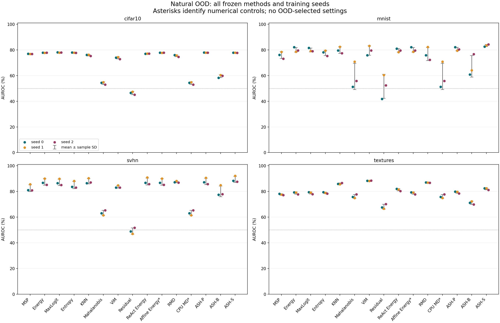
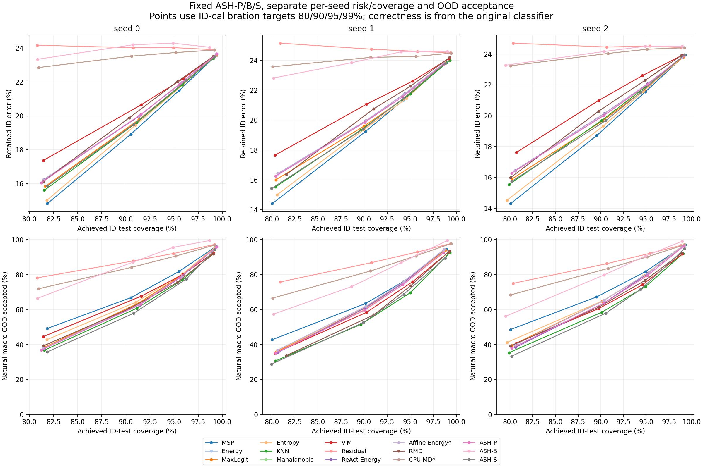

# ASH-P/B/S: complete three-seed frozen evaluation

All three frozen CIFAR-100 classifiers are evaluated on the original four natural OOD datasets. ASH-P/B/S use one fixed p=65 (k=179 out of 512 final pooled coordinates), following the inspected author function defaults. Stable descending values and ascending original coordinate ties are an explicit local adaptation. P retains values, B fills selected coordinates with original_sum/k, and S uses the exponential exp(original_sum/retained_sum). No model/detector statistic, percentile or temperature is fitted; independent training-ID-only preflight precedes OOD scoring. All twelve previous columns are unchanged; starred columns are numerical controls.

Values below are mean ± sample SD across seeds 0/1/2, in percent or percentage points. SD describes these three training seeds; it is not a confidence interval. Every method is reported in protocol order, without test-selected settings or a promoted best method.

Primary operating thresholds use the same 2,500 ID-validation calibration rows at 95% empirical acceptance. These images previously selected checkpoints, so this is reused validation, not a fresh holdout or a coverage guarantee. FPR95-ID uses a separate ID-test benchmark threshold. Four-dataset macros weight datasets equally within each seed; noise is excluded.

| Method | Natural macro AUROC | Benchmark FPR95-ID ↓ | Primary OOD acceptance ↓ | ID-test coverage | Retained ID error ↓ |
|---|---:|---:|---:|---:|---:|
| MSP | 78.23 ± 1.32 | 80.09 ± 1.65 | 79.78 ± 3.25 | 94.89 ± 0.62 | 21.46 ± 0.10 |
| Energy | 80.97 ± 0.79 | 78.41 ± 2.23 | 78.83 ± 2.60 | 95.15 ± 0.75 | 21.95 ± 0.20 |
| MaxLogit | 80.95 ± 0.83 | 78.27 ± 1.71 | 78.44 ± 2.28 | 95.03 ± 0.82 | 21.68 ± 0.24 |
| Entropy | 79.80 ± 1.23 | 78.22 ± 1.78 | 78.67 ± 1.93 | 95.05 ± 0.72 | 21.61 ± 0.18 |
| KNN | 82.42 ± 1.11 | 72.24 ± 2.34 | 73.19 ± 3.62 | 95.27 ± 0.51 | 21.82 ± 0.06 |
| Mahalanobis | 63.19 ± 2.20 | 89.91 ± 0.32 | 90.46 ± 0.33 | 95.30 ± 0.29 | 24.10 ± 0.32 |
| ViM | 81.26 ± 1.20 | 76.02 ± 1.10 | 76.74 ± 3.04 | 95.27 ± 0.69 | 22.47 ± 0.24 |
| Residual | 53.80 ± 2.28 | 91.79 ± 0.31 | 92.35 ± 0.48 | 95.37 ± 0.42 | 24.38 ± 0.31 |
| ReAct Energy | 81.43 ± 0.67 | 77.99 ± 2.19 | 78.37 ± 2.37 | 95.12 ± 0.67 | 21.94 ± 0.16 |
| Affine Energy* | 80.97 ± 0.79 | 78.41 ± 2.23 | 78.83 ± 2.60 | 95.15 ± 0.75 | 21.95 ± 0.20 |
| RMD | 81.61 ± 1.57 | 74.96 ± 2.06 | 75.24 ± 1.57 | 95.09 ± 0.25 | 22.20 ± 0.15 |
| CPU MD* | 63.19 ± 2.20 | 89.91 ± 0.32 | 90.46 ± 0.33 | 95.30 ± 0.29 | 24.10 ± 0.32 |
| ASH-P | 81.42 ± 0.71 | 77.33 ± 1.56 | 77.24 ± 2.73 | 94.95 ± 0.70 | 21.81 ± 0.23 |
| ASH-B | 69.48 ± 2.21 | 92.08 ± 3.21 | 90.95 ± 4.41 | 94.60 ± 0.50 | 24.45 ± 0.15 |
| ASH-S | 83.16 ± 0.72 | 72.33 ± 1.34 | 72.54 ± 4.43 | 94.99 ± 1.11 | 21.70 ± 0.34 |

## Separate natural populations

### cifar10: ID 10,000; OOD 10,000

| Method | AUROC ↑ | AUPR-out ↑ | AUPR-in ↑ | FPR95-ID ↓ | Primary OOD acceptance ↓ |
|---|---:|---:|---:|---:|---:|
| MSP | 76.86 ± 0.10 | 72.70 ± 0.61 | 79.48 ± 0.19 | 81.09 ± 1.04 | 80.88 ± 1.19 |
| Energy | 77.75 ± 0.13 | 73.19 ± 0.68 | 79.88 ± 0.30 | 81.46 ± 1.60 | 81.92 ± 0.98 |
| MaxLogit | 77.95 ± 0.12 | 73.59 ± 0.70 | 80.00 ± 0.30 | 80.84 ± 1.44 | 80.94 ± 1.32 |
| Entropy | 77.80 ± 0.13 | 73.64 ± 0.69 | 80.02 ± 0.21 | 80.30 ± 1.73 | 80.69 ± 1.27 |
| KNN | 75.82 ± 0.58 | 72.26 ± 0.90 | 75.01 ± 1.03 | 81.75 ± 1.56 | 82.64 ± 0.73 |
| Mahalanobis | 54.02 ± 0.99 | 50.95 ± 0.75 | 56.49 ± 1.40 | 96.33 ± 0.33 | 96.57 ± 0.13 |
| ViM | 73.69 ± 0.82 | 68.42 ± 0.99 | 76.10 ± 0.81 | 86.60 ± 1.10 | 87.20 ± 0.72 |
| Residual | 46.30 ± 1.19 | 46.69 ± 0.79 | 47.65 ± 1.15 | 96.79 ± 0.35 | 97.10 ± 0.27 |
| ReAct Energy | 77.06 ± 0.10 | 72.77 ± 0.56 | 78.71 ± 0.56 | 81.52 ± 1.67 | 81.94 ± 0.73 |
| Affine Energy* | 77.75 ± 0.13 | 73.19 ± 0.68 | 79.88 ± 0.30 | 81.46 ± 1.60 | 81.92 ± 0.98 |
| RMD | 75.37 ± 0.72 | 69.95 ± 0.99 | 76.64 ± 1.01 | 86.03 ± 1.38 | 86.23 ± 0.68 |
| CPU MD* | 54.02 ± 0.99 | 50.95 ± 0.75 | 56.49 ± 1.40 | 96.33 ± 0.33 | 96.57 ± 0.13 |
| ASH-P | 77.83 ± 0.11 | 73.39 ± 0.64 | 79.91 ± 0.29 | 81.11 ± 1.59 | 81.17 ± 0.85 |
| ASH-B | 59.47 ± 1.09 | 53.39 ± 1.07 | 62.93 ± 0.89 | 97.65 ± 0.85 | 97.17 ± 1.15 |
| ASH-S | 77.74 ± 0.02 | 73.53 ± 0.57 | 79.67 ± 0.31 | 80.61 ± 1.69 | 80.68 ± 2.14 |

AUPR depends on this explicit ID/OOD population ratio; comparisons across datasets do not share prevalence.

### mnist: ID 10,000; OOD 10,000

| Method | AUROC ↑ | AUPR-out ↑ | AUPR-in ↑ | FPR95-ID ↓ | Primary OOD acceptance ↓ |
|---|---:|---:|---:|---:|---:|
| MSP | 75.84 ± 2.69 | 69.69 ± 2.18 | 80.29 ± 2.13 | 85.66 ± 1.21 | 85.41 ± 1.42 |
| Energy | 80.02 ± 1.83 | 72.85 ± 4.05 | 83.92 ± 1.19 | 85.25 ± 7.25 | 85.98 ± 5.11 |
| MaxLogit | 79.87 ± 1.47 | 72.80 ± 3.04 | 83.74 ± 1.07 | 85.20 ± 6.00 | 85.58 ± 3.95 |
| Entropy | 77.54 ± 2.08 | 71.08 ± 1.52 | 81.35 ± 1.88 | 86.15 ± 4.41 | 86.61 ± 2.71 |
| KNN | 79.80 ± 2.51 | 72.18 ± 2.83 | 84.11 ± 2.05 | 85.96 ± 3.00 | 86.82 ± 4.50 |
| Mahalanobis | 59.24 ± 10.21 | 53.23 ± 8.07 | 65.65 ± 9.02 | 97.29 ± 2.76 | 97.69 ± 2.20 |
| ViM | 79.44 ± 3.69 | 71.35 ± 5.53 | 84.22 ± 2.66 | 86.48 ± 7.15 | 86.88 ± 7.72 |
| Residual | 51.53 ± 9.34 | 48.78 ± 6.02 | 54.98 ± 8.74 | 97.98 ± 1.39 | 98.38 ± 0.98 |
| ReAct Energy | 79.53 ± 1.36 | 72.63 ± 3.96 | 83.23 ± 0.49 | 84.95 ± 7.51 | 85.65 ± 5.73 |
| Affine Energy* | 80.02 ± 1.83 | 72.85 ± 4.05 | 83.92 ± 1.19 | 85.25 ± 7.25 | 85.98 ± 5.11 |
| RMD | 76.72 ± 5.06 | 68.58 ± 7.70 | 81.25 ± 3.38 | 88.75 ± 10.13 | 88.96 ± 10.12 |
| CPU MD* | 59.24 ± 10.21 | 53.23 ± 8.07 | 65.65 ± 9.02 | 97.29 ± 2.76 | 97.69 ± 2.20 |
| ASH-P | 80.62 ± 1.34 | 73.78 ± 3.45 | 84.36 ± 0.80 | 84.08 ± 6.94 | 84.31 ± 4.93 |
| ASH-B | 67.16 ± 8.36 | 58.67 ± 8.22 | 73.85 ± 6.99 | 95.95 ± 5.59 | 95.62 ± 5.58 |
| ASH-S | 83.41 ± 0.84 | 77.82 ± 1.61 | 86.63 ± 0.87 | 77.99 ± 4.91 | 78.04 ± 5.88 |

AUPR depends on this explicit ID/OOD population ratio; comparisons across datasets do not share prevalence.

### svhn: ID 10,000; OOD 26,032

| Method | AUROC ↑ | AUPR-out ↑ | AUPR-in ↑ | FPR95-ID ↓ | Primary OOD acceptance ↓ |
|---|---:|---:|---:|---:|---:|
| MSP | 82.58 ± 2.68 | 90.39 ± 1.81 | 74.45 ± 3.26 | 72.48 ± 6.88 | 71.88 ± 9.03 |
| Energy | 87.38 ± 2.51 | 92.28 ± 1.89 | 81.45 ± 3.30 | 68.68 ± 9.32 | 68.72 ± 12.36 |
| MaxLogit | 87.12 ± 2.49 | 92.33 ± 1.83 | 81.07 ± 3.24 | 68.21 ± 8.42 | 68.11 ± 10.87 |
| Entropy | 84.96 ± 2.78 | 91.55 ± 1.87 | 76.72 ± 3.64 | 67.71 ± 8.31 | 68.10 ± 9.48 |
| KNN | 87.99 ± 2.08 | 93.57 ± 1.20 | 81.33 ± 2.55 | 59.13 ± 8.27 | 60.24 ± 9.08 |
| Mahalanobis | 63.33 ± 1.96 | 77.71 ± 1.60 | 49.02 ± 2.12 | 94.09 ± 1.45 | 94.48 ± 1.70 |
| ViM | 83.59 ± 1.00 | 90.40 ± 0.38 | 77.67 ± 1.38 | 75.86 ± 0.26 | 76.79 ± 2.78 |
| Residual | 49.22 ± 2.40 | 71.23 ± 1.79 | 28.34 ± 2.08 | 95.84 ± 1.07 | 96.18 ± 1.21 |
| ReAct Energy | 87.80 ± 2.70 | 92.45 ± 1.93 | 82.38 ± 3.79 | 68.11 ± 10.02 | 68.15 ± 12.64 |
| Affine Energy* | 87.38 ± 2.51 | 92.28 ± 1.89 | 81.45 ± 3.30 | 68.68 ± 9.32 | 68.72 ± 12.36 |
| RMD | 87.44 ± 0.63 | 92.75 ± 0.23 | 81.15 ± 1.41 | 67.09 ± 3.51 | 67.45 ± 2.93 |
| CPU MD* | 63.33 ± 1.96 | 77.71 ± 1.60 | 49.02 ± 2.12 | 94.09 ± 1.45 | 94.48 ± 1.70 |
| ASH-P | 87.83 ± 2.53 | 92.65 ± 1.87 | 81.96 ± 3.32 | 66.46 ± 9.72 | 65.93 ± 13.21 |
| ASH-B | 80.10 ± 4.15 | 85.97 ± 3.38 | 71.29 ± 3.91 | 88.63 ± 9.77 | 86.08 ± 13.71 |
| ASH-S | 89.42 ± 2.42 | 94.09 ± 1.66 | 83.73 ± 3.13 | 57.93 ± 10.40 | 58.03 ± 12.96 |

AUPR depends on this explicit ID/OOD population ratio; comparisons across datasets do not share prevalence.

### textures: ID 10,000; OOD 1,880

| Method | AUROC ↑ | AUPR-out ↑ | AUPR-in ↑ | FPR95-ID ↓ | Primary OOD acceptance ↓ |
|---|---:|---:|---:|---:|---:|
| MSP | 77.62 ± 0.51 | 35.40 ± 0.76 | 94.91 ± 0.16 | 81.12 ± 0.49 | 80.94 ± 1.74 |
| Energy | 78.75 ± 0.85 | 38.00 ± 1.45 | 95.07 ± 0.25 | 78.26 ± 0.75 | 78.69 ± 2.13 |
| MaxLogit | 78.87 ± 0.81 | 37.68 ± 1.31 | 95.10 ± 0.24 | 78.81 ± 0.80 | 79.13 ± 2.30 |
| Entropy | 78.91 ± 0.60 | 37.66 ± 1.04 | 95.17 ± 0.17 | 78.71 ± 1.13 | 79.29 ± 1.73 |
| KNN | 86.07 ± 0.51 | 54.43 ± 1.86 | 96.97 ± 0.11 | 62.13 ± 2.53 | 63.07 ± 3.88 |
| Mahalanobis | 76.15 ± 1.42 | 42.30 ± 1.15 | 94.06 ± 0.45 | 71.93 ± 0.78 | 73.10 ± 1.53 |
| ViM | 88.33 ± 0.18 | 61.39 ± 1.02 | 97.53 ± 0.03 | 55.14 ± 2.39 | 56.10 ± 3.63 |
| Residual | 68.13 ± 1.88 | 36.07 ± 1.08 | 90.51 ± 0.78 | 76.54 ± 0.42 | 77.73 ± 1.46 |
| ReAct Energy | 81.33 ± 0.86 | 40.18 ± 1.59 | 95.96 ± 0.21 | 77.38 ± 0.68 | 77.73 ± 2.07 |
| Affine Energy* | 78.75 ± 0.85 | 38.00 ± 1.45 | 95.07 ± 0.25 | 78.26 ± 0.75 | 78.69 ± 2.13 |
| RMD | 86.91 ± 0.14 | 58.68 ± 1.20 | 97.13 ± 0.04 | 57.96 ± 2.00 | 58.33 ± 1.26 |
| CPU MD* | 76.15 ± 1.42 | 42.30 ± 1.15 | 94.06 ± 0.45 | 71.93 ± 0.78 | 73.10 ± 1.53 |
| ASH-P | 79.41 ± 0.81 | 38.95 ± 1.36 | 95.24 ± 0.24 | 77.66 ± 0.56 | 77.54 ± 2.10 |
| ASH-B | 71.19 ± 1.23 | 28.13 ± 1.11 | 92.84 ± 0.34 | 86.08 ± 2.09 | 84.91 ± 3.01 |
| ASH-S | 82.05 ± 0.77 | 43.59 ± 1.39 | 95.94 ± 0.22 | 72.80 ± 1.38 | 73.40 ± 3.32 |

AUPR depends on this explicit ID/OOD population ratio; comparisons across datasets do not share prevalence.

## Paired natural macro changes

Each difference is calculated within the same seed before mean/sample SD. Positive AUROC is higher; negative acceptance/FPR is lower. Full per-dataset and per-seed differences against all twelve fixed references are in summary.json.

| Method minus reference | AUROC change (pp) | FPR95-ID change (pp) | Primary OOD acceptance change (pp) |
|---|---:|---:|---:|
| ASH-P − MSP | 3.20 ± 0.79 | -2.76 ± 1.48 | -2.54 ± 0.91 |
| ASH-P − Energy | 0.45 ± 0.17 | -1.08 ± 0.69 | -1.59 ± 0.52 |
| ASH-P − MaxLogit | 0.47 ± 0.12 | -0.94 ± 0.15 | -1.20 ± 1.03 |
| ASH-P − Entropy | 1.62 ± 0.67 | -0.89 ± 0.46 | -1.43 ± 1.52 |
| ASH-P − KNN | -1.00 ± 0.77 | 5.09 ± 3.02 | 4.04 ± 2.50 |
| ASH-P − Mahalanobis | 18.24 ± 2.18 | -12.58 ± 1.75 | -13.22 ± 3.01 |
| ASH-P − ViM | 0.16 ± 1.18 | 1.31 ± 2.42 | 0.49 ± 4.08 |
| ASH-P − Residual | 27.62 ± 2.59 | -14.46 ± 1.87 | -15.11 ± 3.19 |
| ASH-P − ReAct Energy | -0.01 ± 0.07 | -0.66 ± 0.64 | -1.13 ± 0.53 |
| ASH-P − Affine Energy* | 0.45 ± 0.17 | -1.08 ± 0.69 | -1.59 ± 0.52 |
| ASH-P − RMD | -0.19 ± 0.99 | 2.37 ± 1.48 | 1.99 ± 1.20 |
| ASH-P − CPU MD* | 18.24 ± 2.18 | -12.58 ± 1.75 | -13.22 ± 3.01 |
| ASH-B − MSP | -8.75 ± 2.63 | 11.99 ± 3.60 | 11.17 ± 2.45 |
| ASH-B − Energy | -11.49 ± 2.82 | 13.66 ± 5.26 | 12.12 ± 3.77 |
| ASH-B − MaxLogit | -11.47 ± 2.77 | 13.81 ± 4.71 | 12.51 ± 2.57 |
| ASH-B − Entropy | -10.32 ± 2.66 | 13.86 ± 4.57 | 12.28 ± 2.59 |
| ASH-B − KNN | -12.94 ± 2.28 | 19.83 ± 2.27 | 17.75 ± 0.83 |
| ASH-B − Mahalanobis | 6.29 ± 1.66 | 2.17 ± 2.92 | 0.49 ± 4.46 |
| ASH-B − ViM | -11.79 ± 1.75 | 16.06 ± 2.16 | 14.21 ± 2.97 |
| ASH-B − Residual | 15.68 ± 0.59 | 0.29 ± 3.02 | -1.40 ± 4.83 |
| ASH-B − ReAct Energy | -11.95 ± 2.59 | 14.09 ± 5.19 | 12.58 ± 3.67 |
| ASH-B − Affine Energy* | -11.49 ± 2.82 | 13.66 ± 5.26 | 12.12 ± 3.77 |
| ASH-B − RMD | -12.13 ± 2.83 | 17.12 ± 4.07 | 15.71 ± 3.75 |
| ASH-B − CPU MD* | 6.29 ± 1.66 | 2.17 ± 2.92 | 0.49 ± 4.46 |
| ASH-S − MSP | 4.93 ± 0.69 | -7.75 ± 0.41 | -7.24 ± 2.88 |
| ASH-S − Energy | 2.18 ± 0.78 | -6.08 ± 1.72 | -6.29 ± 4.11 |
| ASH-S − MaxLogit | 2.20 ± 0.69 | -5.93 ± 1.21 | -5.90 ± 2.82 |
| ASH-S − Entropy | 3.35 ± 0.65 | -5.88 ± 0.93 | -6.13 ± 2.74 |
| ASH-S − KNN | 0.73 ± 0.40 | 0.09 ± 1.91 | -0.65 ± 1.12 |
| ASH-S − Mahalanobis | 19.97 ± 1.60 | -17.58 ± 1.30 | -17.92 ± 4.44 |
| ASH-S − ViM | 1.89 ± 0.58 | -3.68 ± 1.66 | -4.20 ± 2.61 |
| ASH-S − Residual | 29.36 ± 1.99 | -19.46 ± 1.61 | -19.81 ± 4.82 |
| ASH-S − ReAct Energy | 1.73 ± 0.54 | -5.65 ± 1.63 | -5.83 ± 3.99 |
| ASH-S − Affine Energy* | 2.18 ± 0.78 | -6.08 ± 1.72 | -6.29 ± 4.11 |
| ASH-S − RMD | 1.54 ± 0.94 | -2.62 ± 0.73 | -2.70 ± 3.96 |
| ASH-S − CPU MD* | 19.97 ± 1.60 | -17.58 ± 1.30 | -17.92 ± 4.44 |

## Classification and fitting boundaries

Original classifier ID-test accuracy: 75.77 ± 0.30%. All ID risk/coverage endpoints use these unchanged original predictions. Shaped intermediate predictions can change and are reported separately below.

Training-ID numerical preflight checked every one of the 45,000 rows per seed with independent CPU torch support/shaping/linear logits and fixed manual sort/math rows. No covariance, percentile, temperature or scale coefficient was learned from these checks. ASH-B preserves activation sums; ASH-S uses the actual exponential and rejects degenerate/nonfinite sums. The declared float64 audit tolerances are atol=1e-8, rtol=1e-10.

| Population | Original accuracy % | Variant | Shaped accuracy % | Argmax changes per seed |
|---|---:|---|---:|---|
| id | 75.77 ± 0.30 | ASH-P | 75.66 ± 0.36 | [168, 160, 173] |
| id | 75.77 ± 0.30 | ASH-B | 71.77 ± 0.45 | [1344, 1332, 1300] |
| id | 75.77 ± 0.30 | ASH-S | 75.67 ± 0.33 | [166, 160, 180] |
| validation | 75.23 ± 0.31 | ASH-P | 75.06 ± 0.33 | [90, 87, 85] |
| validation | 75.23 ± 0.31 | ASH-B | 70.97 ± 0.06 | [690, 673, 679] |
| validation | 75.23 ± 0.31 | ASH-S | 75.05 ± 0.32 | [90, 86, 88] |

P-versus-S argmax differences (original bias retained) for ID test/validation: [19, 9, 23] / [10, 3, 7].

Synthetic noise is retained separately and excluded from every natural macro. This is a fixed exploratory adaptation on our ResNet18 after earlier OOD results were observed, not a reproduction of the authors’ DenseNet/ImageNet benchmark or their best parameter search. All three variants are reported without a selected winner. No OOD test selected a checkpoint, percentile, score direction, temperature or target.

## Scientific figures





## Reproduction and evidence

Run with the verified base CPU Python; set OMP_NUM_THREADS, MKL_NUM_THREADS and OPENBLAS_NUM_THREADS to 4 for bounded local computation. For torch CPU auditing on Windows, CUDA_VISIBLE_DEVICES=-1 was verified to hide CUDA; an empty value was ineffective in the observed shell. Historical frozen reports remain unchanged.

```bash
python tools/audit_ash_evaluation.py
python tools/build_ash_report.py
python tools/audit_ash_report.py
```

Raw: original banks are runs/geometry-phase3/seedN/training-bank.npz; training preflight and new evaluation are runs/ash-phase5/seedN/preflight.npz, evaluation/*_scores.npz, *_intermediates.npz and decisions.npz. Full shaped features are exactly reconstructible from saved selected indices/values, sums/scales and frozen inputs. Provenance and independent preflight audit: runs/ash-phase5/*.json. This report audit.json binds all raw artifacts; summary-audit.json independently checks every statistical record. Completion is recorded separately after both audits and visual inspection.
