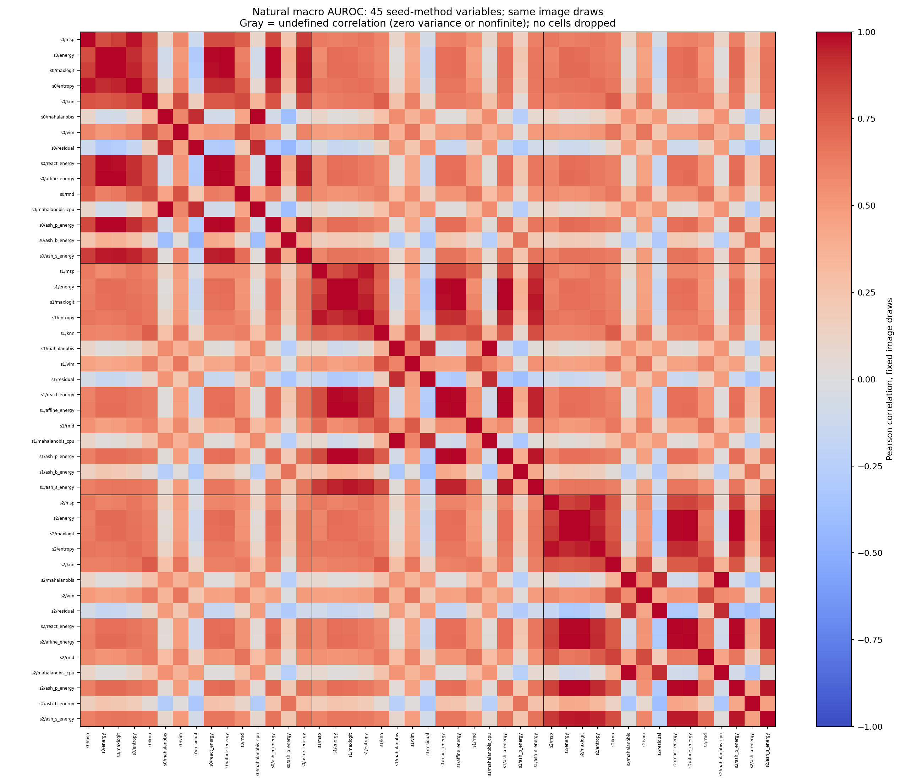
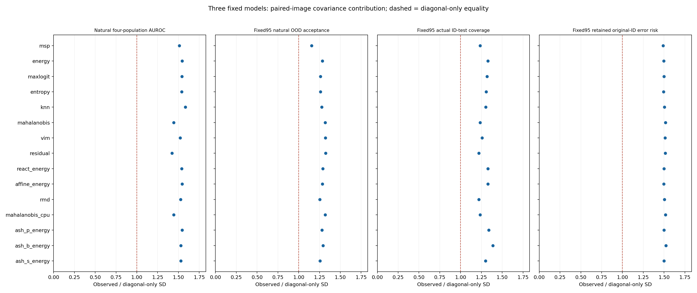
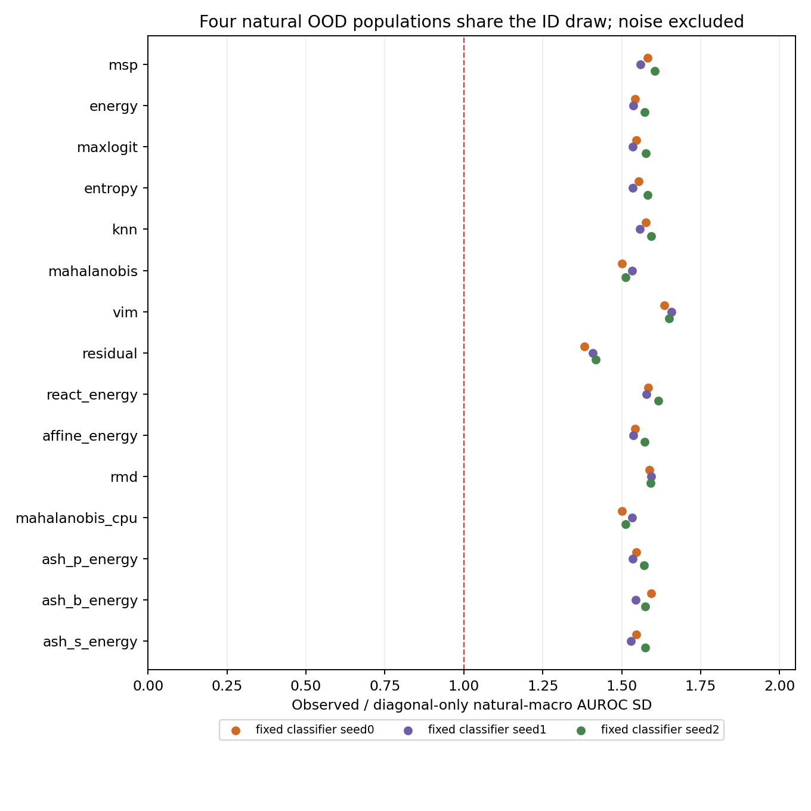

# Saved-bootstrap dependence diagnostics

All covariance and correlation entries use the **same 1,000 saved paired image draws**, with three frozen classifiers and fifteen fixed columns. Population/image sampling variability is conditional on those classifiers and thresholds; this is not training-seed variability or a new inferential test.

For a fixed method, the three-model mean variance equals (sum of three seed variances + two times the three cross-seed covariances)/9. The diagonal-only term is an explicitly labeled independence counterfactual, not an alternative confidence interval. Reported ratios compare observed SD with its diagonal-only algebraic counterpart; zero denominator is undefined.

The full 45×45 sample covariance, Pearson correlation and finite/undefined masks for all 66 endpoints are in immutable endpoint-000 through endpoint-065 artifacts. All 105 later-minus-earlier pairs have their own three-model decompositions. The four-natural covariance/decomposition for each seed/method and four ranking/four operating macros is in natural-components.*; noise is excluded. No setting was filtered by sign or strength.

## Natural four-population AUROC

| Method | Original point (%) | Conditional image 95% interval (%) | Diagonal contribution (variance) | Cross-model contribution (variance) | Observed/diagonal SD ratio |
|---|---:|---:|---:|---:|---:|
| msp | 78.2269 | [77.7172, 78.6845] | 0.0000 | 0.0000 | 1.5111 |
| energy | 80.9734 | [80.4863, 81.4101] | 0.0000 | 0.0000 | 1.5435 |
| maxlogit | 80.9528 | [80.4690, 81.3932] | 0.0000 | 0.0000 | 1.5424 |
| entropy | 79.8034 | [79.3137, 80.2579] | 0.0000 | 0.0000 | 1.5389 |
| knn | 82.4206 | [81.9491, 82.8516] | 0.0000 | 0.0000 | 1.5823 |
| mahalanobis | 63.1860 | [62.6364, 63.7473] | 0.0000 | 0.0000 | 1.4432 |
| vim | 81.2639 | [80.7803, 81.7157] | 0.0000 | 0.0000 | 1.5217 |
| residual | 53.7971 | [53.2616, 54.3436] | 0.0000 | 0.0000 | 1.4224 |
| react_energy | 81.4282 | [80.9518, 81.8613] | 0.0000 | 0.0000 | 1.5392 |
| affine_energy | 80.9734 | [80.4862, 81.4101] | 0.0000 | 0.0000 | 1.5435 |
| rmd | 81.6120 | [81.1241, 82.0410] | 0.0000 | 0.0000 | 1.5255 |
| mahalanobis_cpu | 63.1860 | [62.6364, 63.7473] | 0.0000 | 0.0000 | 1.4432 |
| ash_p_energy | 81.4221 | [80.9364, 81.8634] | 0.0000 | 0.0000 | 1.5434 |
| ash_b_energy | 69.4789 | [68.9032, 70.0565] | 0.0000 | 0.0000 | 1.5286 |
| ash_s_energy | 83.1554 | [82.6876, 83.5626] | 0.0000 | 0.0000 | 1.5300 |

## Fixed95 natural OOD acceptance

| Method | Original point (%) | Conditional image 95% interval (%) | Diagonal contribution (variance) | Cross-model contribution (variance) | Observed/diagonal SD ratio |
|---|---:|---:|---:|---:|---:|
| msp | 79.7788 | [79.4062, 80.1445] | 0.0000 | 0.0000 | 1.1540 |
| energy | 78.8258 | [78.4097, 79.2001] | 0.0000 | 0.0000 | 1.2852 |
| maxlogit | 78.4386 | [78.0202, 78.8003] | 0.0000 | 0.0000 | 1.2612 |
| entropy | 78.6711 | [78.2759, 79.0502] | 0.0000 | 0.0000 | 1.2611 |
| knn | 73.1925 | [72.7389, 73.6447] | 0.0000 | 0.0000 | 1.2759 |
| mahalanobis | 90.4597 | [90.0530, 90.8453] | 0.0000 | 0.0000 | 1.3186 |
| vim | 76.7414 | [76.3089, 77.2127] | 0.0000 | 0.0000 | 1.3199 |
| residual | 92.3495 | [91.9600, 92.7090] | 0.0000 | 0.0000 | 1.3244 |
| react_energy | 78.3673 | [77.9177, 78.7391] | 0.0000 | 0.0000 | 1.2892 |
| affine_energy | 78.8258 | [78.4097, 79.2001] | 0.0000 | 0.0000 | 1.2852 |
| rmd | 75.2416 | [74.8187, 75.7016] | 0.0000 | 0.0000 | 1.2526 |
| mahalanobis_cpu | 90.4597 | [90.0530, 90.8453] | 0.0000 | 0.0000 | 1.3186 |
| ash_p_energy | 77.2363 | [76.7964, 77.6195] | 0.0000 | 0.0000 | 1.2799 |
| ash_b_energy | 90.9467 | [90.6268, 91.2604] | 0.0000 | 0.0000 | 1.2927 |
| ash_s_energy | 72.5390 | [72.0932, 72.9414] | 0.0000 | 0.0000 | 1.2554 |

## Fixed95 actual ID-test coverage

| Method | Original point (%) | Conditional image 95% interval (%) | Diagonal contribution (variance) | Cross-model contribution (variance) | Observed/diagonal SD ratio |
|---|---:|---:|---:|---:|---:|
| msp | 94.8900 | [94.5866, 95.2035] | 0.0000 | 0.0000 | 1.2357 |
| energy | 95.1467 | [94.8200, 95.4700] | 0.0000 | 0.0000 | 1.3294 |
| maxlogit | 95.0300 | [94.7132, 95.3533] | 0.0000 | 0.0000 | 1.3193 |
| entropy | 95.0533 | [94.7300, 95.3500] | 0.0000 | 0.0000 | 1.3086 |
| knn | 95.2667 | [94.9532, 95.5668] | 0.0000 | 0.0000 | 1.3020 |
| mahalanobis | 95.2967 | [95.0100, 95.5834] | 0.0000 | 0.0000 | 1.2347 |
| vim | 95.2733 | [94.9666, 95.5701] | 0.0000 | 0.0000 | 1.2583 |
| residual | 95.3700 | [95.0733, 95.6400] | 0.0000 | 0.0000 | 1.2197 |
| react_energy | 95.1200 | [94.8064, 95.4400] | 0.0000 | 0.0000 | 1.3291 |
| affine_energy | 95.1467 | [94.8200, 95.4700] | 0.0000 | 0.0000 | 1.3294 |
| rmd | 95.0867 | [94.7798, 95.3667] | 0.0000 | 0.0000 | 1.2188 |
| mahalanobis_cpu | 95.2967 | [95.0100, 95.5834] | 0.0000 | 0.0000 | 1.2347 |
| ash_p_energy | 94.9533 | [94.6164, 95.2933] | 0.0000 | 0.0000 | 1.3397 |
| ash_b_energy | 94.6000 | [94.2567, 94.9567] | 0.0000 | 0.0000 | 1.3883 |
| ash_s_energy | 94.9900 | [94.6833, 95.3067] | 0.0000 | 0.0000 | 1.2988 |

## Fixed95 retained original-ID error risk

| Method | Original point (%) | Conditional image 95% interval (%) | Diagonal contribution (variance) | Cross-model contribution (variance) | Observed/diagonal SD ratio |
|---|---:|---:|---:|---:|---:|
| msp | 21.4561 | [20.7273, 22.1161] | 0.0000 | 0.0000 | 1.4882 |
| energy | 21.9478 | [21.2205, 22.6320] | 0.0000 | 0.0000 | 1.4977 |
| maxlogit | 21.6831 | [20.9635, 22.3752] | 0.0000 | 0.0000 | 1.4987 |
| entropy | 21.6116 | [20.9058, 22.3034] | 0.0000 | 0.0000 | 1.4946 |
| knn | 21.8229 | [21.1181, 22.5068] | 0.0000 | 0.0000 | 1.5038 |
| mahalanobis | 24.1035 | [23.3856, 24.8258] | 0.0000 | 0.0000 | 1.5177 |
| vim | 22.4731 | [21.7504, 23.1564] | 0.0000 | 0.0000 | 1.5118 |
| residual | 24.3814 | [23.6624, 25.0999] | 0.0000 | 0.0000 | 1.5153 |
| react_energy | 21.9367 | [21.2033, 22.6187] | 0.0000 | 0.0000 | 1.4983 |
| affine_energy | 21.9478 | [21.2205, 22.6320] | 0.0000 | 0.0000 | 1.4977 |
| rmd | 22.1975 | [21.4676, 22.8682] | 0.0000 | 0.0000 | 1.5055 |
| mahalanobis_cpu | 24.1035 | [23.3856, 24.8258] | 0.0000 | 0.0000 | 1.5177 |
| ash_p_energy | 21.8099 | [21.0876, 22.4822] | 0.0000 | 0.0000 | 1.5004 |
| ash_b_energy | 24.4542 | [23.6754, 25.1995] | 0.0000 | 0.0000 | 1.5217 |
| ash_s_energy | 21.6979 | [20.9770, 22.3724] | 0.0000 | 0.0000 | 1.4991 |

## All 105 later-minus-earlier pairs

Each cell is the observed/diagonal-only SD ratio of the paired method difference, using one common image draw per replicate. The signed pair definition matches the original bootstrap report. All component variances and covariance signs remain in raw JSON for every endpoint.

| Later minus earlier | Natural macro AUROC | Fixed95 natural OOD acceptance | Fixed95 ID coverage | Fixed95 original retained error |
|---|---:|---:|---:|---:|
| energy minus msp | 1.3460 | 1.1029 | 1.0721 | 1.0548 |
| maxlogit minus msp | 1.3613 | 1.0815 | 1.0709 | 1.0660 |
| entropy minus msp | 1.2224 | 1.0638 | 1.0405 | 1.0107 |
| knn minus msp | 1.3588 | 1.1683 | 1.1091 | 1.0839 |
| mahalanobis minus msp | 1.4321 | 1.2743 | 1.2170 | 1.1611 |
| vim minus msp | 1.3436 | 1.2463 | 1.1966 | 1.1594 |
| residual minus msp | 1.4460 | 1.2671 | 1.2233 | 1.1691 |
| react_energy minus msp | 1.3481 | 1.1026 | 1.0737 | 1.0566 |
| affine_energy minus msp | 1.3460 | 1.1029 | 1.0721 | 1.0548 |
| rmd minus msp | 1.3245 | 1.2131 | 1.1448 | 1.1210 |
| mahalanobis_cpu minus msp | 1.4321 | 1.2743 | 1.2170 | 1.1611 |
| ash_p_energy minus msp | 1.3469 | 1.1028 | 1.0808 | 1.0768 |
| ash_b_energy minus msp | 1.5360 | 1.1876 | 1.3237 | 1.2211 |
| ash_s_energy minus msp | 1.3698 | 1.0784 | 1.0520 | 1.0514 |
| maxlogit minus energy | 1.2325 | 1.0348 | 1.0439 | 1.0106 |
| entropy minus energy | 1.3831 | 1.0567 | 1.0459 | 1.0261 |
| knn minus energy | 1.3969 | 1.2221 | 1.1834 | 1.1216 |
| mahalanobis minus energy | 1.4387 | 1.3414 | 1.2863 | 1.2289 |
| vim minus energy | 1.3740 | 1.2950 | 1.2606 | 1.2065 |
| residual minus energy | 1.4534 | 1.3412 | 1.2875 | 1.2362 |
| react_energy minus energy | 1.3306 | 1.0126 | 1.0194 | 0.9995 |
| affine_energy minus energy | 1.0084 | undefined | undefined | undefined |
| rmd minus energy | 1.3722 | 1.2942 | 1.2332 | 1.1851 |
| mahalanobis_cpu minus energy | 1.4387 | 1.3414 | 1.2863 | 1.2289 |
| ash_p_energy minus energy | 1.2779 | 1.0133 | 1.0013 | 0.9852 |
| ash_b_energy minus energy | 1.5816 | 1.2311 | 1.3678 | 1.2535 |
| ash_s_energy minus energy | 1.3619 | 1.0583 | 1.0560 | 1.0452 |
| entropy minus maxlogit | 1.3887 | 1.0635 | 1.0398 | 1.0336 |
| knn minus maxlogit | 1.3878 | 1.1976 | 1.1614 | 1.1088 |
| mahalanobis minus maxlogit | 1.4373 | 1.3260 | 1.2724 | 1.2113 |
| vim minus maxlogit | 1.3678 | 1.2868 | 1.2515 | 1.2029 |
| residual minus maxlogit | 1.4524 | 1.3282 | 1.2793 | 1.2173 |
| react_energy minus maxlogit | 1.2901 | 1.0306 | 1.0439 | 1.0025 |
| affine_energy minus maxlogit | 1.2325 | 1.0348 | 1.0439 | 1.0106 |
| rmd minus maxlogit | 1.3634 | 1.2744 | 1.2153 | 1.1702 |
| mahalanobis_cpu minus maxlogit | 1.4373 | 1.3260 | 1.2724 | 1.2113 |
| ash_p_energy minus maxlogit | 1.2366 | 1.0177 | 1.0467 | 1.0065 |
| ash_b_energy minus maxlogit | 1.5782 | 1.2296 | 1.3665 | 1.2525 |
| ash_s_energy minus maxlogit | 1.4009 | 1.0534 | 1.0616 | 1.0337 |
| knn minus entropy | 1.3832 | 1.2005 | 1.1313 | 1.1042 |
| mahalanobis minus entropy | 1.4379 | 1.3320 | 1.2619 | 1.2021 |
| vim minus entropy | 1.3561 | 1.2847 | 1.2334 | 1.1963 |
| residual minus entropy | 1.4521 | 1.3273 | 1.2676 | 1.2068 |
| react_energy minus entropy | 1.3869 | 1.0686 | 1.0547 | 1.0298 |
| affine_energy minus entropy | 1.3831 | 1.0567 | 1.0459 | 1.0261 |
| rmd minus entropy | 1.3497 | 1.2716 | 1.2068 | 1.1634 |
| mahalanobis_cpu minus entropy | 1.4379 | 1.3320 | 1.2619 | 1.2021 |
| ash_p_energy minus entropy | 1.3875 | 1.0576 | 1.0672 | 1.0448 |
| ash_b_energy minus entropy | 1.5626 | 1.2357 | 1.3581 | 1.2513 |
| ash_s_energy minus entropy | 1.4074 | 1.0690 | 1.0263 | 1.0285 |
| mahalanobis minus knn | 1.4462 | 1.2707 | 1.2650 | 1.2332 |
| vim minus knn | 1.2983 | 1.1812 | 1.1633 | 1.1424 |
| residual minus knn | 1.4648 | 1.2653 | 1.2530 | 1.2268 |
| react_energy minus knn | 1.3983 | 1.2219 | 1.1866 | 1.1257 |
| affine_energy minus knn | 1.3969 | 1.2221 | 1.1834 | 1.1216 |
| rmd minus knn | 1.3709 | 1.1619 | 1.1604 | 1.1419 |
| mahalanobis_cpu minus knn | 1.4462 | 1.2707 | 1.2650 | 1.2332 |
| ash_p_energy minus knn | 1.3952 | 1.2124 | 1.1876 | 1.1243 |
| ash_b_energy minus knn | 1.5741 | 1.2982 | 1.3516 | 1.2537 |
| ash_s_energy minus knn | 1.4031 | 1.2214 | 1.1177 | 1.0990 |
| vim minus mahalanobis | 1.4578 | 1.1609 | 1.1968 | 1.1463 |
| residual minus mahalanobis | 1.3667 | 1.0555 | 1.0545 | 1.0334 |
| react_energy minus mahalanobis | 1.4368 | 1.3456 | 1.2817 | 1.2247 |
| affine_energy minus mahalanobis | 1.4387 | 1.3414 | 1.2863 | 1.2289 |
| rmd minus mahalanobis | 1.4417 | 1.1428 | 1.2105 | 1.1121 |
| mahalanobis_cpu minus mahalanobis | undefined | undefined | undefined | undefined |
| ash_p_energy minus mahalanobis | 1.4387 | 1.3383 | 1.2874 | 1.2314 |
| ash_b_energy minus mahalanobis | 1.5096 | 1.3234 | 1.3409 | 1.2409 |
| ash_s_energy minus mahalanobis | 1.4353 | 1.3218 | 1.2502 | 1.2022 |
| residual minus vim | 1.4997 | 1.1877 | 1.1979 | 1.1476 |
| react_energy minus vim | 1.3684 | 1.2977 | 1.2569 | 1.2034 |
| affine_energy minus vim | 1.3740 | 1.2950 | 1.2606 | 1.2065 |
| rmd minus vim | 1.3113 | 1.0713 | 1.1275 | 1.0655 |
| mahalanobis_cpu minus vim | 1.4578 | 1.1609 | 1.1968 | 1.1463 |
| ash_p_energy minus vim | 1.3723 | 1.2913 | 1.2634 | 1.2171 |
| ash_b_energy minus vim | 1.5404 | 1.3111 | 1.3440 | 1.2173 |
| ash_s_energy minus vim | 1.3677 | 1.2864 | 1.2119 | 1.1923 |
| react_energy minus residual | 1.4514 | 1.3448 | 1.2834 | 1.2325 |
| affine_energy minus residual | 1.4534 | 1.3412 | 1.2875 | 1.2362 |
| rmd minus residual | 1.4553 | 1.1727 | 1.2001 | 1.1220 |
| mahalanobis_cpu minus residual | 1.3667 | 1.0555 | 1.0545 | 1.0334 |
| ash_p_energy minus residual | 1.4540 | 1.3392 | 1.2894 | 1.2359 |
| ash_b_energy minus residual | 1.5083 | 1.3194 | 1.3411 | 1.2435 |
| ash_s_energy minus residual | 1.4519 | 1.3226 | 1.2552 | 1.2078 |
| affine_energy minus react_energy | 1.3306 | 1.0126 | 1.0194 | 0.9995 |
| rmd minus react_energy | 1.3670 | 1.2973 | 1.2330 | 1.1853 |
| mahalanobis_cpu minus react_energy | 1.4368 | 1.3456 | 1.2817 | 1.2247 |
| ash_p_energy minus react_energy | 1.3048 | 1.0244 | 1.0163 | 0.9834 |
| ash_b_energy minus react_energy | 1.5799 | 1.2306 | 1.3680 | 1.2559 |
| ash_s_energy minus react_energy | 1.3236 | 1.0476 | 1.0613 | 1.0433 |
| rmd minus affine_energy | 1.3722 | 1.2942 | 1.2332 | 1.1851 |
| mahalanobis_cpu minus affine_energy | 1.4387 | 1.3414 | 1.2863 | 1.2289 |
| ash_p_energy minus affine_energy | 1.2779 | 1.0133 | 1.0013 | 0.9852 |
| ash_b_energy minus affine_energy | 1.5816 | 1.2311 | 1.3678 | 1.2535 |
| ash_s_energy minus affine_energy | 1.3619 | 1.0583 | 1.0560 | 1.0452 |
| mahalanobis_cpu minus rmd | 1.4417 | 1.1428 | 1.2105 | 1.1121 |
| ash_p_energy minus rmd | 1.3697 | 1.2883 | 1.2328 | 1.1933 |
| ash_b_energy minus rmd | 1.5269 | 1.2903 | 1.3189 | 1.1932 |
| ash_s_energy minus rmd | 1.3471 | 1.2752 | 1.1915 | 1.1586 |
| ash_p_energy minus mahalanobis_cpu | 1.4387 | 1.3383 | 1.2874 | 1.2314 |
| ash_b_energy minus mahalanobis_cpu | 1.5096 | 1.3234 | 1.3409 | 1.2409 |
| ash_s_energy minus mahalanobis_cpu | 1.4353 | 1.3218 | 1.2502 | 1.2022 |
| ash_b_energy minus ash_p_energy | 1.5848 | 1.2232 | 1.3725 | 1.2614 |
| ash_s_energy minus ash_p_energy | 1.3702 | 1.0429 | 1.0844 | 1.0768 |
| ash_s_energy minus ash_b_energy | 1.5743 | 1.2166 | 1.3506 | 1.2428 |

## Four-natural population macro dependence

The next table retains every method and three fixed classifiers for the AUROC macro. The other three ranking and four operating natural macros are in natural-components.json/npz. The four OOD populations have distinct OOD draws and share ID draws, so their macro variability includes cross-population terms.

| Method | Seed 0 observed/diagonal SD | Seed 1 | Seed 2 |
|---|---:|---:|---:|
| msp | 1.5820 | 1.5590 | 1.6040 |
| energy | 1.5421 | 1.5365 | 1.5720 |
| maxlogit | 1.5462 | 1.5340 | 1.5755 |
| entropy | 1.5527 | 1.5348 | 1.5815 |
| knn | 1.5762 | 1.5578 | 1.5925 |
| mahalanobis | 1.5008 | 1.5325 | 1.5113 |
| vim | 1.6350 | 1.6566 | 1.6498 |
| residual | 1.3819 | 1.4080 | 1.4172 |
| react_energy | 1.5839 | 1.5781 | 1.6152 |
| affine_energy | 1.5421 | 1.5365 | 1.5720 |
| rmd | 1.5866 | 1.5938 | 1.5918 |
| mahalanobis_cpu | 1.5008 | 1.5325 | 1.5113 |
| ash_p_energy | 1.5456 | 1.5339 | 1.5707 |
| ash_b_energy | 1.5940 | 1.5450 | 1.5748 |
| ash_s_energy | 1.5453 | 1.5290 | 1.5748 |

## Interpretation and audit boundary

Pearson correlation is undefined when either full-draw marginal variance is zero; its mask and NaN in raw arrays/None in JSON are retained. Every finite count is saved; nonfinite draws invalidate the affected covariance instead of producing a pairwise complete-case matrix. Covariance is descriptive of this fixed empirical bootstrap and does not reveal causal failure mechanisms, guarantee population coverage, resolve validation reuse or justify method/threshold selection.

Raw endpoint data, independent scalar audit, source/input snapshots, regression and figure-coordinate audits are retained locally. The complete paired-bootstrap report supplies the original points and conditional intervals; this report adds no new score, training or threshold.

