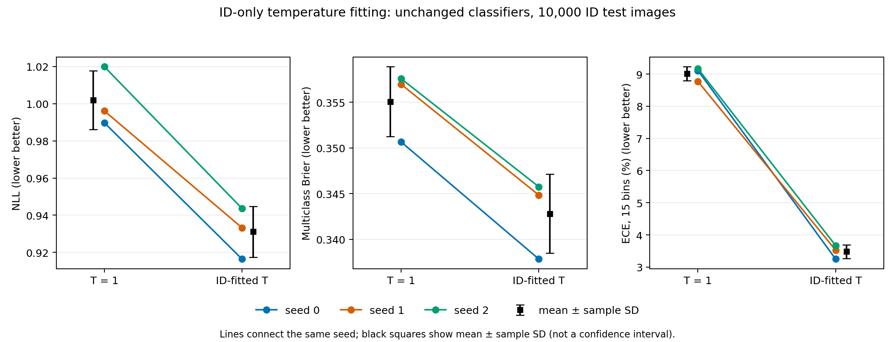
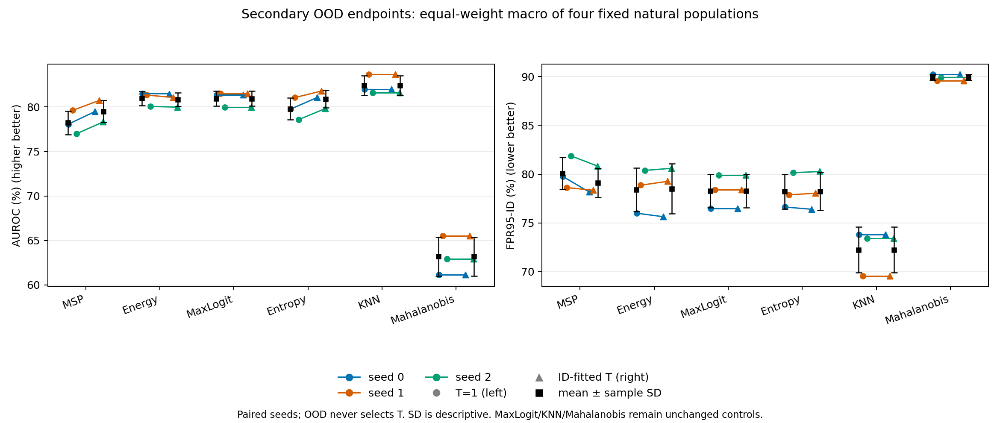

# ID-only temperature calibration: complete three-seed phase 2

Original classifiers, baseline metrics and raw artifacts remain frozen. One temperature per seed was fitted on 2,500 ID validation rows. The disjoint 2,500 remaining validation rows select all operational thresholds. Both subsets previously served checkpoint selection: they are not entirely fresh holdouts, and no conformal coverage is claimed.

All classical T=1 and calibrated scores use matched CPU float64 arithmetic. MaxLogit and saved KNN/Mahalanobis scores and thresholds are unchanged controls; features are never refitted. OOD endpoints are descriptive and never select a temperature, method or checkpoint.

## Fixed temperatures

| Seed | Selected epoch | T | Fit NLL T=1 | Fit NLL calibrated | Optimizer |
|---|---:|---:|---:|---:|---|
| 0 | 89 | 1.373153 | 1.021663 | 0.942026 | success |
| 1 | 96 | 1.357944 | 1.037112 | 0.961927 | success |
| 2 | 92 | 1.365040 | 1.036178 | 0.959690 | success |

## Primary ID-test endpoints

Mean ± sample SD across seeds 0, 1, 2. Delta is paired calibrated minus T=1, computed within each seed. Brier is the unnormalized sum over all classes; ECE uses 15 fixed equal-width confidence bins.

| Endpoint | T=1 | ID-fitted T | Paired delta |
|---|---:|---:|---:|
| NLL | 1.0019 ± 0.0159 | 0.9311 ± 0.0137 | -0.0708 ± 0.0070 |
| Brier | 0.3551 ± 0.0038 | 0.3428 ± 0.0043 | -0.0123 ± 0.0005 |
| ECE (%) / delta pp | 9.0156 ± 0.2145 | 3.4807 ± 0.2126 | -5.5349 ± 0.3097 |
| Accuracy (%) / delta pp | 75.7700 ± 0.2972 | 75.7700 ± 0.2972 | 0.0000 ± 0.0000 |

## Secondary OOD endpoints

AUROC and benchmark FPR95-ID are percentages; paired changes are percentage points. FPR95-ID uses an ID-test benchmark threshold and remains separate from the operational ID-validation threshold. Lower FPR is better. Four natural populations retain their original sizes/prevalences; AP is available in summary.json and per-seed results.

| Dataset | Method | AUROC T=1 | AUROC fitted T | Delta AUROC | FPR95 T=1 | FPR95 fitted T | Delta FPR95 |
|---|---|---:|---:|---:|---:|---:|---:|
| cifar10 | MSP | 76.86 ± 0.10 | 77.61 ± 0.11 | 0.75 ± 0.01 | 81.09 ± 1.04 | 80.61 ± 1.15 | -0.48 ± 0.31 |
| cifar10 | Energy | 77.75 ± 0.13 | 77.49 ± 0.13 | -0.26 ± 0.01 | 81.46 ± 1.60 | 81.84 ± 1.61 | 0.38 ± 0.04 |
| cifar10 | MaxLogit | 77.95 ± 0.12 | 77.95 ± 0.12 | 0.00 ± 0.00 | 80.84 ± 1.44 | 80.84 ± 1.44 | 0.00 ± 0.00 |
| cifar10 | Entropy | 77.80 ± 0.13 | 78.23 ± 0.12 | 0.43 ± 0.02 | 80.30 ± 1.73 | 80.83 ± 1.67 | 0.53 ± 0.13 |
| cifar10 | KNN | 75.82 ± 0.58 | 75.82 ± 0.58 | 0.00 ± 0.00 | 81.75 ± 1.56 | 81.75 ± 1.56 | 0.00 ± 0.00 |
| cifar10 | Mahalanobis | 54.02 ± 0.99 | 54.02 ± 0.99 | 0.00 ± 0.00 | 96.33 ± 0.33 | 96.33 ± 0.33 | 0.00 ± 0.00 |
| mnist | MSP | 75.84 ± 2.69 | 77.32 ± 2.15 | 1.48 ± 0.63 | 85.66 ± 1.21 | 85.74 ± 2.99 | 0.08 ± 2.12 |
| mnist | Energy | 80.02 ± 1.83 | 80.03 ± 2.21 | 0.00 ± 0.50 | 85.25 ± 7.25 | 84.71 ± 8.07 | -0.54 ± 0.85 |
| mnist | MaxLogit | 79.87 ± 1.47 | 79.87 ± 1.47 | 0.00 ± 0.00 | 85.20 ± 6.00 | 85.20 ± 6.00 | 0.00 ± 0.00 |
| mnist | Entropy | 77.54 ± 2.08 | 79.12 ± 1.32 | 1.58 ± 1.12 | 86.15 ± 4.41 | 86.15 ± 5.76 | 0.01 ± 1.47 |
| mnist | KNN | 79.80 ± 2.51 | 79.80 ± 2.51 | 0.00 ± 0.00 | 85.96 ± 3.00 | 85.96 ± 3.00 | 0.00 ± 0.00 |
| mnist | Mahalanobis | 59.24 ± 10.21 | 59.24 ± 10.21 | 0.00 ± 0.00 | 97.29 ± 2.76 | 97.29 ± 2.76 | 0.00 ± 0.00 |
| svhn | MSP | 82.58 ± 2.68 | 84.48 ± 2.66 | 1.90 ± 0.17 | 72.48 ± 6.88 | 69.97 ± 7.45 | -2.52 ± 0.84 |
| svhn | Energy | 87.38 ± 2.51 | 87.39 ± 2.52 | 0.01 ± 0.12 | 68.68 ± 9.32 | 69.18 ± 9.50 | 0.50 ± 1.00 |
| svhn | MaxLogit | 87.12 ± 2.49 | 87.12 ± 2.49 | 0.00 ± 0.00 | 68.21 ± 8.42 | 68.21 ± 8.42 | 0.00 ± 0.00 |
| svhn | Entropy | 84.96 ± 2.78 | 86.64 ± 2.61 | 1.69 ± 0.33 | 67.71 ± 8.31 | 67.33 ± 9.12 | -0.39 ± 1.05 |
| svhn | KNN | 87.99 ± 2.08 | 87.99 ± 2.08 | 0.00 ± 0.00 | 59.13 ± 8.27 | 59.13 ± 8.27 | 0.00 ± 0.00 |
| svhn | Mahalanobis | 63.33 ± 1.96 | 63.33 ± 1.96 | 0.00 ± 0.00 | 94.09 ± 1.45 | 94.09 ± 1.45 | 0.00 ± 0.00 |
| textures | MSP | 77.62 ± 0.51 | 78.65 ± 0.59 | 1.02 ± 0.10 | 81.12 ± 0.49 | 80.14 ± 0.85 | -0.98 ± 0.39 |
| textures | Energy | 78.75 ± 0.85 | 78.50 ± 0.88 | -0.25 ± 0.04 | 78.26 ± 0.75 | 78.26 ± 0.97 | 0.00 ± 0.42 |
| textures | MaxLogit | 78.87 ± 0.81 | 78.87 ± 0.81 | 0.00 ± 0.00 | 78.81 ± 0.80 | 78.81 ± 0.80 | 0.00 ± 0.00 |
| textures | Entropy | 78.91 ± 0.60 | 79.59 ± 0.66 | 0.68 ± 0.11 | 78.71 ± 1.13 | 78.63 ± 0.81 | -0.07 ± 0.54 |
| textures | KNN | 86.07 ± 0.51 | 86.07 ± 0.51 | 0.00 ± 0.00 | 62.13 ± 2.53 | 62.13 ± 2.53 | 0.00 ± 0.00 |
| textures | Mahalanobis | 76.15 ± 1.42 | 76.15 ± 1.42 | 0.00 ± 0.00 | 71.93 ± 0.78 | 71.93 ± 0.78 | 0.00 ± 0.00 |

## Equal-weight natural macro

Average the four natural datasets within each seed, then summarize the three seeds. Noise is excluded.

| Method | AUROC T=1 | AUROC fitted T | Paired AUROC delta | FPR95 T=1 | FPR95 fitted T | Paired FPR95 delta |
|---|---:|---:|---:|---:|---:|---:|
| MSP | 78.23 ± 1.32 | 79.52 ± 1.20 | 1.29 ± 0.16 | 80.09 ± 1.65 | 79.11 ± 1.49 | -0.97 ± 0.66 |
| Energy | 80.97 ± 0.79 | 80.85 ± 0.77 | -0.12 ± 0.13 | 78.41 ± 2.23 | 78.50 ± 2.57 | 0.08 ± 0.40 |
| MaxLogit | 80.95 ± 0.83 | 80.95 ± 0.83 | 0.00 ± 0.00 | 78.27 ± 1.71 | 78.27 ± 1.71 | 0.00 ± 0.00 |
| Entropy | 79.80 ± 1.23 | 80.90 ± 1.00 | 1.09 ± 0.31 | 78.22 ± 1.78 | 78.24 ± 1.94 | 0.02 ± 0.22 |
| KNN | 82.42 ± 1.11 | 82.42 ± 1.11 | 0.00 ± 0.00 | 72.24 ± 2.34 | 72.24 ± 2.34 | 0.00 ± 0.00 |
| Mahalanobis | 63.19 ± 2.20 | 63.19 ± 2.20 | 0.00 ± 0.00 | 89.91 ± 0.32 | 89.91 ± 0.32 | 0.00 ± 0.00 |

## Operational 2,500-row ID-validation thresholds

Thresholds select at least 95% empirical acceptance on their fixed ID-only calibration subset. Achieved ID-test acceptance is measured, not guaranteed; each operational threshold is applied unchanged to OOD. Original 5,000-row baseline thresholds remain in per-seed precision_and_original_thresholds records.

| Dataset | Method | ID accepted T=1 (%) | ID accepted fitted T (%) | OOD accepted T=1 (%) | OOD accepted fitted T (%) |
|---|---|---:|---:|---:|---:|
| cifar10 | MSP | 94.89 ± 0.62 | 94.89 ± 0.73 | 80.88 ± 1.19 | 80.37 ± 0.89 |
| cifar10 | Energy | 95.15 ± 0.75 | 95.21 ± 0.65 | 81.92 ± 0.98 | 82.33 ± 0.85 |
| cifar10 | MaxLogit | 95.03 ± 0.82 | 95.03 ± 0.82 | 80.94 ± 1.32 | 80.94 ± 1.32 |
| cifar10 | Entropy | 95.05 ± 0.72 | 94.95 ± 0.69 | 80.69 ± 1.27 | 80.84 ± 1.07 |
| cifar10 | KNN | 95.27 ± 0.51 | 95.27 ± 0.51 | 82.64 ± 0.73 | 82.64 ± 0.73 |
| cifar10 | Mahalanobis | 95.30 ± 0.29 | 95.30 ± 0.29 | 96.57 ± 0.13 | 96.57 ± 0.13 |
| mnist | MSP | 94.89 ± 0.62 | 94.89 ± 0.73 | 85.41 ± 1.42 | 85.39 ± 0.47 |
| mnist | Energy | 95.15 ± 0.75 | 95.21 ± 0.65 | 85.98 ± 5.11 | 85.64 ± 6.14 |
| mnist | MaxLogit | 95.03 ± 0.82 | 95.03 ± 0.82 | 85.58 ± 3.95 | 85.58 ± 3.95 |
| mnist | Entropy | 95.05 ± 0.72 | 94.95 ± 0.69 | 86.61 ± 2.71 | 86.24 ± 4.16 |
| mnist | KNN | 95.27 ± 0.51 | 95.27 ± 0.51 | 86.82 ± 4.50 | 86.82 ± 4.50 |
| mnist | Mahalanobis | 95.30 ± 0.29 | 95.30 ± 0.29 | 97.69 ± 2.20 | 97.69 ± 2.20 |
| svhn | MSP | 94.89 ± 0.62 | 94.89 ± 0.73 | 71.88 ± 9.03 | 69.35 ± 9.58 |
| svhn | Energy | 95.15 ± 0.75 | 95.21 ± 0.65 | 68.72 ± 12.36 | 69.53 ± 11.96 |
| svhn | MaxLogit | 95.03 ± 0.82 | 95.03 ± 0.82 | 68.11 ± 10.87 | 68.11 ± 10.87 |
| svhn | Entropy | 95.05 ± 0.72 | 94.95 ± 0.69 | 68.10 ± 9.48 | 66.96 ± 10.73 |
| svhn | KNN | 95.27 ± 0.51 | 95.27 ± 0.51 | 60.24 ± 9.08 | 60.24 ± 9.08 |
| svhn | Mahalanobis | 95.30 ± 0.29 | 95.30 ± 0.29 | 94.48 ± 1.70 | 94.48 ± 1.70 |
| textures | MSP | 94.89 ± 0.62 | 94.89 ± 0.73 | 80.94 ± 1.74 | 79.68 ± 1.88 |
| textures | Energy | 95.15 ± 0.75 | 95.21 ± 0.65 | 78.69 ± 2.13 | 78.79 ± 1.81 |
| textures | MaxLogit | 95.03 ± 0.82 | 95.03 ± 0.82 | 79.13 ± 2.30 | 79.13 ± 2.30 |
| textures | Entropy | 95.05 ± 0.72 | 94.95 ± 0.69 | 79.29 ± 1.73 | 78.67 ± 1.76 |
| textures | KNN | 95.27 ± 0.51 | 95.27 ± 0.51 | 63.07 ± 3.88 | 63.07 ± 3.88 |
| textures | Mahalanobis | 95.30 ± 0.29 | 95.30 ± 0.29 | 73.10 ± 1.53 | 73.10 ± 1.53 |

## Precision and independent verification

The original GPU float32 baseline is not overwritten. Phase-2 T=1 uses float64 for classical methods and canonical original eval-final ID feature scores for all populations. Extension ID logits were verified within rtol=atol=1e-6; saved Mahalanobis ID scores within the already frozen extension tolerance rtol=1e-4, atol=1e-6. These differences are logged explicitly, alongside the original full-validation threshold metrics.

| Method | Max absolute score difference | Max absolute AUROC difference | Max absolute FPR95 difference |
|---|---:|---:|---:|
| MSP | 5.28269e-07 | 6.11702e-07 | 0 |
| Energy | 1.27769e-06 | 2e-08 | 0 |
| MaxLogit | 0 | 1.11022e-16 | 0 |
| Entropy | 1.04247e-06 | 1.32979e-07 | 0 |
| KNN | 0 | 2.22045e-16 | 0 |
| Mahalanobis | 0 | 2.22045e-16 | 0 |

Independent audit: 227 original artifact hashes, 540 sklearn AUROC/AP checks, 540 raw-score formula/control checks, 2340 threshold/count/prevalence checks, 108 probability endpoint checks and 2610 precision/original-threshold checks. A separate convex inverse-temperature root calculation verifies all three fitting optima.

Three-seed sample SD describes variation across these classifiers; it is not a confidence interval or significance test. Probability calibration, score ranking and high-ID-acceptance OOD rejection are separate endpoints. Synthetic noise outputs are retained only as diagnostics in summary.json. No method is promoted using OOD test results.
