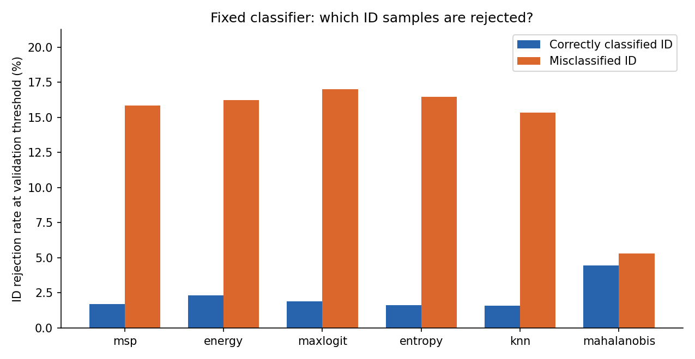

# Frozen-threshold failure analysis

Classifier selected epoch: 96. ID test accuracy: 75.56%.

All thresholds are the original ID-validation-calibrated thresholds. No detector is refitted, no test-set threshold is chosen, and ID misclassifications remain ID.

## CIFAR10

| Method | Correct ID rejected % | Incorrect ID rejected % | Accuracy of accepted ID % | OOD accepted % |
|---|---:|---:|---:|---:|
| msp | 1.71 | 15.83 | 78.31 | 81.35 |
| energy | 2.33 | 16.24 | 78.29 | 80.65 |
| maxlogit | 1.89 | 17.02 | 78.52 | 80.47 |
| entropy | 1.64 | 16.49 | 78.45 | 81.18 |
| knn | 1.57 | 15.34 | 78.23 | 81.98 |
| mahalanobis | 4.46 | 5.32 | 75.73 | 96.26 |

Top accepted-OOD classifier output IDs and representative sample indices are retained in `failure-analysis.json`. Output-class concentration is descriptive and does not define OOD semantics.

## MNIST

| Method | Correct ID rejected % | Incorrect ID rejected % | Accuracy of accepted ID % | OOD accepted % |
|---|---:|---:|---:|---:|
| msp | 1.71 | 15.83 | 78.31 | 85.75 |
| energy | 2.33 | 16.24 | 78.29 | 91.72 |
| maxlogit | 1.89 | 17.02 | 78.52 | 90.38 |
| entropy | 1.64 | 16.49 | 78.45 | 89.98 |
| knn | 1.57 | 15.34 | 78.23 | 83.29 |
| mahalanobis | 4.46 | 5.32 | 75.73 | 94.68 |

Top accepted-OOD classifier output IDs and representative sample indices are retained in `failure-analysis.json`. Output-class concentration is descriptive and does not define OOD semantics.

## NOISE

| Method | Correct ID rejected % | Incorrect ID rejected % | Accuracy of accepted ID % | OOD accepted % |
|---|---:|---:|---:|---:|
| msp | 1.71 | 15.83 | 78.31 | 6.52 |
| energy | 2.33 | 16.24 | 78.29 | 0.44 |
| maxlogit | 1.89 | 17.02 | 78.52 | 0.84 |
| entropy | 1.64 | 16.49 | 78.45 | 0.64 |
| knn | 1.57 | 15.34 | 78.23 | 0.02 |
| mahalanobis | 4.46 | 5.32 | 75.73 | 99.82 |

Top accepted-OOD classifier output IDs and representative sample indices are retained in `failure-analysis.json`. Output-class concentration is descriptive and does not define OOD semantics.

## Interpretation limits

Rejection of classification mistakes can improve accuracy on the remaining accepted ID samples, but it does not demonstrate natural OOD detection. OOD acceptance must be assessed separately. This report explains a fixed model and threshold; it is not a method-selection experiment.

