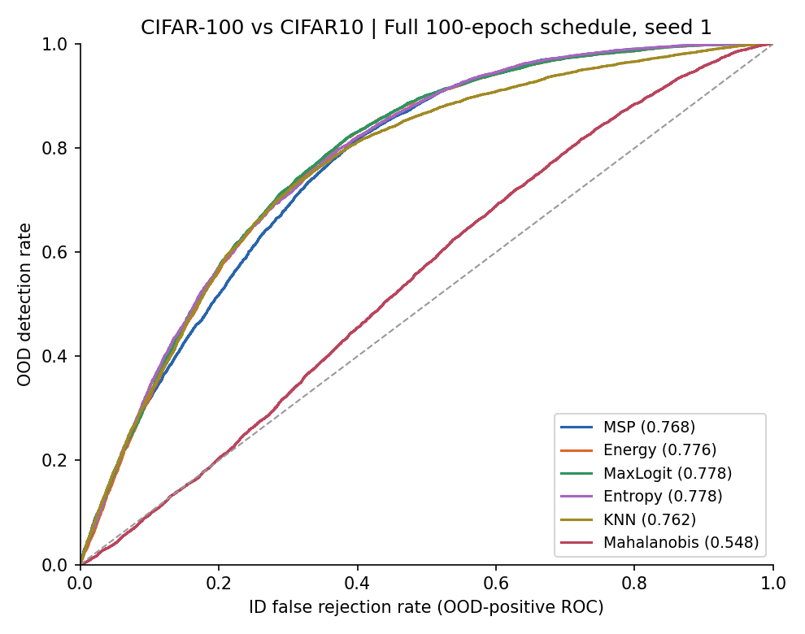
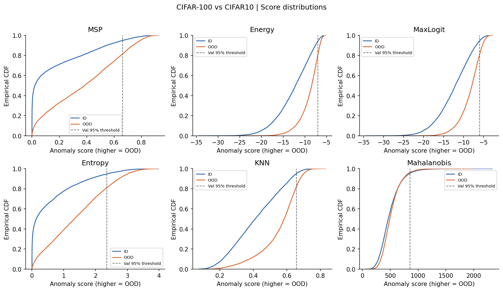
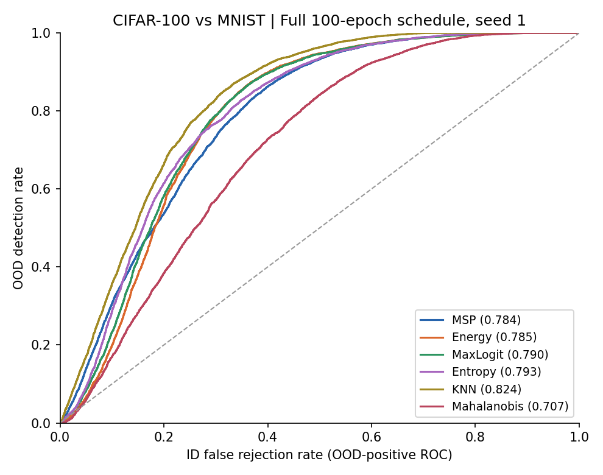
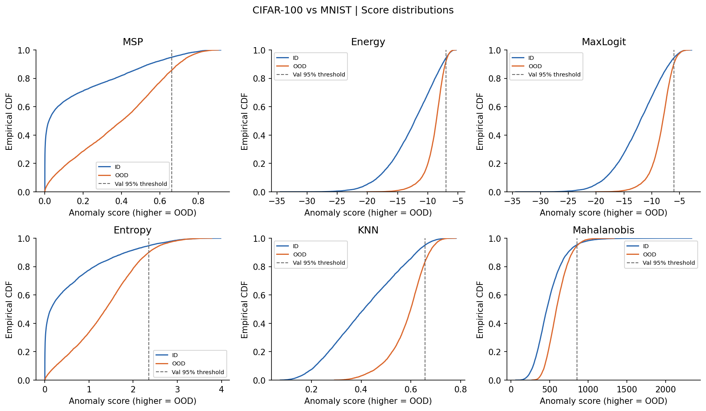
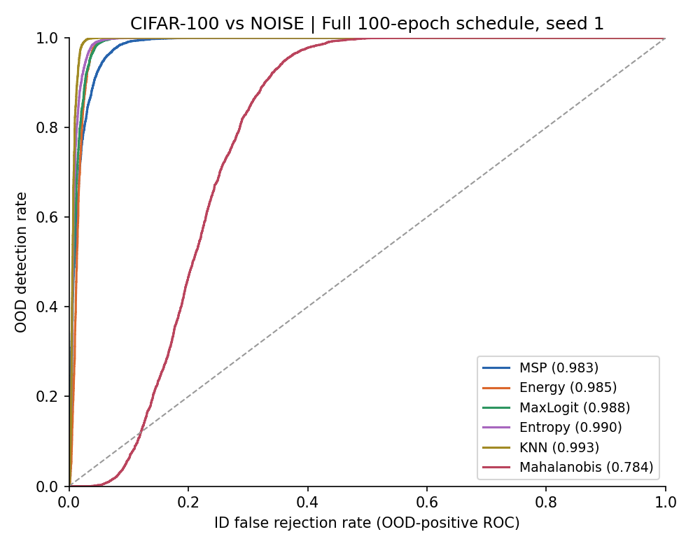
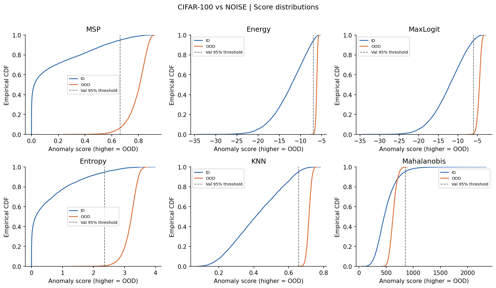

# OOD Detection: Full 100-epoch schedule, seed 1

ID: cifar100; selected checkpoint epoch 96; ID test accuracy **75.56%**.

All detector scores increase toward OOD. Checkpoint selection uses ID validation accuracy only.

This is an independently trained CIFAR study, not a full OpenOOD reproduction. A pilot or one training seed does not support a multiseed conclusion.

## CIFAR10

near-OOD natural images; official test split.

| Method | AUROC % (95% sample CI) | AUPR-out % | FPR95-ID % | ID test accept % (val threshold) | OOD accept % (val threshold) |
|---|---:|---:|---:|---:|---:|
| MSP | 76.79 [76.18, 77.53] | 72.20 | 81.77 | 94.84 | 81.35 |
| Energy | 77.61 [77.05, 78.36] | 72.52 | 83.05 | 94.27 | 80.65 |
| MaxLogit | 77.81 [77.25, 78.58] | 72.96 | 82.37 | 94.41 | 80.47 |
| Entropy | 77.77 [77.18, 78.47] | 73.05 | 81.96 | 94.73 | 81.18 |
| KNN | 76.25 [75.63, 76.93] | 72.41 | 81.78 | 95.06 | 81.98 |
| Mahalanobis | 54.81 [53.94, 55.58] | 51.58 | 95.97 | 95.33 | 96.26 |

Energy − MSP AUROC difference: 0.82 percentage points (paired sample-bootstrap 95% CI [0.46, 1.20]).

ID count: 10000; OOD count: 10000. AUROC/AUPR higher is better; FPR95-ID and OOD acceptance lower is better.

## MNIST

far-OOD handwritten digits; official test; bilinear 28->32; repeated RGB.

| Method | AUROC % (95% sample CI) | AUPR-out % | FPR95-ID % | ID test accept % (val threshold) | OOD accept % (val threshold) |
|---|---:|---:|---:|---:|---:|
| MSP | 78.43 [77.82, 79.11] | 71.29 | 86.16 | 94.84 | 85.75 |
| Energy | 78.48 [77.77, 79.19] | 68.41 | 93.43 | 94.27 | 91.72 |
| MaxLogit | 79.05 [78.37, 79.74] | 69.74 | 91.86 | 94.41 | 90.38 |
| Entropy | 79.33 [78.67, 79.97] | 70.71 | 90.85 | 94.73 | 89.98 |
| KNN | 82.43 [81.89, 83.04] | 75.45 | 83.02 | 95.06 | 83.29 |
| Mahalanobis | 70.74 [69.99, 71.32] | 62.34 | 94.19 | 95.33 | 94.68 |

Energy − MSP AUROC difference: 0.05 percentage points (paired sample-bootstrap 95% CI [-0.34, 0.43]).

ID count: 10000; OOD count: 10000. AUROC/AUPR higher is better; FPR95-ID and OOD acceptance lower is better.

## NOISE

uniform pixel noise; synthetic diagnostic only.

| Method | AUROC % (95% sample CI) | AUPR-out % | FPR95-ID % | ID test accept % (val threshold) | OOD accept % (val threshold) |
|---|---:|---:|---:|---:|---:|
| MSP | 98.35 [98.18, 98.50] | 97.55 | 6.90 | 94.84 | 6.52 |
| Energy | 98.47 [98.28, 98.67] | 96.37 | 0.91 | 94.27 | 0.44 |
| MaxLogit | 98.80 [98.64, 98.95] | 97.69 | 1.28 | 94.41 | 0.84 |
| Entropy | 99.03 [98.89, 99.17] | 97.88 | 0.77 | 94.73 | 0.64 |
| KNN | 99.28 [99.15, 99.39] | 98.04 | 0.02 | 95.06 | 0.02 |
| Mahalanobis | 78.41 [77.70, 79.05] | 64.58 | 99.74 | 95.33 | 99.82 |

Energy − MSP AUROC difference: 0.12 percentage points (paired sample-bootstrap 95% CI [-0.03, 0.25]).

ID count: 10000; OOD count: 10000. AUROC/AUPR higher is better; FPR95-ID and OOD acceptance lower is better.

## Interpretation boundary

FPR95-ID is the OOD acceptance rate at the empirical 95% ID-test operating point. The separately reported validation-calibrated operating point uses no test values to fit its threshold. High AUROC alone does not imply useful rejection at high ID acceptance.

Intervals use 300 stratified paired bootstrap draws of ID/OOD test samples, fixed seed 2026. These approximate percentile intervals describe sample uncertainty conditional on this trained classifier. They do not estimate uncertainty from retraining or replace training-seed mean/sample SD.

Uniform noise is a diagnostic, not a natural OOD benchmark. Scores below chance are retained with their predeclared orientation; they are not flipped after observing test performance.

Checkpoint SHA-256: `1aa639febbd9a690041af15b13bce5a68c9d6c714a6e20d695e54b53ebe6f80f`.
