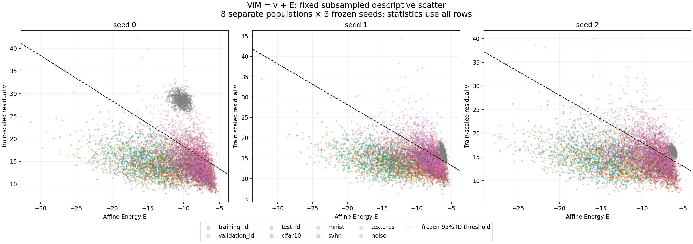
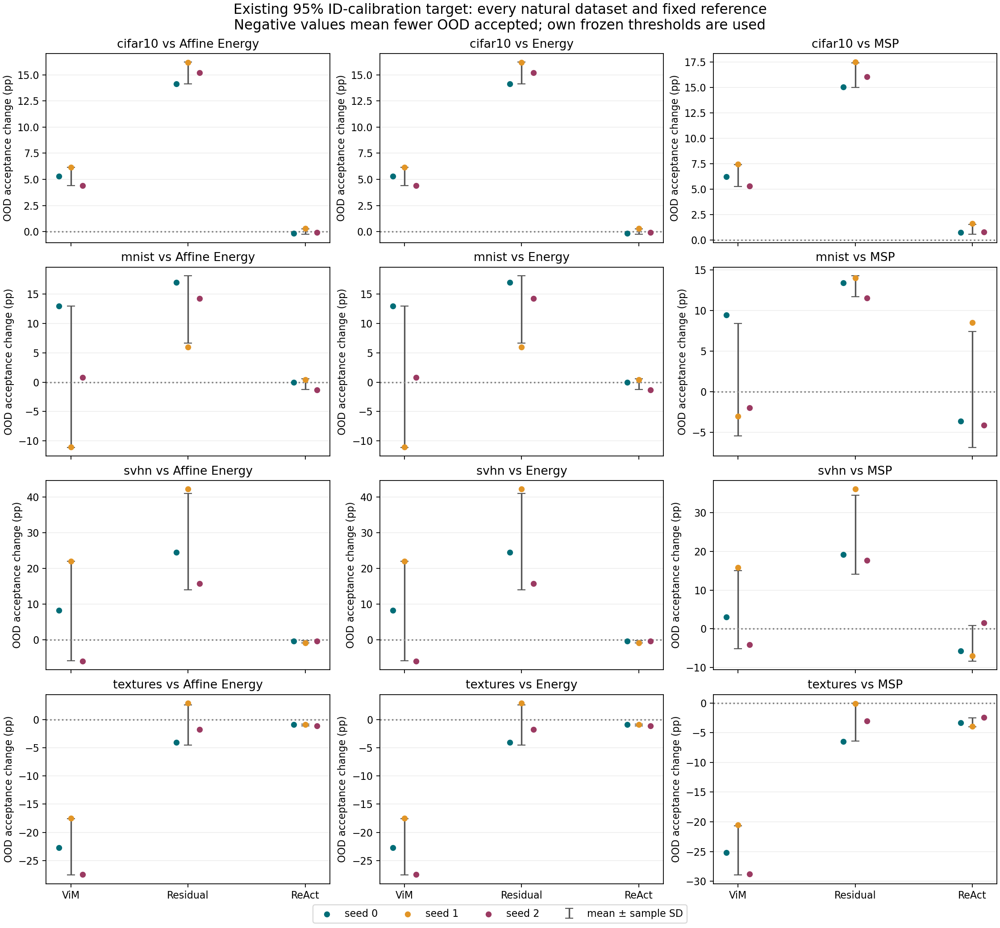

# Frozen geometry diagnostics: components and decision transitions

This posthoc analysis describes the already audited three-seed geometry results. No model, detector, hyperparameter, threshold or dataset was fitted/changed. The fixed scope includes every population and all three additions × three references × four existing targets. Prior raw artifacts/source hashes remain intact.

Values are mean ± sample SD across training seeds 0/1/2. Within-population SD (ddof=0), covariance and every fixed quantile are separately preserved in summary.json. Seed SD is descriptive, not CI; population means/correlations cannot establish a cause of AUROC changes.

## ViM score components

`S = v + E`, `v = alpha * residual`, `E = -logsumexp(affine_logits)`. Higher S is more OOD. The variance identity `Var(S)=Var(v)+Var(E)+2 Cov(v,E)` was independently verified on all samples.

| Population | n per seed | Mean v | Mean E | Mean S | Pearson(v,E) |
|---|---:|---:|---:|---:|---:|
| training_id | 45,000 | 14.804 ± 0.118 | -14.813 ± 0.117 | -0.009 ± 0.000 | -0.373 ± 0.007 |
| validation_id | 5,000 | 14.500 ± 0.127 | -12.773 ± 0.089 | 1.727 ± 0.038 | -0.356 ± 0.003 |
| test_id | 10,000 | 14.439 ± 0.135 | -12.774 ± 0.140 | 1.665 ± 0.022 | -0.349 ± 0.004 |
| cifar10 | 10,000 | 14.042 ± 0.110 | -9.065 ± 0.094 | 4.977 ± 0.091 | -0.315 ± 0.018 |
| mnist | 10,000 | 14.467 ± 0.729 | -8.801 ± 0.140 | 5.666 ± 0.595 | -0.471 ± 0.052 |
| svhn | 26,032 | 14.344 ± 0.353 | -7.874 ± 0.404 | 6.470 ± 0.080 | -0.463 ± 0.050 |
| textures | 1,880 | 17.032 ± 0.327 | -8.931 ± 0.163 | 8.101 ± 0.165 | -0.552 ± 0.025 |
| noise | 10,000 | 20.355 ± 7.117 | -7.576 ± 2.379 | 12.779 ± 4.739 | -0.486 ± 0.198 |

Noise is a synthetic diagnostic and is never included in a natural OOD aggregate. Training/validation/test ID remain distinct populations.

## Signed population mean differences

These are paired differences within the same seed. Both component signs are preserved; delta S equals delta v plus delta E. This identity describes mean score shifts and does not replace rank-based detection metrics.

| Population minus reference | Delta v | Delta E | Delta S |
|---|---:|---:|---:|
| cifar10_minus_test_id | -0.397 ± 0.130 | 3.709 ± 0.045 | 3.312 ± 0.109 |
| mnist_minus_test_id | 0.028 ± 0.850 | 3.974 ± 0.267 | 4.001 ± 0.584 |
| svhn_minus_test_id | -0.095 ± 0.251 | 4.900 ± 0.296 | 4.805 ± 0.073 |
| textures_minus_test_id | 2.593 ± 0.217 | 3.843 ± 0.110 | 6.436 ± 0.159 |
| noise_minus_test_id | 5.916 ± 7.030 | 5.198 ± 2.274 | 11.114 ± 4.757 |
| validation_id_minus_training_id | -0.304 ± 0.009 | 2.040 ± 0.029 | 1.736 ± 0.037 |
| test_id_minus_training_id | -0.365 ± 0.023 | 2.039 ± 0.040 | 1.674 ± 0.021 |

## Exhaustive fixed-threshold decision transitions

The primary 95% ID-calibration target is shown below because it was already the fixed primary operating point. Every 80/90/95/99% target is saved in summary.json. All 108 seed/comparison/target settings and per-class ID counts remain available as raw transition codes.

Both methods use their own frozen threshold selected from the same 2,500 reused ID-validation calibration rows. Thus these transitions include threshold differences; they are not a pure ranking effect or a comparison at exactly equal achieved ID-test coverage. Correct/incorrect ID use original classifier predictions, with separate subgroup denominators. OOD populations have no classifier-correctness flag.

| Addition minus reference | Population | Both accept % | Addition only % | Reference only % | Neither % | Acceptance change (pp) |
|---|---|---:|---:|---:|---:|---:|
| ViM − Affine Energy | test_id | 90.880 ± 1.038 | 4.393 ± 0.654 | 4.267 ± 0.581 | 0.460 ± 0.130 | 0.127 ± 0.840 |
| ViM − Affine Energy | correct ID | 95.634 ± 0.659 | 1.848 ± 0.280 | 2.377 ± 0.586 | 0.141 ± 0.075 | -0.529 ± 0.699 |
| ViM − Affine Energy | incorrect ID | 76.025 ± 2.239 | 12.342 ± 1.774 | 10.178 ± 0.509 | 1.455 ± 0.398 | 2.164 ± 1.849 |
| ViM − Affine Energy | cifar10 | 71.270 ± 1.232 | 15.933 ± 0.803 | 10.650 ± 0.463 | 2.147 ± 0.274 | 5.283 ± 0.865 |
| ViM − Affine Energy | mnist | 74.200 ± 4.231 | 12.677 ± 5.399 | 11.780 ± 7.011 | 1.343 ± 0.885 | 0.897 ± 12.055 |
| ViM − Affine Energy | svhn | 50.558 ± 9.091 | 26.228 ± 10.275 | 18.157 ± 3.996 | 5.057 ± 2.142 | 8.071 ± 13.957 |
| ViM − Affine Energy | textures | 41.809 ± 1.543 | 14.291 ± 2.634 | 36.879 ± 2.368 | 7.021 ± 1.691 | -22.589 ± 5.002 |
| ViM − Affine Energy | noise | 0.000 ± 0.000 | 0.350 ± 0.606 | 33.660 ± 57.452 | 65.990 ± 57.151 | -33.310 ± 57.758 |
| ViM − Energy | test_id | 90.880 ± 1.038 | 4.393 ± 0.654 | 4.267 ± 0.581 | 0.460 ± 0.130 | 0.127 ± 0.840 |
| ViM − Energy | correct ID | 95.634 ± 0.659 | 1.848 ± 0.280 | 2.377 ± 0.586 | 0.141 ± 0.075 | -0.529 ± 0.699 |
| ViM − Energy | incorrect ID | 76.025 ± 2.239 | 12.342 ± 1.774 | 10.178 ± 0.509 | 1.455 ± 0.398 | 2.164 ± 1.849 |
| ViM − Energy | cifar10 | 71.270 ± 1.232 | 15.933 ± 0.803 | 10.650 ± 0.463 | 2.147 ± 0.274 | 5.283 ± 0.865 |
| ViM − Energy | mnist | 74.200 ± 4.231 | 12.677 ± 5.399 | 11.780 ± 7.011 | 1.343 ± 0.885 | 0.897 ± 12.055 |
| ViM − Energy | svhn | 50.558 ± 9.091 | 26.228 ± 10.275 | 18.157 ± 3.996 | 5.057 ± 2.142 | 8.071 ± 13.957 |
| ViM − Energy | textures | 41.809 ± 1.543 | 14.291 ± 2.634 | 36.879 ± 2.368 | 7.021 ± 1.691 | -22.589 ± 5.002 |
| ViM − Energy | noise | 0.000 ± 0.000 | 0.350 ± 0.606 | 33.660 ± 57.452 | 65.990 ± 57.151 | -33.310 ± 57.758 |
| ViM − MSP | test_id | 90.990 ± 0.931 | 4.283 ± 0.435 | 3.900 ± 0.548 | 0.827 ± 0.199 | 0.383 ± 0.657 |
| ViM − MSP | correct ID | 96.092 ± 0.631 | 1.390 ± 0.185 | 2.271 ± 0.576 | 0.247 ± 0.087 | -0.881 ± 0.659 |
| ViM − MSP | incorrect ID | 75.045 ± 1.780 | 13.321 ± 1.195 | 8.996 ± 0.467 | 2.637 ± 0.594 | 4.325 ± 1.355 |
| ViM − MSP | cifar10 | 71.713 ± 1.345 | 15.490 ± 0.989 | 9.167 ± 0.400 | 3.630 ± 0.347 | 6.323 ± 1.074 |
| ViM − MSP | mnist | 75.297 ± 6.715 | 11.580 ± 1.292 | 10.117 ± 5.791 | 3.007 ± 1.972 | 1.463 ± 6.918 |
| ViM − MSP | svhn | 56.245 ± 6.969 | 20.541 ± 7.578 | 15.637 ± 2.707 | 7.577 ± 1.933 | 4.904 ± 10.088 |
| ViM − MSP | textures | 45.709 ± 2.303 | 10.390 ± 1.635 | 35.230 ± 2.503 | 8.670 ± 1.652 | -24.840 ± 4.135 |
| ViM − MSP | noise | 0.017 ± 0.029 | 0.333 ± 0.577 | 38.983 ± 52.946 | 60.667 ± 52.613 | -38.650 ± 53.267 |
| Residual − Affine Energy | test_id | 90.523 ± 0.350 | 4.847 ± 0.747 | 4.623 ± 0.425 | 0.007 ± 0.006 | 0.223 ± 1.166 |
| Residual − Affine Energy | correct ID | 93.195 ± 0.183 | 1.985 ± 0.268 | 4.816 ± 0.405 | 0.004 ± 0.008 | -2.832 ± 0.660 |
| Residual − Affine Energy | incorrect ID | 82.182 ± 1.695 | 13.783 ± 2.140 | 4.021 ± 0.482 | 0.014 ± 0.024 | 9.762 ± 2.612 |
| Residual − Affine Energy | cifar10 | 79.027 ± 0.993 | 18.073 ± 0.969 | 2.893 ± 0.270 | 0.007 ± 0.012 | 15.180 ± 1.030 |
| Residual − Affine Energy | mnist | 84.363 ± 4.582 | 14.020 ± 5.109 | 1.617 ± 0.985 | 0.000 ± 0.000 | 12.403 ± 5.757 |
| Residual − Affine Energy | svhn | 64.952 ± 11.240 | 31.232 ± 12.351 | 3.763 ± 1.210 | 0.052 ± 0.031 | 27.469 ± 13.488 |
| Residual − Affine Energy | textures | 57.074 ± 1.068 | 20.656 ± 2.258 | 21.613 ± 1.424 | 0.656 ± 0.221 | -0.957 ± 3.552 |
| Residual − Affine Energy | noise | 0.320 ± 0.282 | 66.323 ± 57.438 | 33.340 ± 57.729 | 0.017 ± 0.029 | 32.983 ± 115.167 |
| Residual − Energy | test_id | 90.523 ± 0.350 | 4.847 ± 0.747 | 4.623 ± 0.425 | 0.007 ± 0.006 | 0.223 ± 1.166 |
| Residual − Energy | correct ID | 93.195 ± 0.183 | 1.985 ± 0.268 | 4.816 ± 0.405 | 0.004 ± 0.008 | -2.832 ± 0.660 |
| Residual − Energy | incorrect ID | 82.182 ± 1.695 | 13.783 ± 2.140 | 4.021 ± 0.482 | 0.014 ± 0.024 | 9.762 ± 2.612 |
| Residual − Energy | cifar10 | 79.027 ± 0.993 | 18.073 ± 0.969 | 2.893 ± 0.270 | 0.007 ± 0.012 | 15.180 ± 1.030 |
| Residual − Energy | mnist | 84.363 ± 4.582 | 14.020 ± 5.109 | 1.617 ± 0.985 | 0.000 ± 0.000 | 12.403 ± 5.757 |
| Residual − Energy | svhn | 64.952 ± 11.240 | 31.232 ± 12.351 | 3.763 ± 1.210 | 0.052 ± 0.031 | 27.469 ± 13.488 |
| Residual − Energy | textures | 57.074 ± 1.068 | 20.656 ± 2.258 | 21.613 ± 1.424 | 0.656 ± 0.221 | -0.957 ± 3.552 |
| Residual − Energy | noise | 0.320 ± 0.282 | 66.323 ± 57.438 | 33.340 ± 57.729 | 0.017 ± 0.029 | 32.983 ± 115.167 |
| Residual − MSP | test_id | 90.337 ± 0.186 | 5.033 ± 0.606 | 4.553 ± 0.430 | 0.077 ± 0.025 | 0.480 ± 1.035 |
| Residual − MSP | correct ID | 93.560 ± 0.217 | 1.619 ± 0.193 | 4.803 ± 0.405 | 0.018 ± 0.015 | -3.184 ± 0.596 |
| Residual − MSP | incorrect ID | 80.269 ± 1.292 | 15.697 ± 1.754 | 3.773 ± 0.498 | 0.261 ± 0.062 | 11.924 ± 2.251 |
| Residual − MSP | cifar10 | 78.190 ± 1.238 | 18.910 ± 1.208 | 2.690 ± 0.250 | 0.210 ± 0.026 | 16.220 ± 1.220 |
| Residual − MSP | mnist | 83.903 ± 1.962 | 14.480 ± 1.334 | 1.510 ± 0.901 | 0.107 ± 0.100 | 12.970 ± 1.309 |
| Residual − MSP | svhn | 68.562 ± 7.872 | 27.622 ± 9.073 | 3.320 ± 1.178 | 0.496 ± 0.057 | 24.302 ± 10.238 |
| Residual − MSP | textures | 60.284 ± 0.111 | 17.447 ± 1.492 | 20.656 ± 1.703 | 1.613 ± 0.251 | -3.209 ± 3.195 |
| Residual − MSP | noise | 5.663 ± 5.909 | 60.980 ± 52.911 | 33.337 ± 57.732 | 0.020 ± 0.035 | 27.643 ± 110.590 |
| ReAct − Affine Energy | test_id | 95.073 ± 0.734 | 0.047 ± 0.072 | 0.073 ± 0.059 | 4.807 ± 0.686 | -0.027 ± 0.121 |
| ReAct − Affine Energy | correct ID | 97.971 ± 0.250 | 0.026 ± 0.046 | 0.040 ± 0.035 | 1.963 ± 0.221 | -0.013 ± 0.074 |
| ReAct − Affine Energy | incorrect ID | 86.024 ± 2.125 | 0.109 ± 0.155 | 0.179 ± 0.132 | 13.687 ± 2.028 | -0.069 ± 0.267 |
| ReAct − Affine Energy | cifar10 | 81.803 ± 0.929 | 0.133 ± 0.214 | 0.117 ± 0.064 | 17.947 ± 0.780 | 0.017 ± 0.257 |
| ReAct − Affine Energy | mnist | 85.500 ± 5.475 | 0.150 ± 0.251 | 0.480 ± 0.754 | 13.870 ± 5.358 | -0.330 ± 0.913 |
| ReAct − Affine Energy | svhn | 67.923 ± 12.986 | 0.229 ± 0.361 | 0.793 ± 0.650 | 31.055 ± 12.016 | -0.563 ± 0.289 |
| ReAct − Affine Energy | textures | 77.589 ± 2.304 | 0.142 ± 0.246 | 1.099 ± 0.187 | 21.170 ± 1.891 | -0.957 ± 0.141 |
| ReAct − Affine Energy | noise | 33.613 ± 57.493 | 0.017 ± 0.029 | 0.047 ± 0.081 | 66.323 ± 57.438 | -0.030 ± 0.098 |
| ReAct − Energy | test_id | 95.073 ± 0.734 | 0.047 ± 0.072 | 0.073 ± 0.059 | 4.807 ± 0.686 | -0.027 ± 0.121 |
| ReAct − Energy | correct ID | 97.971 ± 0.250 | 0.026 ± 0.046 | 0.040 ± 0.035 | 1.963 ± 0.221 | -0.013 ± 0.074 |
| ReAct − Energy | incorrect ID | 86.024 ± 2.125 | 0.109 ± 0.155 | 0.179 ± 0.132 | 13.687 ± 2.028 | -0.069 ± 0.267 |
| ReAct − Energy | cifar10 | 81.803 ± 0.929 | 0.133 ± 0.214 | 0.117 ± 0.064 | 17.947 ± 0.780 | 0.017 ± 0.257 |
| ReAct − Energy | mnist | 85.500 ± 5.475 | 0.150 ± 0.251 | 0.480 ± 0.754 | 13.870 ± 5.358 | -0.330 ± 0.913 |
| ReAct − Energy | svhn | 67.923 ± 12.986 | 0.229 ± 0.361 | 0.793 ± 0.650 | 31.055 ± 12.016 | -0.563 ± 0.289 |
| ReAct − Energy | textures | 77.589 ± 2.304 | 0.142 ± 0.246 | 1.099 ± 0.187 | 21.170 ± 1.891 | -0.957 ± 0.141 |
| ReAct − Energy | noise | 33.613 ± 57.493 | 0.017 ± 0.029 | 0.047 ± 0.081 | 66.323 ± 57.438 | -0.030 ± 0.098 |
| ReAct − MSP | test_id | 93.060 ± 0.742 | 2.060 ± 0.072 | 1.830 ± 0.139 | 3.050 ± 0.546 | 0.230 ± 0.070 |
| ReAct − MSP | correct ID | 97.355 ± 0.258 | 0.642 ± 0.052 | 1.008 ± 0.063 | 0.995 ± 0.144 | -0.365 ± 0.021 |
| ReAct − MSP | incorrect ID | 79.641 ± 2.069 | 6.493 ± 0.082 | 4.401 ± 0.379 | 9.465 ± 1.721 | 2.092 ± 0.299 |
| ReAct − MSP | cifar10 | 75.117 ± 1.029 | 6.820 ± 0.306 | 5.763 ± 0.178 | 12.300 ± 0.889 | 1.057 ± 0.480 |
| ReAct − MSP | mnist | 79.397 ± 1.836 | 6.253 ± 3.894 | 6.017 ± 3.255 | 8.333 ± 2.482 | 0.237 ± 7.143 |
| ReAct − MSP | svhn | 61.031 ± 12.069 | 7.121 ± 1.387 | 10.851 ± 3.485 | 20.997 ± 9.419 | -3.730 ± 4.590 |
| ReAct − MSP | textures | 71.702 ± 1.977 | 6.028 ± 0.354 | 9.238 ± 0.427 | 13.032 ± 1.765 | -3.209 ± 0.755 |
| ReAct − MSP | noise | 33.593 ± 57.510 | 0.037 ± 0.040 | 5.407 ± 5.740 | 60.963 ± 52.897 | -5.370 ± 5.729 |

## Scientific figures

The joint scatter uses the predeclared sorted random sample of at most 1,000 rows per population. All statistics and decision counts use full populations. The dashed ViM boundary is the existing 95%-calibration threshold, not a newly fitted line.



The next figure shows acceptance changes for all natural datasets against every fixed reference, with per-seed points and mean/sample SD. Noise and ID transition tables remain separate; no result is promoted as a selected method.



## Reproduction and evidence

```bash
python tools/run_geometry_diagnostics.py
python tools/audit_geometry_diagnostics.py
python tools/build_geometry_diagnostics_report.py
python tools/audit_geometry_diagnostics_report.py
```

Raw vectors/sampled indices and original ID labels: runs/geometry-diagnostics/seedN/analysis/*_components.npz. Transition codes and [addition,reference,target,ID_class,state,correctness] counts: transitions.npz. Original masks are reused byte-for-byte. Completed audits bind all source/input/raw artifact hashes; completion is recorded separately after summary audit and visual QA.

No causal explanation, significance claim, OOD tuning or fresh-validation coverage guarantee follows from this posthoc diagnostic. A future method study needs a separate declared ID-only development protocol.
