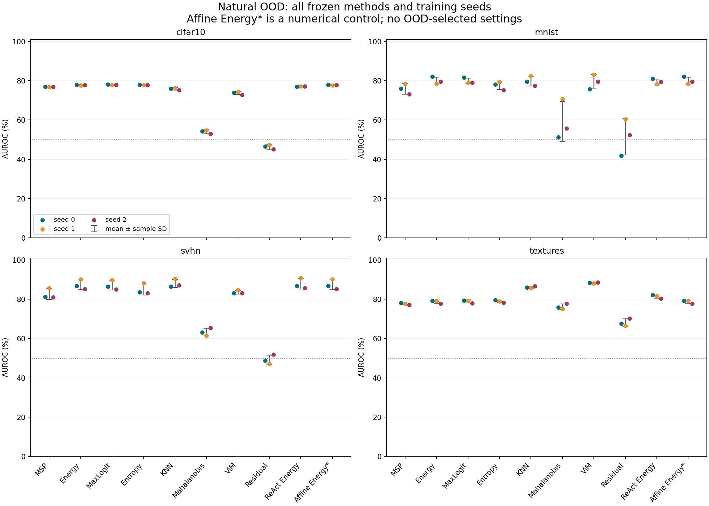
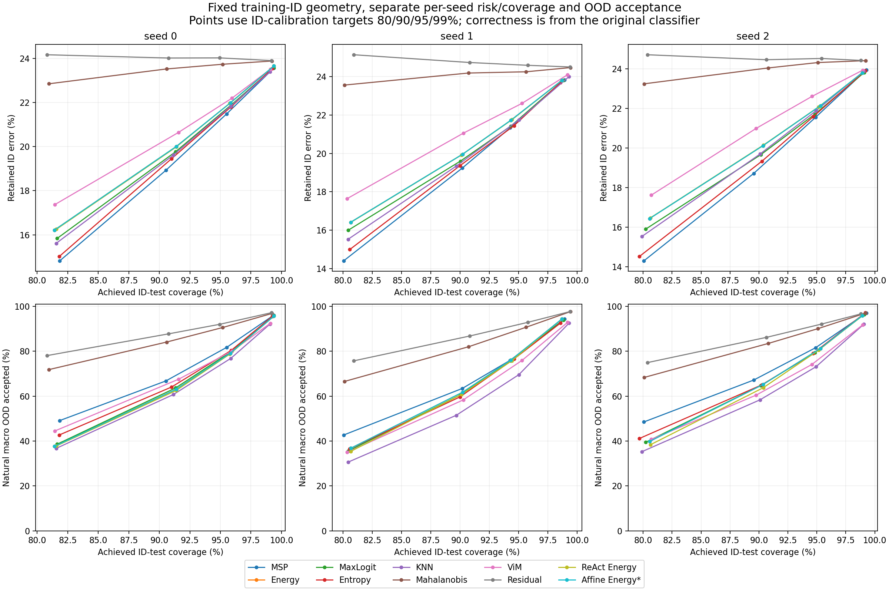

# Training-ID geometry: complete three-seed evaluation

All 3 frozen CIFAR-100 classifiers are evaluated on the same four natural OOD populations. ViM, Residual and ReAct use only the 45,000 ID training features for fitting; D=256, clipping quantile=0.99 and T=1 were fixed before these results. Original six matched T=1 controls are byte-identical. Affine Energy* is a feature-to-head float64 numerical control.

Values below are mean ± sample SD across seeds 0/1/2, in percent or percentage points. SD describes these three training seeds; it is not a confidence interval. Every method is reported in protocol order, without test-selected settings or a promoted best method.

Primary operating thresholds use the same 2,500 ID-validation calibration rows at 95% empirical acceptance. These images previously selected checkpoints, so this is reused validation, not a fresh holdout or a coverage guarantee. FPR95-ID uses a separate ID-test benchmark threshold. Four-dataset macros weight datasets equally within each seed; noise is excluded.

| Method | Natural macro AUROC | Benchmark FPR95-ID ↓ | Primary OOD acceptance ↓ | ID-test coverage | Retained ID error ↓ |
|---|---:|---:|---:|---:|---:|
| MSP | 78.23 ± 1.32 | 80.09 ± 1.65 | 79.78 ± 3.25 | 94.89 ± 0.62 | 21.46 ± 0.10 |
| Energy | 80.97 ± 0.79 | 78.41 ± 2.23 | 78.83 ± 2.60 | 95.15 ± 0.75 | 21.95 ± 0.20 |
| MaxLogit | 80.95 ± 0.83 | 78.27 ± 1.71 | 78.44 ± 2.28 | 95.03 ± 0.82 | 21.68 ± 0.24 |
| Entropy | 79.80 ± 1.23 | 78.22 ± 1.78 | 78.67 ± 1.93 | 95.05 ± 0.72 | 21.61 ± 0.18 |
| KNN | 82.42 ± 1.11 | 72.24 ± 2.34 | 73.19 ± 3.62 | 95.27 ± 0.51 | 21.82 ± 0.06 |
| Mahalanobis | 63.19 ± 2.20 | 89.91 ± 0.32 | 90.46 ± 0.33 | 95.30 ± 0.29 | 24.10 ± 0.32 |
| ViM | 81.26 ± 1.20 | 76.02 ± 1.10 | 76.74 ± 3.04 | 95.27 ± 0.69 | 22.47 ± 0.24 |
| Residual | 53.80 ± 2.28 | 91.79 ± 0.31 | 92.35 ± 0.48 | 95.37 ± 0.42 | 24.38 ± 0.31 |
| ReAct Energy | 81.43 ± 0.67 | 77.99 ± 2.19 | 78.37 ± 2.37 | 95.12 ± 0.67 | 21.94 ± 0.16 |
| Affine Energy* | 80.97 ± 0.79 | 78.41 ± 2.23 | 78.83 ± 2.60 | 95.15 ± 0.75 | 21.95 ± 0.20 |

## Separate natural populations

### cifar10: ID 10,000; OOD 10,000

| Method | AUROC ↑ | AUPR-out ↑ | AUPR-in ↑ | FPR95-ID ↓ | Primary OOD acceptance ↓ |
|---|---:|---:|---:|---:|---:|
| MSP | 76.86 ± 0.10 | 72.70 ± 0.61 | 79.48 ± 0.19 | 81.09 ± 1.04 | 80.88 ± 1.19 |
| Energy | 77.75 ± 0.13 | 73.19 ± 0.68 | 79.88 ± 0.30 | 81.46 ± 1.60 | 81.92 ± 0.98 |
| MaxLogit | 77.95 ± 0.12 | 73.59 ± 0.70 | 80.00 ± 0.30 | 80.84 ± 1.44 | 80.94 ± 1.32 |
| Entropy | 77.80 ± 0.13 | 73.64 ± 0.69 | 80.02 ± 0.21 | 80.30 ± 1.73 | 80.69 ± 1.27 |
| KNN | 75.82 ± 0.58 | 72.26 ± 0.90 | 75.01 ± 1.03 | 81.75 ± 1.56 | 82.64 ± 0.73 |
| Mahalanobis | 54.02 ± 0.99 | 50.95 ± 0.75 | 56.49 ± 1.40 | 96.33 ± 0.33 | 96.57 ± 0.13 |
| ViM | 73.69 ± 0.82 | 68.42 ± 0.99 | 76.10 ± 0.81 | 86.60 ± 1.10 | 87.20 ± 0.72 |
| Residual | 46.30 ± 1.19 | 46.69 ± 0.79 | 47.65 ± 1.15 | 96.79 ± 0.35 | 97.10 ± 0.27 |
| ReAct Energy | 77.06 ± 0.10 | 72.77 ± 0.56 | 78.71 ± 0.56 | 81.52 ± 1.67 | 81.94 ± 0.73 |
| Affine Energy* | 77.75 ± 0.13 | 73.19 ± 0.68 | 79.88 ± 0.30 | 81.46 ± 1.60 | 81.92 ± 0.98 |

AUPR depends on this explicit ID/OOD population ratio; comparisons across datasets do not share prevalence.

### mnist: ID 10,000; OOD 10,000

| Method | AUROC ↑ | AUPR-out ↑ | AUPR-in ↑ | FPR95-ID ↓ | Primary OOD acceptance ↓ |
|---|---:|---:|---:|---:|---:|
| MSP | 75.84 ± 2.69 | 69.69 ± 2.18 | 80.29 ± 2.13 | 85.66 ± 1.21 | 85.41 ± 1.42 |
| Energy | 80.02 ± 1.83 | 72.85 ± 4.05 | 83.92 ± 1.19 | 85.25 ± 7.25 | 85.98 ± 5.11 |
| MaxLogit | 79.87 ± 1.47 | 72.80 ± 3.04 | 83.74 ± 1.07 | 85.20 ± 6.00 | 85.58 ± 3.95 |
| Entropy | 77.54 ± 2.08 | 71.08 ± 1.52 | 81.35 ± 1.88 | 86.15 ± 4.41 | 86.61 ± 2.71 |
| KNN | 79.80 ± 2.51 | 72.18 ± 2.83 | 84.11 ± 2.05 | 85.96 ± 3.00 | 86.82 ± 4.50 |
| Mahalanobis | 59.24 ± 10.21 | 53.23 ± 8.07 | 65.65 ± 9.02 | 97.29 ± 2.76 | 97.69 ± 2.20 |
| ViM | 79.44 ± 3.69 | 71.35 ± 5.53 | 84.22 ± 2.66 | 86.48 ± 7.15 | 86.88 ± 7.72 |
| Residual | 51.53 ± 9.34 | 48.78 ± 6.02 | 54.98 ± 8.74 | 97.98 ± 1.39 | 98.38 ± 0.98 |
| ReAct Energy | 79.53 ± 1.36 | 72.63 ± 3.96 | 83.23 ± 0.49 | 84.95 ± 7.51 | 85.65 ± 5.73 |
| Affine Energy* | 80.02 ± 1.83 | 72.85 ± 4.05 | 83.92 ± 1.19 | 85.25 ± 7.25 | 85.98 ± 5.11 |

AUPR depends on this explicit ID/OOD population ratio; comparisons across datasets do not share prevalence.

### svhn: ID 10,000; OOD 26,032

| Method | AUROC ↑ | AUPR-out ↑ | AUPR-in ↑ | FPR95-ID ↓ | Primary OOD acceptance ↓ |
|---|---:|---:|---:|---:|---:|
| MSP | 82.58 ± 2.68 | 90.39 ± 1.81 | 74.45 ± 3.26 | 72.48 ± 6.88 | 71.88 ± 9.03 |
| Energy | 87.38 ± 2.51 | 92.28 ± 1.89 | 81.45 ± 3.30 | 68.68 ± 9.32 | 68.72 ± 12.36 |
| MaxLogit | 87.12 ± 2.49 | 92.33 ± 1.83 | 81.07 ± 3.24 | 68.21 ± 8.42 | 68.11 ± 10.87 |
| Entropy | 84.96 ± 2.78 | 91.55 ± 1.87 | 76.72 ± 3.64 | 67.71 ± 8.31 | 68.10 ± 9.48 |
| KNN | 87.99 ± 2.08 | 93.57 ± 1.20 | 81.33 ± 2.55 | 59.13 ± 8.27 | 60.24 ± 9.08 |
| Mahalanobis | 63.33 ± 1.96 | 77.71 ± 1.60 | 49.02 ± 2.12 | 94.09 ± 1.45 | 94.48 ± 1.70 |
| ViM | 83.59 ± 1.00 | 90.40 ± 0.38 | 77.67 ± 1.38 | 75.86 ± 0.26 | 76.79 ± 2.78 |
| Residual | 49.22 ± 2.40 | 71.23 ± 1.79 | 28.34 ± 2.08 | 95.84 ± 1.07 | 96.18 ± 1.21 |
| ReAct Energy | 87.80 ± 2.70 | 92.45 ± 1.93 | 82.38 ± 3.79 | 68.11 ± 10.02 | 68.15 ± 12.64 |
| Affine Energy* | 87.38 ± 2.51 | 92.28 ± 1.89 | 81.45 ± 3.30 | 68.68 ± 9.32 | 68.72 ± 12.36 |

AUPR depends on this explicit ID/OOD population ratio; comparisons across datasets do not share prevalence.

### textures: ID 10,000; OOD 1,880

| Method | AUROC ↑ | AUPR-out ↑ | AUPR-in ↑ | FPR95-ID ↓ | Primary OOD acceptance ↓ |
|---|---:|---:|---:|---:|---:|
| MSP | 77.62 ± 0.51 | 35.40 ± 0.76 | 94.91 ± 0.16 | 81.12 ± 0.49 | 80.94 ± 1.74 |
| Energy | 78.75 ± 0.85 | 38.00 ± 1.45 | 95.07 ± 0.25 | 78.26 ± 0.75 | 78.69 ± 2.13 |
| MaxLogit | 78.87 ± 0.81 | 37.68 ± 1.31 | 95.10 ± 0.24 | 78.81 ± 0.80 | 79.13 ± 2.30 |
| Entropy | 78.91 ± 0.60 | 37.66 ± 1.04 | 95.17 ± 0.17 | 78.71 ± 1.13 | 79.29 ± 1.73 |
| KNN | 86.07 ± 0.51 | 54.43 ± 1.86 | 96.97 ± 0.11 | 62.13 ± 2.53 | 63.07 ± 3.88 |
| Mahalanobis | 76.15 ± 1.42 | 42.30 ± 1.15 | 94.06 ± 0.45 | 71.93 ± 0.78 | 73.10 ± 1.53 |
| ViM | 88.33 ± 0.18 | 61.39 ± 1.02 | 97.53 ± 0.03 | 55.14 ± 2.39 | 56.10 ± 3.63 |
| Residual | 68.13 ± 1.88 | 36.07 ± 1.08 | 90.51 ± 0.78 | 76.54 ± 0.42 | 77.73 ± 1.46 |
| ReAct Energy | 81.33 ± 0.86 | 40.18 ± 1.59 | 95.96 ± 0.21 | 77.38 ± 0.68 | 77.73 ± 2.07 |
| Affine Energy* | 78.75 ± 0.85 | 38.00 ± 1.45 | 95.07 ± 0.25 | 78.26 ± 0.75 | 78.69 ± 2.13 |

AUPR depends on this explicit ID/OOD population ratio; comparisons across datasets do not share prevalence.

## Paired natural macro changes

Each difference is calculated within the same seed before mean/sample SD. Positive AUROC is higher; negative acceptance/FPR is lower. Full per-dataset and per-seed differences against all three fixed references are in summary.json.

| Method minus reference | AUROC change (pp) | FPR95-ID change (pp) | Primary OOD acceptance change (pp) |
|---|---:|---:|---:|
| ViM − Affine Energy* | 0.29 ± 1.35 | -2.39 ± 3.11 | -2.08 ± 4.35 |
| ViM − Energy | 0.29 ± 1.35 | -2.39 ± 3.11 | -2.08 ± 4.35 |
| ViM − MSP | 3.04 ± 0.88 | -4.07 ± 1.74 | -3.04 ± 3.85 |
| Residual − Affine Energy* | -27.18 ± 2.76 | 13.38 ± 2.52 | 13.52 ± 3.03 |
| Residual − Energy | -27.18 ± 2.76 | 13.38 ± 2.52 | 13.52 ± 3.03 |
| Residual − MSP | -24.43 ± 2.38 | 11.70 ± 1.89 | 12.57 ± 3.73 |
| ReAct Energy − Affine Energy* | 0.45 ± 0.24 | -0.42 ± 0.11 | -0.46 ± 0.24 |
| ReAct Energy − Energy | 0.45 ± 0.24 | -0.42 ± 0.11 | -0.46 ± 0.24 |
| ReAct Energy − MSP | 3.20 ± 0.76 | -2.10 ± 1.92 | -1.41 ± 1.42 |

## Classification and fitting boundaries

Original classifier ID-test accuracy: 75.77 ± 0.30%. The clipping intermediates have a separate accuracy of 75.70 ± 0.33% and changed argmax counts [86.0, 87.0, 89.0]. All risk/counts above use original classifier correctness. Affine reconstruction argmax changes: [0.0, 0.0, 0.0].

Training-only alpha per seed: [9.681649299095243, 9.525943976353545, 9.589149117616088]; global clipping levels: [2.325183184146886, 2.3064880418777474, 2.317371854782106]. Subspace, scale and clipping were independently checked before OOD scoring. All training-bank/native validation identity checks passed.

Synthetic noise is saved in summary.json and raw artifacts, explicitly excluded from every natural macro. This local CIFAR experiment is an exploratory extension, not the authors’ ImageNet benchmark or an OpenOOD reproduction. No detector hyperparameter, checkpoint, score sign or operating target was selected from OOD tests.

## Scientific figures





## Reproduction and evidence

Run with the verified base CPU Python; set OMP_NUM_THREADS, MKL_NUM_THREADS and OPENBLAS_NUM_THREADS to 4 for bounded local computation. For torch CPU auditing on Windows, CUDA_VISIBLE_DEVICES=-1 was verified to hide CUDA; an empty value was ineffective in the observed shell. Historical frozen reports remain unchanged.

```powershell
& C:/Users/zxzx/anaconda3/python.exe tools/audit_geometry_evaluation.py
& C:/Users/zxzx/anaconda3/python.exe tools/build_geometry_report.py
& C:/Users/zxzx/anaconda3/python.exe tools/audit_geometry_report.py
```

Raw: runs/geometry-phase3/seedN/training-bank.npz, fit-state.npz, evaluation/*_scores.npz, *_intermediates.npz and decisions.npz. Provenance and independent fit audit: runs/geometry-phase3/*.json. This report audit.json binds all raw artifacts; summary-audit.json independently checks every statistical record. Completion is recorded separately after both audits and visual inspection.
