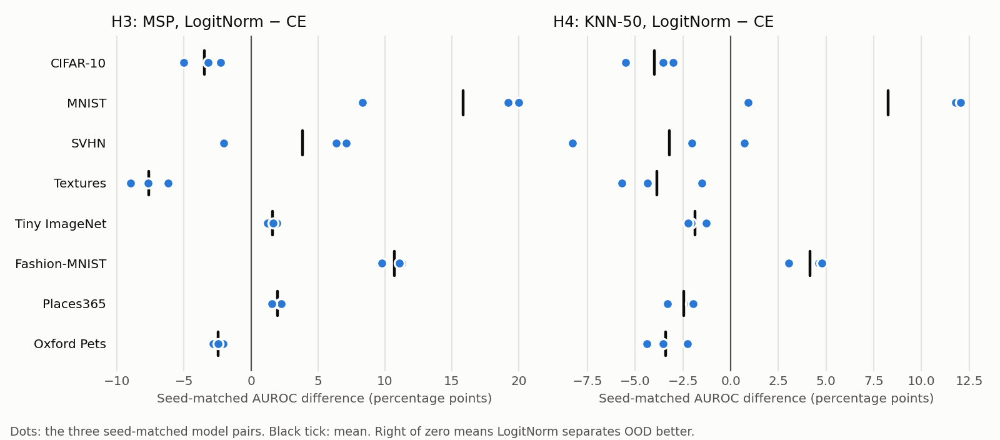

# LogitNorm representation study

Three new ResNet-18 classifiers trained with LogitNorm (τ = 0.04), with every other setting identical to the three ID-isolated cross-entropy (CE) models, which serve as seed-matched comparators. The [protocol](../../docs/LOGITNORM_REPRESENTATION.md) was frozen before training, and the evaluation code before any LogitNorm OOD output existed (evaluation declaration `bdec874c2fd74eb7b27bd5da6e6161438945566bc4be8f7c677e4e1cf9c28b67`).

ID-test accuracy: CE 75.80 ± 0.27%, LogitNorm 73.81 ± 0.46%, seed-matched difference -2.00 ± 0.48 pp.

## Decisions

| Hypothesis | CIFAR-10 | MNIST | SVHN | Textures | Tiny ImageNet | Fashion-MNIST | Places365 | Oxford Pets | Overall |
|---|---|---|---|---|---|---|---|---|---|
| H3 MSP improves | contradicted | supported | mixed | contradicted | supported | supported | supported | contradicted | **not confirmed** |
| H4 KNN-50 improves | contradicted | supported | mixed | contradicted | contradicted | supported | contradicted | contradicted | **not confirmed** |

The sign rule was fixed before training: "supported" means all three seed-matched differences are positive, "contradicted" means all are negative, and "mixed" covers everything else.

## AUROC difference, LogitNorm − CE

Mean ± sample SD over the three seed-matched pairs, in percentage points.

| Population | MSP | Energy | MaxLogit | Entropy | KNN-50 | Pooled Mahalanobis |
|---|---:|---:|---:|---:|---:|---:|
| CIFAR-10 | -3.50 ± 1.39 | -7.65 ± 3.10 | -4.81 ± 1.38 | -7.40 ± 1.34 | -4.01 ± 1.31 | -11.56 ± 0.94 |
| MNIST | +15.83 ± 6.50 | +8.35 ± 7.73 | +12.13 ± 3.87 | +15.99 ± 7.16 | +8.25 ± 6.36 | -40.50 ± 7.28 |
| SVHN | +3.82 ± 5.07 | -6.99 ± 12.58 | -0.55 ± 5.36 | +0.34 ± 6.29 | -3.20 ± 4.63 | -19.56 ± 10.82 |
| Textures | -7.63 ± 1.39 | -22.05 ± 9.91 | -10.08 ± 1.86 | -14.56 ± 1.16 | -3.87 ± 2.14 | -5.28 ± 2.48 |
| Tiny ImageNet | +1.61 ± 0.34 | -4.76 ± 1.78 | +0.32 ± 0.26 | -1.98 ± 0.30 | -1.86 ± 0.50 | -19.93 ± 0.95 |
| Fashion-MNIST | +10.70 ± 0.81 | +0.48 ± 6.02 | +6.71 ± 0.79 | +9.08 ± 0.96 | +4.14 ± 0.95 | -49.68 ± 7.30 |
| Places365 | +1.99 ± 0.39 | -4.01 ± 2.34 | +1.16 ± 0.26 | -1.04 ± 0.41 | -2.45 ± 0.75 | -21.16 ± 1.48 |
| Oxford Pets | -2.45 ± 0.38 | -6.39 ± 4.96 | -3.66 ± 0.70 | -7.55 ± 0.55 | -3.39 ± 1.07 | -13.26 ± 0.40 |

## Absolute AUROC

Mean ± sample SD over three seeds, in percent.

| Population | Objective | MSP | Energy | MaxLogit | Entropy | KNN-50 | Pooled Mahalanobis |
|---|---|---:|---:|---:|---:|---:|---:|
| CIFAR-10 | CE | 76.90 ± 0.25 | 77.80 ± 0.28 | 78.00 ± 0.28 | 77.86 ± 0.30 | 75.84 ± 0.76 | 53.93 ± 1.11 |
| CIFAR-10 | LogitNorm | 73.40 ± 1.57 | 70.14 ± 3.34 | 73.19 ± 1.65 | 70.45 ± 1.49 | 71.82 ± 1.32 | 42.37 ± 1.79 |
| MNIST | CE | 75.49 ± 2.86 | 79.52 ± 1.39 | 79.38 ± 1.13 | 77.17 ± 2.24 | 79.39 ± 2.64 | 59.36 ± 10.44 |
| MNIST | LogitNorm | 91.33 ± 4.31 | 87.87 ± 7.34 | 91.51 ± 4.37 | 93.15 ± 5.25 | 87.64 ± 3.73 | 18.86 ± 16.63 |
| SVHN | CE | 82.33 ± 2.90 | 86.96 ± 2.82 | 86.72 ± 2.80 | 84.66 ± 3.05 | 87.95 ± 2.10 | 63.66 ± 2.06 |
| SVHN | LogitNorm | 86.16 ± 2.22 | 79.97 ± 10.26 | 86.17 ± 2.59 | 85.00 ± 3.29 | 84.75 ± 2.60 | 44.10 ± 9.13 |
| Textures | CE | 77.71 ± 0.57 | 78.82 ± 0.95 | 78.94 ± 0.91 | 79.00 ± 0.67 | 86.08 ± 0.44 | 76.02 ± 1.30 |
| Textures | LogitNorm | 70.08 ± 1.84 | 56.77 ± 8.96 | 68.87 ± 1.84 | 64.44 ± 1.59 | 82.21 ± 2.00 | 70.73 ± 2.99 |
| Tiny ImageNet | CE | 78.02 ± 0.19 | 78.95 ± 0.33 | 79.12 ± 0.32 | 79.19 ± 0.23 | 80.17 ± 0.28 | 58.81 ± 0.45 |
| Tiny ImageNet | LogitNorm | 79.64 ± 0.45 | 74.19 ± 1.51 | 79.44 ± 0.48 | 77.21 ± 0.42 | 78.32 ± 0.75 | 38.88 ± 0.89 |
| Fashion-MNIST | CE | 86.10 ± 0.31 | 90.42 ± 0.16 | 90.13 ± 0.08 | 88.49 ± 0.22 | 90.48 ± 0.44 | 60.51 ± 2.72 |
| Fashion-MNIST | LogitNorm | 96.80 ± 0.70 | 90.90 ± 6.15 | 96.85 ± 0.71 | 97.57 ± 0.87 | 94.63 ± 0.65 | 10.82 ± 4.62 |
| Places365 | CE | 75.52 ± 0.59 | 75.93 ± 0.85 | 76.15 ± 0.84 | 76.43 ± 0.67 | 75.56 ± 0.84 | 59.45 ± 0.48 |
| Places365 | LogitNorm | 77.51 ± 0.77 | 71.92 ± 1.95 | 77.31 ± 0.76 | 75.39 ± 0.82 | 73.11 ± 1.26 | 38.29 ± 1.10 |
| Oxford Pets | CE | 80.84 ± 0.67 | 81.60 ± 0.78 | 81.87 ± 0.77 | 82.10 ± 0.76 | 83.56 ± 0.09 | 56.56 ± 0.63 |
| Oxford Pets | LogitNorm | 78.39 ± 0.30 | 75.21 ± 4.92 | 78.21 ± 0.52 | 74.55 ± 0.48 | 80.17 ± 0.97 | 43.30 ± 1.02 |

## Fixed 95% ID-validation operating point

OOD acceptance (lower is better) at each model's own frozen 1,500-row ID threshold, mean ± sample SD, in percent. The last two columns give the lowest-acceptance method among the six for each objective.

| Population | CE MSP | LogitNorm MSP | CE KNN-50 | LogitNorm KNN-50 | Lowest, CE | Lowest, LogitNorm |
|---|---:|---:|---:|---:|---|---|
| CIFAR-10 | 81.83 ± 0.53 | 85.50 ± 1.09 | 83.51 ± 2.29 | 86.12 ± 1.02 | Entropy 81.66 | MaxLogit 85.28 |
| MNIST | 86.71 ± 1.10 | 48.51 ± 22.69 | 87.78 ± 5.91 | 56.50 ± 15.45 | MSP 86.71 | Entropy 35.98 |
| SVHN | 73.74 ± 8.65 | 72.18 ± 6.04 | 61.41 ± 11.12 | 68.00 ± 9.49 | KNN-50 61.41 | KNN-50 68.00 |
| Textures | 81.72 ± 0.89 | 88.03 ± 2.06 | 64.10 ± 2.40 | 73.49 ± 5.80 | KNN-50 64.10 | Pooled Mahalanobis 66.38 |
| Tiny ImageNet | 78.88 ± 1.11 | 79.33 ± 1.45 | 78.65 ± 2.75 | 79.36 ± 2.19 | Entropy 77.85 | MaxLogit 79.13 |
| Fashion-MNIST | 66.17 ± 2.01 | 21.13 ± 5.51 | 54.00 ± 1.20 | 27.19 ± 3.46 | KNN-50 54.00 | Entropy 14.81 |
| Places365 | 82.42 ± 0.22 | 82.38 ± 2.07 | 81.62 ± 1.70 | 83.30 ± 2.81 | KNN-50 81.62 | MaxLogit 82.29 |
| Oxford Pets | 76.45 ± 0.61 | 86.39 ± 0.77 | 79.52 ± 1.82 | 83.88 ± 1.72 | Entropy 75.59 | KNN-50 83.88 |

Achieved ID-test acceptance for every method and objective, all four targets, AUPR and FPR95-ID are in [metrics.csv](metrics.csv) and [summary.json](summary.json).

## Interpretation

**Neither hypothesis is confirmed.** LogitNorm improved MSP AUROC on all three seeds for four of eight populations: MNIST, Tiny ImageNet, Fashion-MNIST and Places365. It worsened MSP on all three seeds for three: CIFAR-10 (−3.50 pp), Textures (−7.63 pp) and Oxford Pets (−2.45 pp). SVHN was mixed. For KNN-50, which reads only the penultimate features, LogitNorm helped on MNIST and Fashion-MNIST and was worse on all three seeds for five populations. Under this protocol LogitNorm did not produce a representation that separates OOD better in general. It also cost 2.00 ± 0.48 pp ID-test accuracy.

**Where it helped, it helped a lot, and only on grayscale sources.** At the fixed 95% ID-validation threshold:

| Population | Lowest OOD acceptance, CE | Lowest OOD acceptance, LogitNorm |
|---|---:|---:|
| Fashion-MNIST | 54.0% (KNN-50) | 14.8% (Entropy) |
| MNIST | 86.7% (MSP) | 36.0% (Entropy; ±23 pp across seeds for MSP) |
| CIFAR-10 | 81.7% | 85.3% |
| Tiny ImageNet | 77.9% | 79.1% |
| Places365 | 81.6% | 82.3% |
| Oxford Pets | 75.6% | 83.9% |

On the four natural-photo populations, no method under either objective gets below about 76% OOD acceptance. Pooled Mahalanobis degraded sharply under LogitNorm, by −5 to −50 pp AUROC, so the shared-covariance Gaussian model fits these features worse.

**Post-hoc observation (not part of any decision).** This is the second intervention with the same split. ASH-S ([confirmation report](../posthoc-confirmation/REPORT.md)) and now LogitNorm both help on populations with an obvious low-level source difference, such as grayscale digits and clothing. Neither helps on object-centric natural photos. The accumulated evidence suggests the attainable gains here come from low-level image statistics rather than semantic novelty. That is a hypothesis, not a result. The same-source CIFAR-100 class-holdout protocol removes the low-level cue, so it is the natural place to test it.

**Two confounds limit the attribution to the loss alone.**

- **Checkpoint epoch.** LogitNorm's ID checkpoint-validation accuracy peaked just after the first learning-rate drop and then declined; for seed 0 it went from 75.65% at epoch 57 to 74.85% at epoch 100. The predeclared ID-only rule therefore selected epochs 57/55/54, against 92/96/98 for CE. The comparison is between objectives *as selected by the frozen rule*, not at equal training length.
- **τ.** τ = 0.04 is a single reference setting, not tuned for CIFAR-100 or ResNet-18. A different τ could behave differently. Choosing τ from these results would be test-set tuning; a τ study would need its own ID-only criterion or a fresh OOD population.

**Limits.** Three seeds per objective, one architecture, 100 epochs. The CE and LogitNorm models were trained on different operating systems with the same library versions. All eight populations had been used to evaluate other methods, though never for this contrast.
