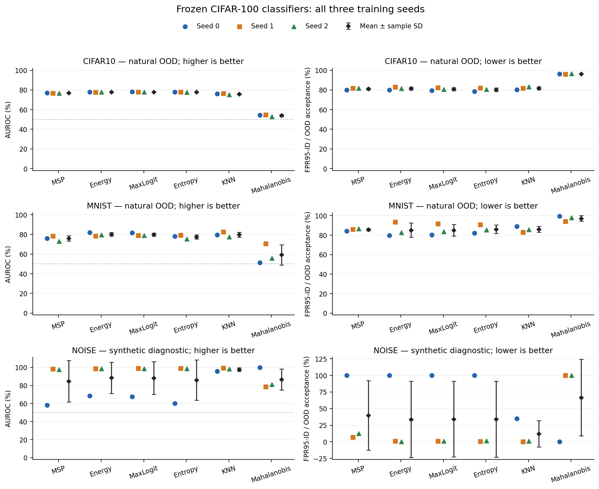

# Audited three-seed comparison

Colored points are the three independently trained classifiers, with identical data split and scoring protocol. Black diamonds and whiskers show mean and sample SD across training seeds; these are not confidence intervals and differ from the single-classifier sample bootstrap intervals in each seed report. Symmetric SD whiskers can extend outside the rate range; the plotted seed rates stay within 0–100%.

Synthetic diagnostics are labeled separately and excluded from the natural macro. All methods keep their original temperature, score direction and training-only feature fitting.

Input summary SHA-256: `77572b8e74b39f05360a70dfaac4485479f32292d3fb370e2538e46bdb5d1c7e`.

The independent audit passed for the exact summary plotted here. Figures are descriptive and do not establish statistical significance or select a method from OOD tests.
