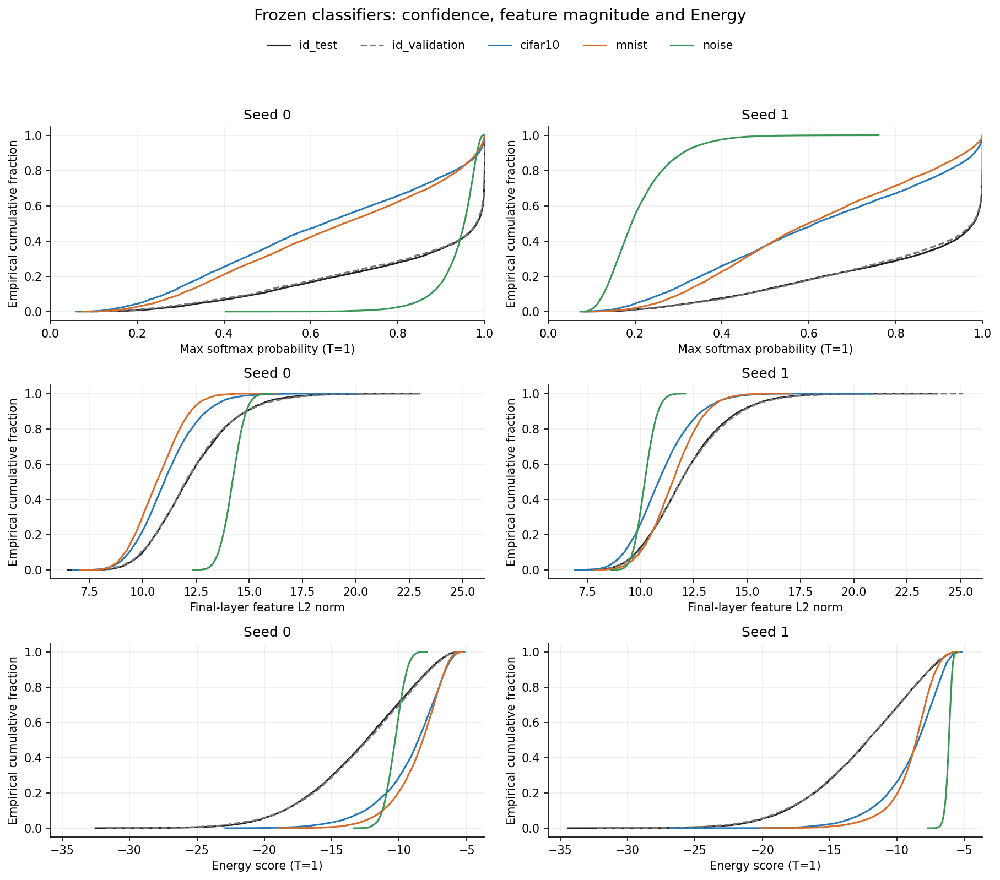

# Frozen-output distribution diagnostics

Described training seeds: [0, 1]; predeclared seeds: [0, 1, 2]. No across-seed mean/SD is inferred here.

This CPU analysis reads existing logits/features and changes no classifier, score, threshold, temperature or detector parameter. ID validation and test populations remain distinct. No ID-test or OOD features are used to fit a detector.

At T=1, Energy = -max(logit) + log(max softmax probability). It also equals -mean(logit) - logsumexp(logit - mean(logit)). Both identities are checked on every saved population. These decompositions describe logit magnitude and relative separation; they do not prove causation.

## Seed 0

ID test accuracy 76.11%; selected epoch 89.

| Population | Count | Median confidence | Confidence >=99% | Median feature norm | Median Energy | Median logit mean |
|---|---:|---:|---:|---:|---:|---:|
| id_test | 10000 | 0.9821 | 45.82% | 12.058 | -12.427 | 0.001 |
| id_validation | 5000 | 0.9807 | 44.18% | 12.015 | -12.355 | 0.001 |
| cifar10 | 10000 | 0.6309 | 8.72% | 11.011 | -8.583 | 0.001 |
| mnist | 10000 | 0.6756 | 6.98% | 10.655 | -8.244 | 0.001 |
| noise | 10000 | 0.9528 | 2.28% | 14.208 | -10.296 | 0.001 |

## Seed 1

ID test accuracy 75.56%; selected epoch 96.

| Population | Count | Median confidence | Confidence >=99% | Median feature norm | Median Energy | Median logit mean |
|---|---:|---:|---:|---:|---:|---:|
| id_test | 10000 | 0.9786 | 44.06% | 11.874 | -12.171 | 0.001 |
| id_validation | 5000 | 0.9769 | 43.48% | 11.875 | -12.170 | 0.001 |
| cifar10 | 10000 | 0.6150 | 7.22% | 10.834 | -8.418 | 0.001 |
| mnist | 10000 | 0.5995 | 4.24% | 11.496 | -8.577 | 0.001 |
| noise | 10000 | 0.1921 | 0.00% | 10.194 | -6.158 | 0.001 |

Feature magnitudes across independently trained networks have different coordinate scales. These descriptors do not explain a causal mechanism or define a fitted OOD detector. Synthetic populations are diagnostic only. Training-seed summary requires all predeclared seeds.

All quantiles, source-array SHA-256 values, environment and identity residuals are retained in diagnostics.json. OOD results remain descriptive and cannot select a hyperparameter. All data and artifacts remain local.
