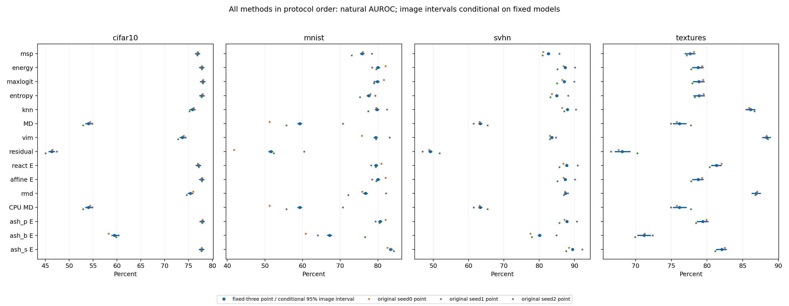
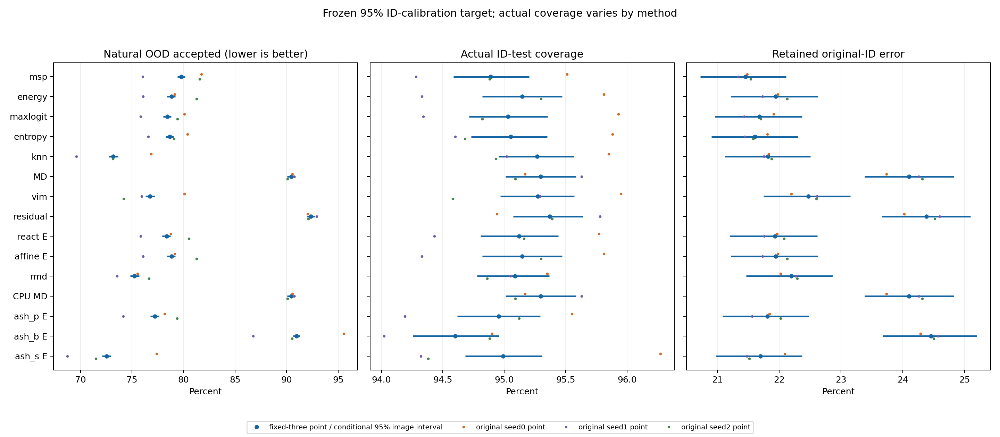

# Conditional paired image-bootstrap report

Conditional paired image sampling at fixed classifiers/thresholds; three training seeds are not resampled. Original seed SD is separate. Descriptive intervals, no significance/winner/population coverage guarantee. Noise outside natural macro; reused validation and posthoc scope remain limitations.

All 1,000 draws use identical ID/OOD image counts across methods and the three fixed models. Percentile intervals: [2.5%,97.5%], linear interpolation. The mean of three model metrics is computed inside each paired draw. Intervals are on the fixed-three mean; the seed SD column describes the original three model points, not the image interval.

## Natural four-population macro AUROC

| Method | Original point / conditional image interval (%) | Original 3-seed SD (pp) |
|---|---:|---:|
| msp | 78.2269 [77.7172, 78.6845] | 1.3178 |
| energy | 80.9734 [80.4863, 81.4101] | 0.7907 |
| maxlogit | 80.9528 [80.4690, 81.3932] | 0.8338 |
| entropy | 79.8034 [79.3137, 80.2579] | 1.2328 |
| knn | 82.4206 [81.9491, 82.8516] | 1.1062 |
| mahalanobis | 63.1860 [62.6364, 63.7473] | 2.1987 |
| vim | 81.2639 [80.7803, 81.7157] | 1.1957 |
| residual | 53.7971 [53.2616, 54.3436] | 2.2790 |
| react_energy | 81.4282 [80.9518, 81.8613] | 0.6737 |
| affine_energy | 80.9734 [80.4862, 81.4101] | 0.7907 |
| rmd | 81.6120 [81.1241, 82.0410] | 1.5655 |
| mahalanobis_cpu | 63.1860 [62.6364, 63.7473] | 2.1987 |
| ash_p_energy | 81.4221 [80.9364, 81.8634] | 0.7107 |
| ash_b_energy | 69.4789 [68.9032, 70.0565] | 2.2055 |
| ash_s_energy | 83.1554 [82.6876, 83.5626] | 0.7206 |

## cifar10: AUROC

ID n=10000, OOD n=10000, OOD prevalence=0.500000. AP depends on these proportions.

| Method | Original point / conditional image interval (%) | Original 3-seed SD (pp) |
|---|---:|---:|
| msp | 76.8574 [76.3128, 77.4053] | 0.0996 |
| energy | 77.7459 [77.1726, 78.2945] | 0.1276 |
| maxlogit | 77.9500 [77.3816, 78.4913] | 0.1237 |
| entropy | 77.8021 [77.2436, 78.3398] | 0.1326 |
| knn | 75.8244 [75.2098, 76.3611] | 0.5793 |
| mahalanobis | 54.0198 [53.3557, 54.6693] | 0.9944 |
| vim | 73.6935 [73.0775, 74.2922] | 0.8232 |
| residual | 46.3007 [45.6230, 46.9592] | 1.1924 |
| react_energy | 77.0556 [76.4766, 77.6045] | 0.0981 |
| affine_energy | 77.7459 [77.1726, 78.2945] | 0.1276 |
| rmd | 75.3669 [74.7713, 75.9582] | 0.7226 |
| mahalanobis_cpu | 54.0198 [53.3557, 54.6693] | 0.9944 |
| ash_p_energy | 77.8315 [77.2598, 78.3650] | 0.1060 |
| ash_b_energy | 59.4699 [58.7977, 60.1771] | 1.0865 |
| ash_s_energy | 77.7385 [77.1482, 78.2945] | 0.0248 |

## mnist: AUROC

ID n=10000, OOD n=10000, OOD prevalence=0.500000. AP depends on these proportions.

| Method | Original point / conditional image interval (%) | Original 3-seed SD (pp) |
|---|---:|---:|
| msp | 75.8432 [75.2437, 76.4003] | 2.6924 |
| energy | 80.0216 [79.4879, 80.5254] | 1.8303 |
| maxlogit | 79.8716 [79.3284, 80.4020] | 1.4722 |
| entropy | 77.5399 [76.9650, 78.0845] | 2.0826 |
| knn | 79.8000 [79.2073, 80.3378] | 2.5142 |
| mahalanobis | 59.2376 [58.6299, 59.8646] | 10.2104 |
| vim | 79.4441 [78.8848, 79.9668] | 3.6867 |
| residual | 51.5338 [50.9150, 52.1618] | 9.3365 |
| react_energy | 79.5267 [78.9934, 80.0514] | 1.3572 |
| affine_energy | 80.0216 [79.4879, 80.5254] | 1.8303 |
| rmd | 76.7228 [76.1068, 77.2985] | 5.0626 |
| mahalanobis_cpu | 59.2376 [58.6299, 59.8646] | 10.2104 |
| ash_p_energy | 80.6182 [80.0860, 81.1314] | 1.3443 |
| ash_b_energy | 67.1559 [66.5205, 67.7822] | 8.3611 |
| ash_s_energy | 83.4135 [82.9096, 83.8859] | 0.8422 |

## svhn: AUROC

ID n=10000, OOD n=26032, OOD prevalence=0.722469. AP depends on these proportions.

| Method | Original point / conditional image interval (%) | Original 3-seed SD (pp) |
|---|---:|---:|
| msp | 82.5844 [82.1451, 83.0126] | 2.6813 |
| energy | 87.3802 [86.9943, 87.7605] | 2.5143 |
| maxlogit | 87.1192 [86.7291, 87.5008] | 2.4906 |
| entropy | 84.9594 [84.5516, 85.3552] | 2.7841 |
| knn | 87.9858 [87.6050, 88.3504] | 2.0774 |
| mahalanobis | 63.3341 [62.7715, 63.8435] | 1.9611 |
| vim | 83.5919 [83.1198, 83.9961] | 1.0010 |
| residual | 49.2209 [48.6773, 49.7333] | 2.4047 |
| react_energy | 87.8020 [87.4272, 88.1789] | 2.7006 |
| affine_energy | 87.3802 [86.9943, 87.7605] | 2.5143 |
| rmd | 87.4445 [87.0518, 87.7959] | 0.6349 |
| mahalanobis_cpu | 63.3341 [62.7715, 63.8435] | 1.9611 |
| ash_p_energy | 87.8304 [87.4508, 88.2000] | 2.5334 |
| ash_b_energy | 80.1013 [79.5836, 80.6237] | 4.1455 |
| ash_s_energy | 89.4178 [89.0720, 89.7568] | 2.4230 |

## textures: AUROC

ID n=10000, OOD n=1880, OOD prevalence=0.158249. AP depends on these proportions.

| Method | Original point / conditional image interval (%) | Original 3-seed SD (pp) |
|---|---:|---:|
| msp | 77.6226 [76.8380, 78.3607] | 0.5119 |
| energy | 78.7460 [77.8955, 79.5267] | 0.8525 |
| maxlogit | 78.8705 [78.0068, 79.6523] | 0.8068 |
| entropy | 78.9123 [78.0810, 79.6927] | 0.6036 |
| knn | 86.0722 [85.3872, 86.7269] | 0.5144 |
| mahalanobis | 76.1527 [75.2108, 77.1098] | 1.4204 |
| vim | 88.3261 [87.7062, 88.9227] | 0.1786 |
| residual | 68.1329 [67.0600, 69.2751] | 1.8819 |
| react_energy | 81.3286 [80.5648, 82.0255] | 0.8557 |
| affine_energy | 78.7460 [77.8955, 79.5267] | 0.8525 |
| rmd | 86.9137 [86.2299, 87.5220] | 0.1367 |
| mahalanobis_cpu | 76.1527 [75.2108, 77.1098] | 1.4204 |
| ash_p_energy | 79.4082 [78.5615, 80.1762] | 0.8125 |
| ash_b_energy | 71.1884 [70.2426, 72.1368] | 1.2333 |
| ash_s_energy | 82.0518 [81.2380, 82.7489] | 0.7718 |

## noise: AUROC (noise diagnostic only)

ID n=10000, OOD n=10000, OOD prevalence=0.500000. AP depends on these proportions.

| Method | Original point / conditional image interval (%) | Original 3-seed SD (pp) |
|---|---:|---:|
| msp | 84.7285 [84.3880, 85.0454] | 23.0556 |
| energy | 88.5505 [88.2332, 88.8426] | 17.3069 |
| maxlogit | 88.3045 [88.0009, 88.5902] | 18.0633 |
| entropy | 85.9346 [85.6120, 86.2492] | 22.3355 |
| knn | 97.7504 [97.5793, 97.9116] | 1.9187 |
| mahalanobis | 86.5511 [86.1637, 86.9292] | 11.6858 |
| vim | 98.9571 [98.8367, 99.0618] | 0.9065 |
| residual | 83.1533 [82.7221, 83.5750] | 14.5708 |
| react_energy | 90.6196 [90.3167, 90.9088] | 13.7108 |
| affine_energy | 88.5505 [88.2332, 88.8426] | 17.3069 |
| rmd | 97.8204 [97.6637, 97.9672] | 2.0862 |
| mahalanobis_cpu | 86.5511 [86.1637, 86.9292] | 11.6858 |
| ash_p_energy | 89.4190 [89.1070, 89.7046] | 16.1396 |
| ash_b_energy | 82.8190 [82.3453, 83.3765] | 12.9186 |
| ash_s_energy | 92.5447 [92.2806, 92.8050] | 10.9781 |

## Frozen calibration target 0.8: id_coverage

| Method | Original point / conditional image interval (%) | Original 3-seed SD (pp) |
|---|---:|---:|
| msp | 80.6567 [80.0866, 81.2067] | 1.0335 |
| energy | 80.8733 [80.2732, 81.4733] | 0.4669 |
| maxlogit | 80.7700 [80.1566, 81.3901] | 0.7607 |
| entropy | 80.6833 [80.0700, 81.2901] | 1.0645 |
| knn | 80.6267 [79.9400, 81.2368] | 0.8424 |
| mahalanobis | 80.3833 [79.7832, 80.9633] | 0.4996 |
| vim | 80.8300 [80.1866, 81.4034] | 0.5499 |
| residual | 80.7033 [80.1198, 81.2667] | 0.2854 |
| react_energy | 80.9600 [80.3565, 81.5600] | 0.5373 |
| affine_energy | 80.8733 [80.2732, 81.4733] | 0.4669 |
| rmd | 81.0433 [80.4098, 81.6300] | 0.8458 |
| mahalanobis_cpu | 80.3833 [79.7832, 80.9633] | 0.4996 |
| ash_p_energy | 80.6133 [80.0198, 81.2000] | 0.5463 |
| ash_b_energy | 80.1900 [79.5666, 80.8602] | 0.6651 |
| ash_s_energy | 80.6633 [80.0465, 81.2734] | 1.0163 |

## Frozen calibration target 0.8: retained_error_risk

| Method | Original point / conditional image interval (%) | Original 3-seed SD (pp) |
|---|---:|---:|
| msp | 14.5078 [13.8931, 15.1316] | 0.2751 |
| energy | 16.3553 [15.6707, 17.0354] | 0.1225 |
| maxlogit | 15.9139 [15.2399, 16.5664] | 0.0813 |
| entropy | 14.8420 [14.2249, 15.4626] | 0.2785 |
| knn | 15.5570 [14.8965, 16.1716] | 0.0460 |
| mahalanobis | 23.2192 [22.4587, 23.9694] | 0.3588 |
| vim | 17.5437 [16.8304, 18.1712] | 0.1558 |
| residual | 24.6746 [23.9380, 25.4588] | 0.4911 |
| react_energy | 16.3789 [15.6687, 17.0647] | 0.1120 |
| affine_energy | 16.3553 [15.6707, 17.0354] | 0.1225 |
| rmd | 16.1672 [15.4696, 16.7750] | 0.1944 |
| mahalanobis_cpu | 23.2192 [22.4587, 23.9694] | 0.3588 |
| ash_p_energy | 16.1931 [15.5008, 16.8414] | 0.1216 |
| ash_b_energy | 23.1449 [22.3813, 23.9298] | 0.2848 |
| ash_s_energy | 15.6686 [14.9953, 16.3125] | 0.2239 |

## Frozen calibration target 0.8: natural_ood_acceptance_macro

| Method | Original point / conditional image interval (%) | Original 3-seed SD (pp) |
|---|---:|---:|
| msp | 46.7914 [46.3174, 47.2520] | 3.5532 |
| energy | 38.0914 [37.5939, 38.5804] | 1.5696 |
| maxlogit | 37.8989 [37.4126, 38.3996] | 2.0640 |
| entropy | 40.1393 [39.6429, 40.5974] | 3.1944 |
| knn | 34.2137 [33.7420, 34.7181] | 3.1908 |
| mahalanobis | 68.9145 [68.4476, 69.4217] | 2.6918 |
| vim | 40.0838 [39.6158, 40.4969] | 4.7751 |
| residual | 76.2758 [75.8034, 76.7553] | 1.6239 |
| react_energy | 37.2224 [36.7390, 37.6865] | 1.5548 |
| affine_energy | 38.0914 [37.5939, 38.5804] | 1.5696 |
| rmd | 37.3521 [36.8980, 37.7948] | 3.1782 |
| mahalanobis_cpu | 68.9145 [68.4476, 69.4217] | 2.6918 |
| ash_p_energy | 36.5703 [36.0643, 37.0392] | 1.4186 |
| ash_b_energy | 59.9659 [59.4881, 60.4338] | 5.6298 |
| ash_s_energy | 32.5780 [32.0777, 33.0637] | 3.5005 |

## Frozen calibration target 0.9: id_coverage

| Method | Original point / conditional image interval (%) | Original 3-seed SD (pp) |
|---|---:|---:|
| msp | 90.0867 [89.6565, 90.5103] | 0.4966 |
| energy | 90.6433 [90.1833, 91.0700] | 0.6413 |
| maxlogit | 90.5000 [90.0365, 90.9336] | 0.7308 |
| entropy | 90.4133 [89.9699, 90.8337] | 0.5270 |
| knn | 90.3000 [89.8567, 90.7401] | 0.7669 |
| mahalanobis | 90.7033 [90.2632, 91.0868] | 0.1060 |
| vim | 90.5367 [90.0932, 90.9800] | 0.9388 |
| residual | 90.7400 [90.3032, 91.1567] | 0.0819 |
| react_energy | 90.6200 [90.1633, 91.0634] | 0.6709 |
| affine_energy | 90.6433 [90.1833, 91.0700] | 0.6413 |
| rmd | 90.3933 [89.9600, 90.8167] | 0.6506 |
| mahalanobis_cpu | 90.7033 [90.2632, 91.0868] | 0.1060 |
| ash_p_energy | 90.6667 [90.2065, 91.0901] | 0.7845 |
| ash_b_energy | 89.9033 [89.4567, 90.4168] | 1.1113 |
| ash_s_energy | 90.4200 [89.9700, 90.8342] | 0.4493 |

## Frozen calibration target 0.9: retained_error_risk

| Method | Original point / conditional image interval (%) | Original 3-seed SD (pp) |
|---|---:|---:|
| msp | 18.9590 [18.2654, 19.6159] | 0.2637 |
| energy | 20.0273 [19.3176, 20.7140] | 0.0768 |
| maxlogit | 19.6754 [18.9663, 20.3330] | 0.0888 |
| entropy | 19.3811 [18.6656, 20.0466] | 0.0616 |
| knn | 19.5491 [18.8472, 20.2172] | 0.1852 |
| mahalanobis | 23.9202 [23.1695, 24.6425] | 0.3520 |
| vim | 20.8990 [20.1960, 21.5625] | 0.2196 |
| residual | 24.4067 [23.6731, 25.1256] | 0.3649 |
| react_energy | 20.0140 [19.3038, 20.7008] | 0.1130 |
| affine_energy | 20.0273 [19.3176, 20.7140] | 0.0768 |
| rmd | 20.3137 [19.6032, 20.9719] | 0.4344 |
| mahalanobis_cpu | 23.9202 [23.1695, 24.6425] | 0.3520 |
| ash_p_energy | 19.9884 [19.2878, 20.6646] | 0.1173 |
| ash_b_energy | 24.0650 [23.2841, 24.8213] | 0.1971 |
| ash_s_energy | 19.5271 [18.8464, 20.1920] | 0.1470 |

## Frozen calibration target 0.9: natural_ood_acceptance_macro

| Method | Original point / conditional image interval (%) | Original 3-seed SD (pp) |
|---|---:|---:|
| msp | 65.8069 [65.3633, 66.2235] | 2.0575 |
| energy | 63.3451 [62.8393, 63.8098] | 1.7229 |
| maxlogit | 62.9888 [62.4901, 63.4485] | 2.1597 |
| entropy | 62.9387 [62.4553, 63.4215] | 2.8846 |
| knn | 56.8577 [56.3429, 57.3811] | 4.8201 |
| mahalanobis | 83.2116 [82.7331, 83.6902] | 1.0677 |
| vim | 62.1293 [61.6138, 62.6043] | 4.8243 |
| residual | 86.9318 [86.4881, 87.3667] | 0.7880 |
| react_energy | 62.3595 [61.8687, 62.8433] | 1.5058 |
| affine_energy | 63.3451 [62.8393, 63.8098] | 1.7229 |
| rmd | 59.5726 [59.1101, 60.0681] | 2.3331 |
| mahalanobis_cpu | 83.2116 [82.7331, 83.6902] | 1.0677 |
| ash_p_energy | 62.1508 [61.6402, 62.6135] | 2.1678 |
| ash_b_energy | 79.9504 [79.5306, 80.3523] | 7.0139 |
| ash_s_energy | 56.0533 [55.5440, 56.5403] | 3.0755 |

## Frozen calibration target 0.95: id_coverage

| Method | Original point / conditional image interval (%) | Original 3-seed SD (pp) |
|---|---:|---:|
| msp | 94.8900 [94.5866, 95.2035] | 0.6151 |
| energy | 95.1467 [94.8200, 95.4700] | 0.7518 |
| maxlogit | 95.0300 [94.7132, 95.3533] | 0.8155 |
| entropy | 95.0533 [94.7300, 95.3500] | 0.7170 |
| knn | 95.2667 [94.9532, 95.5668] | 0.5072 |
| mahalanobis | 95.2967 [95.0100, 95.5834] | 0.2914 |
| vim | 95.2733 [94.9666, 95.5701] | 0.6852 |
| residual | 95.3700 [95.0733, 95.6400] | 0.4204 |
| react_energy | 95.1200 [94.8064, 95.4400] | 0.6709 |
| affine_energy | 95.1467 [94.8200, 95.4700] | 0.7518 |
| rmd | 95.0867 [94.7798, 95.3667] | 0.2470 |
| mahalanobis_cpu | 95.2967 [95.0100, 95.5834] | 0.2914 |
| ash_p_energy | 94.9533 [94.6164, 95.2933] | 0.6951 |
| ash_b_energy | 94.6000 [94.2567, 94.9567] | 0.5024 |
| ash_s_energy | 94.9900 [94.6833, 95.3067] | 1.1089 |

## Frozen calibration target 0.95: retained_error_risk

| Method | Original point / conditional image interval (%) | Original 3-seed SD (pp) |
|---|---:|---:|
| msp | 21.4561 [20.7273, 22.1161] | 0.1041 |
| energy | 21.9478 [21.2205, 22.6320] | 0.2010 |
| maxlogit | 21.6831 [20.9635, 22.3752] | 0.2401 |
| entropy | 21.6116 [20.9058, 22.3034] | 0.1825 |
| knn | 21.8229 [21.1181, 22.5068] | 0.0640 |
| mahalanobis | 24.1035 [23.3856, 24.8258] | 0.3190 |
| vim | 22.4731 [21.7504, 23.1564] | 0.2374 |
| residual | 24.3814 [23.6624, 25.0999] | 0.3105 |
| react_energy | 21.9367 [21.2033, 22.6187] | 0.1607 |
| affine_energy | 21.9478 [21.2205, 22.6320] | 0.2010 |
| rmd | 22.1975 [21.4676, 22.8682] | 0.1506 |
| mahalanobis_cpu | 24.1035 [23.3856, 24.8258] | 0.3190 |
| ash_p_energy | 21.8099 [21.0876, 22.4822] | 0.2327 |
| ash_b_energy | 24.4542 [23.6754, 25.1995] | 0.1469 |
| ash_s_energy | 21.6979 [20.9770, 22.3724] | 0.3437 |

## Frozen calibration target 0.95: natural_ood_acceptance_macro

| Method | Original point / conditional image interval (%) | Original 3-seed SD (pp) |
|---|---:|---:|
| msp | 79.7788 [79.4062, 80.1445] | 3.2493 |
| energy | 78.8258 [78.4097, 79.2001] | 2.5976 |
| maxlogit | 78.4386 [78.0202, 78.8003] | 2.2808 |
| entropy | 78.6711 [78.2759, 79.0502] | 1.9337 |
| knn | 73.1925 [72.7389, 73.6447] | 3.6214 |
| mahalanobis | 90.4597 [90.0530, 90.8453] | 0.3263 |
| vim | 76.7414 [76.3089, 77.2127] | 3.0380 |
| residual | 92.3495 [91.9600, 92.7090] | 0.4802 |
| react_energy | 78.3673 [77.9177, 78.7391] | 2.3702 |
| affine_energy | 78.8258 [78.4097, 79.2001] | 2.5976 |
| rmd | 75.2416 [74.8187, 75.7016] | 1.5652 |
| mahalanobis_cpu | 90.4597 [90.0530, 90.8453] | 0.3263 |
| ash_p_energy | 77.2363 [76.7964, 77.6195] | 2.7305 |
| ash_b_energy | 90.9467 [90.6268, 91.2604] | 4.4072 |
| ash_s_energy | 72.5390 [72.0932, 72.9414] | 4.4261 |

## Frozen calibration target 0.99: id_coverage

| Method | Original point / conditional image interval (%) | Original 3-seed SD (pp) |
|---|---:|---:|
| msp | 99.1833 [99.0699, 99.2901] | 0.2346 |
| energy | 98.9967 [98.8500, 99.1233] | 0.3513 |
| maxlogit | 99.0900 [98.9567, 99.2233] | 0.2751 |
| entropy | 98.9967 [98.8633, 99.1300] | 0.3625 |
| knn | 99.1367 [98.9967, 99.2633] | 0.1415 |
| mahalanobis | 99.2933 [99.1733, 99.4033] | 0.1185 |
| vim | 99.0700 [98.9333, 99.1900] | 0.1212 |
| residual | 99.1267 [98.9967, 99.2500] | 0.2902 |
| react_energy | 98.9933 [98.8467, 99.1200] | 0.3525 |
| affine_energy | 98.9967 [98.8500, 99.1233] | 0.3513 |
| rmd | 99.0667 [98.9367, 99.1867] | 0.2203 |
| mahalanobis_cpu | 99.2933 [99.1733, 99.4033] | 0.1185 |
| ash_p_energy | 99.0633 [98.9333, 99.1867] | 0.4104 |
| ash_b_energy | 98.8900 [98.7265, 99.0467] | 0.1852 |
| ash_s_energy | 99.0733 [98.9333, 99.2000] | 0.2458 |

## Frozen calibration target 0.99: retained_error_risk

| Method | Original point / conditional image interval (%) | Original 3-seed SD (pp) |
|---|---:|---:|
| msp | 23.7777 [23.0632, 24.4709] | 0.1963 |
| energy | 23.7552 [23.0349, 24.4605] | 0.0857 |
| maxlogit | 23.7362 [23.0230, 24.4329] | 0.1367 |
| entropy | 23.7146 [23.0104, 24.4293] | 0.1799 |
| knn | 23.7583 [23.0395, 24.4623] | 0.3257 |
| mahalanobis | 24.2579 [23.5275, 24.9770] | 0.3258 |
| vim | 23.8484 [23.1151, 24.5598] | 0.3039 |
| residual | 24.2787 [23.5627, 24.9981] | 0.3281 |
| react_energy | 23.7526 [23.0322, 24.4604] | 0.0839 |
| affine_energy | 23.7552 [23.0349, 24.4605] | 0.0857 |
| rmd | 23.8693 [23.1485, 24.5790] | 0.3398 |
| mahalanobis_cpu | 24.2579 [23.5275, 24.9770] | 0.3258 |
| ash_p_energy | 23.7660 [23.0600, 24.4702] | 0.1278 |
| ash_b_energy | 24.3870 [23.6465, 25.1066] | 0.2970 |
| ash_s_energy | 23.7435 [23.0383, 24.4553] | 0.2401 |

## Frozen calibration target 0.99: natural_ood_acceptance_macro

| Method | Original point / conditional image interval (%) | Original 3-seed SD (pp) |
|---|---:|---:|
| msp | 95.8530 [95.6595, 96.0148] | 1.3352 |
| energy | 95.3472 [95.1288, 95.5414] | 0.8438 |
| maxlogit | 95.4094 [95.2014, 95.5845] | 1.3239 |
| entropy | 95.0973 [94.8809, 95.2831] | 2.2946 |
| knn | 92.2333 [91.9483, 92.5009] | 0.2545 |
| mahalanobis | 97.2037 [96.9520, 97.4724] | 0.4277 |
| vim | 92.3709 [92.0141, 92.7296] | 0.5922 |
| residual | 97.2018 [96.9388, 97.4626] | 0.5078 |
| react_energy | 95.3009 [95.0793, 95.5029] | 0.8284 |
| affine_energy | 95.3472 [95.1288, 95.5414] | 0.8438 |
| rmd | 92.4411 [92.1231, 92.7493] | 0.8732 |
| mahalanobis_cpu | 97.2037 [96.9520, 97.4724] | 0.4277 |
| ash_p_energy | 94.8859 [94.6585, 95.0862] | 2.1021 |
| ash_b_energy | 99.3183 [99.1956, 99.4313] | 0.2168 |
| ash_s_energy | 92.7882 [92.5481, 93.0043] | 2.9970 |

## All 105 protocol pairs: later minus earlier

No subset selected by results. AUROC differences and fixed95 operating differences are percentage points. ID coverage and retained original-classifier risk changes accompany OOD acceptance differences. Full JSON retains every seed, all six ranking fields, all five datasets, all four targets and every pair.

| Pair (later minus earlier) | Natural AUROC delta (pp) | Fixed95 natural OOD acceptance delta (pp) | Fixed95 ID coverage delta (pp) | Fixed95 retained error delta (pp) |
|---|---:|---:|---:|---:|
| energy minus msp | 2.7465 [2.4994, 3.0281] | -0.9529 [-1.2793, -0.6303] | 0.2567 [0.0166, 0.5134] | 0.4917 [0.3401, 0.6596] |
| maxlogit minus msp | 2.7259 [2.5128, 2.9727] | -1.3402 [-1.6122, -1.0781] | 0.1400 [-0.0601, 0.3501] | 0.2270 [0.0867, 0.3626] |
| entropy minus msp | 1.5765 [1.4820, 1.6811] | -1.1077 [-1.3565, -0.8738] | 0.1633 [-0.0167, 0.3534] | 0.1554 [0.0352, 0.2795] |
| knn minus msp | 4.1937 [3.9252, 4.4755] | -6.5863 [-6.9934, -6.1625] | 0.3767 [0.0832, 0.6667] | 0.3668 [0.1583, 0.5649] |
| mahalanobis minus msp | -15.0408 [-15.7043, -14.3659] | 10.6809 [10.1393, 11.2475] | 0.4067 [-0.0268, 0.8267] | 2.6474 [2.4022, 2.8996] |
| vim minus msp | 3.0370 [2.6441, 3.4241] | -3.0374 [-3.5791, -2.4374] | 0.3833 [-0.0135, 0.7670] | 1.0170 [0.7577, 1.2755] |
| residual minus msp | -24.4298 [-25.1633, -23.6541] | 12.5707 [12.0177, 13.1540] | 0.4800 [0.0500, 0.8934] | 2.9253 [2.6791, 3.1763] |
| react_energy minus msp | 3.2013 [2.9592, 3.4717] | -1.4115 [-1.7388, -1.0802] | 0.2300 [-0.0168, 0.4802] | 0.4806 [0.3342, 0.6447] |
| affine_energy minus msp | 2.7465 [2.4994, 3.0281] | -0.9529 [-1.2793, -0.6303] | 0.2567 [0.0166, 0.5134] | 0.4917 [0.3401, 0.6596] |
| rmd minus msp | 3.3851 [3.0600, 3.6858] | -4.5372 [-5.0341, -3.9615] | 0.1967 [-0.1867, 0.5533] | 0.7414 [0.4885, 0.9839] |
| mahalanobis_cpu minus msp | -15.0408 [-15.7043, -14.3659] | 10.6809 [10.1393, 11.2475] | 0.4067 [-0.0268, 0.8267] | 2.6474 [2.4022, 2.8996] |
| ash_p_energy minus msp | 3.1952 [2.9551, 3.4598] | -2.5424 [-2.8762, -2.2120] | 0.0633 [-0.1734, 0.3068] | 0.3537 [0.1889, 0.5182] |
| ash_b_energy minus msp | -8.7480 [-9.4116, -8.0846] | 11.1679 [10.7049, 11.6061] | -0.2900 [-0.7333, 0.2035] | 2.9981 [2.7407, 3.2495] |
| ash_s_energy minus msp | 4.9285 [4.7294, 5.1605] | -7.2397 [-7.5498, -6.9402] | 0.1000 [-0.0967, 0.3067] | 0.2417 [0.1106, 0.3791] |
| maxlogit minus energy | -0.0206 [-0.0649, 0.0203] | -0.3873 [-0.5767, -0.2096] | -0.1167 [-0.2533, 0.0234] | -0.2647 [-0.3538, -0.1762] |
| entropy minus energy | -1.1700 [-1.3591, -1.0046] | -0.1547 [-0.3811, 0.0632] | -0.0933 [-0.2534, 0.0700] | -0.3362 [-0.4440, -0.2291] |
| knn minus energy | 1.4472 [1.1643, 1.7342] | -5.6334 [-6.0993, -5.1781] | 0.1200 [-0.1934, 0.4434] | -0.1248 [-0.3310, 0.0808] |
| mahalanobis minus energy | -17.7874 [-18.5166, -17.0684] | 11.6339 [11.0378, 12.2941] | 0.1500 [-0.3000, 0.5668] | 2.1557 [1.8960, 2.4090] |
| vim minus energy | 0.2905 [-0.1268, 0.7085] | -2.0845 [-2.6706, -1.4207] | 0.1267 [-0.3100, 0.5533] | 0.5254 [0.2519, 0.7859] |
| residual minus energy | -27.1763 [-27.9444, -26.3656] | 13.5237 [12.9229, 14.1647] | 0.2233 [-0.2269, 0.6767] | 2.4336 [2.1824, 2.6732] |
| react_energy minus energy | 0.4548 [0.3984, 0.5143] | -0.4585 [-0.5399, -0.3800] | -0.0267 [-0.0667, 0.0133] | -0.0111 [-0.0354, 0.0138] |
| affine_energy minus energy | 0.0000 [-0.0000, 0.0000] | 0.0000 [0.0000, 0.0000] | 0.0000 [0.0000, 0.0000] | 0.0000 [0.0000, 0.0000] |
| rmd minus energy | 0.6386 [0.2651, 0.9943] | -3.5842 [-4.1456, -2.9374] | -0.0600 [-0.4800, 0.3501] | 0.2498 [-0.0194, 0.4989] |
| mahalanobis_cpu minus energy | -17.7874 [-18.5166, -17.0684] | 11.6339 [11.0378, 12.2941] | 0.1500 [-0.3000, 0.5668] | 2.1557 [1.8960, 2.4090] |
| ash_p_energy minus energy | 0.4487 [0.4206, 0.4752] | -1.5895 [-1.7229, -1.4658] | -0.1933 [-0.2867, -0.1033] | -0.1379 [-0.2049, -0.0770] |
| ash_b_energy minus energy | -11.4945 [-12.0904, -10.8740] | 12.1208 [11.7281, 12.5709] | -0.5467 [-0.9834, -0.0833] | 2.5064 [2.2764, 2.7398] |
| ash_s_energy minus energy | 2.1820 [2.0545, 2.3103] | -6.2868 [-6.5566, -6.0195] | -0.1567 [-0.3434, 0.0267] | -0.2499 [-0.3702, -0.1264] |
| entropy minus maxlogit | -1.1494 [-1.2990, -1.0135] | 0.2325 [0.0781, 0.3911] | 0.0233 [-0.1033, 0.1433] | -0.0715 [-0.1521, 0.0089] |
| knn minus maxlogit | 1.4678 [1.1987, 1.7459] | -5.2461 [-5.6898, -4.8062] | 0.2367 [-0.0668, 0.5368] | 0.1399 [-0.0634, 0.3499] |
| mahalanobis minus maxlogit | -17.7668 [-18.4860, -17.0476] | 12.0211 [11.4273, 12.6581] | 0.2667 [-0.1767, 0.6969] | 2.4204 [2.1648, 2.6787] |
| vim minus maxlogit | 0.3111 [-0.1083, 0.7201] | -1.6972 [-2.2886, -1.0879] | 0.2433 [-0.2001, 0.6568] | 0.7901 [0.5106, 1.0463] |
| residual minus maxlogit | -27.1557 [-27.9133, -26.3541] | 13.9109 [13.3287, 14.5536] | 0.3400 [-0.0903, 0.7802] | 2.6983 [2.4363, 2.9371] |
| react_energy minus maxlogit | 0.4754 [0.4071, 0.5499] | -0.0713 [-0.2509, 0.1233] | 0.0900 [-0.0533, 0.2300] | 0.2536 [0.1677, 0.3458] |
| affine_energy minus maxlogit | 0.0206 [-0.0203, 0.0649] | 0.3873 [0.2096, 0.5767] | 0.1167 [-0.0234, 0.2533] | 0.2647 [0.1762, 0.3538] |
| rmd minus maxlogit | 0.6592 [0.3080, 0.9991] | -3.1970 [-3.7481, -2.5602] | 0.0567 [-0.3302, 0.4501] | 0.5145 [0.2418, 0.7657] |
| mahalanobis_cpu minus maxlogit | -17.7668 [-18.4860, -17.0476] | 12.0211 [11.4273, 12.6581] | 0.2667 [-0.1767, 0.6969] | 2.4204 [2.1648, 2.6787] |
| ash_p_energy minus maxlogit | 0.4692 [0.4274, 0.5161] | -1.2022 [-1.3712, -1.0314] | -0.0767 [-0.2067, 0.0633] | 0.1268 [0.0404, 0.2189] |
| ash_b_energy minus maxlogit | -11.4740 [-12.0787, -10.8541] | 12.5081 [12.0940, 12.9670] | -0.4300 [-0.8801, 0.0468] | 2.7711 [2.5264, 3.0138] |
| ash_s_energy minus maxlogit | 2.2026 [2.0833, 2.3115] | -5.8995 [-6.1315, -5.6471] | -0.0400 [-0.2133, 0.1400] | 0.0148 [-0.0961, 0.1294] |
| knn minus entropy | 2.6172 [2.3785, 2.8554] | -5.4786 [-5.9328, -5.0474] | 0.2133 [-0.0635, 0.5034] | 0.2114 [0.0119, 0.4020] |
| mahalanobis minus entropy | -16.6174 [-17.2999, -15.9172] | 11.7886 [11.1799, 12.4496] | 0.2433 [-0.1968, 0.6667] | 2.4919 [2.2366, 2.7306] |
| vim minus entropy | 1.4605 [1.0743, 1.8435] | -1.9297 [-2.5008, -1.3248] | 0.2200 [-0.2067, 0.6101] | 0.8616 [0.5788, 1.1218] |
| residual minus entropy | -26.0063 [-26.7544, -25.2535] | 13.6784 [13.0630, 14.3093] | 0.3167 [-0.1138, 0.7501] | 2.7698 [2.5055, 2.9991] |
| react_energy minus entropy | 1.6248 [1.4576, 1.8102] | -0.3038 [-0.5281, -0.0658] | 0.0667 [-0.0933, 0.2301] | 0.3251 [0.2207, 0.4321] |
| affine_energy minus entropy | 1.1700 [1.0046, 1.3591] | 0.1547 [-0.0632, 0.3811] | 0.0933 [-0.0700, 0.2534] | 0.3362 [0.2291, 0.4440] |
| rmd minus entropy | 1.8086 [1.4997, 2.1104] | -3.4295 [-3.9827, -2.8313] | 0.0333 [-0.3534, 0.4400] | 0.5860 [0.3351, 0.8325] |
| mahalanobis_cpu minus entropy | -16.6174 [-17.2999, -15.9172] | 11.7886 [11.1799, 12.4496] | 0.2433 [-0.1968, 0.6667] | 2.4919 [2.2366, 2.7306] |
| ash_p_energy minus entropy | 1.6187 [1.4616, 1.7942] | -1.4348 [-1.6452, -1.2170] | -0.1000 [-0.2633, 0.0667] | 0.1983 [0.0899, 0.3087] |
| ash_b_energy minus entropy | -10.3246 [-10.9504, -9.6638] | 12.2756 [11.8347, 12.7249] | -0.4533 [-0.8968, 0.0067] | 2.8426 [2.5939, 3.0971] |
| ash_s_energy minus entropy | 3.3520 [3.2100, 3.5058] | -6.1321 [-6.3733, -5.8864] | -0.0633 [-0.2233, 0.1000] | 0.0863 [-0.0295, 0.1949] |
| mahalanobis minus knn | -19.2346 [-19.7750, -18.6768] | 17.2672 [16.7511, 17.8069] | 0.0300 [-0.3736, 0.4433] | 2.2806 [2.0508, 2.5199] |
| vim minus knn | -1.1567 [-1.3925, -0.9306] | 3.5489 [3.1396, 4.0069] | 0.0067 [-0.2901, 0.3167] | 0.6502 [0.4639, 0.8592] |
| residual minus knn | -28.6235 [-29.2585, -27.9620] | 19.1570 [18.6195, 19.7063] | 0.1033 [-0.3201, 0.5301] | 2.5584 [2.3312, 2.7935] |
| react_energy minus knn | -0.9924 [-1.2712, -0.7145] | 5.1748 [4.7128, 5.6277] | -0.1467 [-0.4700, 0.1701] | 0.1138 [-0.0947, 0.3165] |
| affine_energy minus knn | -1.4472 [-1.7342, -1.1643] | 5.6334 [5.1781, 6.0993] | -0.1200 [-0.4434, 0.1934] | 0.1248 [-0.0808, 0.3310] |
| rmd minus knn | -0.8086 [-1.0363, -0.5797] | 2.0491 [1.6420, 2.5248] | -0.1800 [-0.4834, 0.1302] | 0.3746 [0.1701, 0.5875] |
| mahalanobis_cpu minus knn | -19.2346 [-19.7750, -18.6768] | 17.2672 [16.7511, 17.8069] | 0.0300 [-0.3736, 0.4433] | 2.2806 [2.0508, 2.5199] |
| ash_p_energy minus knn | -0.9985 [-1.2723, -0.7269] | 4.0439 [3.5839, 4.4944] | -0.3133 [-0.6134, 0.0033] | -0.0131 [-0.2075, 0.1855] |
| ash_b_energy minus knn | -12.9417 [-13.6569, -12.2129] | 17.7542 [17.1896, 18.2962] | -0.6667 [-1.1467, -0.1631] | 2.6313 [2.3830, 2.8957] |
| ash_s_energy minus knn | 0.7348 [0.4864, 0.9608] | -0.6534 [-1.0858, -0.2390] | -0.2767 [-0.5300, -0.0000] | -0.1251 [-0.3022, 0.0594] |
| vim minus mahalanobis | 18.0778 [17.5806, 18.5311] | -13.7183 [-14.0880, -13.3245] | -0.0233 [-0.3668, 0.3033] | -1.6303 [-1.8106, -1.4583] |
| residual minus mahalanobis | -9.3889 [-9.6008, -9.1893] | 1.8898 [1.7132, 2.0673] | 0.0733 [-0.0967, 0.2401] | 0.2779 [0.2056, 0.3513] |
| react_energy minus mahalanobis | 18.2422 [17.5331, 18.9579] | -12.0924 [-12.7423, -11.5074] | -0.1767 [-0.5868, 0.2636] | -2.1668 [-2.4132, -1.9110] |
| affine_energy minus mahalanobis | 17.7874 [17.0684, 18.5166] | -11.6339 [-12.2941, -11.0378] | -0.1500 [-0.5668, 0.3000] | -2.1557 [-2.4090, -1.8960] |
| rmd minus mahalanobis | 18.4259 [17.8975, 18.9194] | -15.2181 [-15.6243, -14.7999] | -0.2100 [-0.5636, 0.1367] | -1.9059 [-2.0860, -1.7236] |
| mahalanobis_cpu minus mahalanobis | 0.0000 [0.0000, 0.0000] | 0.0000 [0.0000, 0.0000] | 0.0000 [0.0000, 0.0000] | 0.0000 [0.0000, 0.0000] |
| ash_p_energy minus mahalanobis | 18.2360 [17.5113, 18.9520] | -13.2234 [-13.8860, -12.6180] | -0.3433 [-0.7767, 0.1134] | -2.2936 [-2.5509, -2.0272] |
| ash_b_energy minus mahalanobis | 6.2928 [5.3346, 7.2460] | 0.4870 [-0.0514, 1.0372] | -0.6967 [-1.1468, -0.1899] | 0.3507 [0.1669, 0.5457] |
| ash_s_energy minus mahalanobis | 19.9694 [19.2668, 20.6317] | -17.9207 [-18.5876, -17.3046] | -0.3067 [-0.7135, 0.1335] | -2.4056 [-2.6651, -2.1580] |
| residual minus vim | -27.4668 [-28.0178, -26.9144] | 15.6081 [15.2081, 16.0081] | 0.0967 [-0.2301, 0.4302] | 1.9082 [1.7267, 2.0923] |
| react_energy minus vim | 0.1644 [-0.2471, 0.5595] | 1.6259 [0.9564, 2.2094] | -0.1533 [-0.5771, 0.2900] | -0.5365 [-0.7951, -0.2623] |
| affine_energy minus vim | -0.2905 [-0.7085, 0.1268] | 2.0845 [1.4207, 2.6706] | -0.1267 [-0.5533, 0.3100] | -0.5254 [-0.7859, -0.2519] |
| rmd minus vim | 0.3481 [0.1041, 0.5986] | -1.4998 [-1.8536, -1.1306] | -0.1867 [-0.4501, 0.1001] | -0.2756 [-0.4517, -0.1156] |
| mahalanobis_cpu minus vim | -18.0778 [-18.5311, -17.5806] | 13.7183 [13.3245, 14.0880] | 0.0233 [-0.3033, 0.3668] | 1.6303 [1.4583, 1.8106] |
| ash_p_energy minus vim | 0.1582 [-0.2434, 0.5576] | 0.4949 [-0.1665, 1.0943] | -0.3200 [-0.7401, 0.1102] | -0.6633 [-0.9294, -0.3912] |
| ash_b_energy minus vim | -11.7850 [-12.5472, -11.0544] | 14.2053 [13.6213, 14.7541] | -0.6733 [-1.1036, -0.1366] | 1.9811 [1.7542, 2.2172] |
| ash_s_energy minus vim | 1.8915 [1.5159, 2.2752] | -4.2023 [-4.8446, -3.6404] | -0.2833 [-0.6800, 0.1068] | -0.7753 [-1.0306, -0.5181] |
| react_energy minus residual | 27.6311 [26.8324, 28.3876] | -13.9822 [-14.6177, -13.3881] | -0.2500 [-0.6839, 0.2003] | -2.4447 [-2.6854, -2.1837] |
| affine_energy minus residual | 27.1763 [26.3656, 27.9444] | -13.5237 [-14.1647, -12.9229] | -0.2233 [-0.6767, 0.2269] | -2.4336 [-2.6732, -2.1824] |
| rmd minus residual | 27.8149 [27.1881, 28.4191] | -17.1079 [-17.5335, -16.6589] | -0.2833 [-0.6534, 0.0701] | -2.1838 [-2.3790, -1.9970] |
| mahalanobis_cpu minus residual | 9.3889 [9.1893, 9.6008] | -1.8898 [-2.0673, -1.7132] | -0.0733 [-0.2401, 0.0967] | -0.2779 [-0.3513, -0.2056] |
| ash_p_energy minus residual | 27.6250 [26.8198, 28.3837] | -15.1132 [-15.7497, -14.5207] | -0.4167 [-0.8835, 0.0335] | -2.5715 [-2.8107, -2.3120] |
| ash_b_energy minus residual | 15.6818 [14.6843, 16.6556] | -1.4028 [-1.9232, -0.8890] | -0.7700 [-1.2200, -0.2733] | 0.0728 [-0.1140, 0.2629] |
| ash_s_energy minus residual | 29.3583 [28.5889, 30.0760] | -19.8105 [-20.4597, -19.2197] | -0.3800 [-0.8067, 0.0567] | -2.6835 [-2.9281, -2.4419] |
| affine_energy minus react_energy | -0.4548 [-0.5143, -0.3984] | 0.4585 [0.3800, 0.5399] | 0.0267 [-0.0133, 0.0667] | 0.0111 [-0.0138, 0.0354] |
| rmd minus react_energy | 0.1838 [-0.1830, 0.5279] | -3.1257 [-3.6903, -2.4637] | -0.0333 [-0.4534, 0.3701] | 0.2609 [-0.0102, 0.5033] |
| mahalanobis_cpu minus react_energy | -18.2422 [-18.9579, -17.5331] | 12.0924 [11.5074, 12.7423] | 0.1767 [-0.2636, 0.5868] | 2.1668 [1.9110, 2.4132] |
| ash_p_energy minus react_energy | -0.0062 [-0.0654, 0.0488] | -1.1310 [-1.2586, -1.0034] | -0.1667 [-0.2601, -0.0733] | -0.1268 [-0.1937, -0.0662] |
| ash_b_energy minus react_energy | -11.9494 [-12.5464, -11.3315] | 12.5794 [12.1797, 13.0296] | -0.5200 [-0.9467, -0.0599] | 2.5175 [2.2850, 2.7468] |
| ash_s_energy minus react_energy | 1.7272 [1.6002, 1.8496] | -5.8283 [-6.0928, -5.5661] | -0.1300 [-0.3233, 0.0601] | -0.2388 [-0.3609, -0.1154] |
| rmd minus affine_energy | 0.6386 [0.2651, 0.9943] | -3.5842 [-4.1456, -2.9374] | -0.0600 [-0.4800, 0.3501] | 0.2498 [-0.0194, 0.4989] |
| mahalanobis_cpu minus affine_energy | -17.7874 [-18.5166, -17.0684] | 11.6339 [11.0378, 12.2941] | 0.1500 [-0.3000, 0.5668] | 2.1557 [1.8960, 2.4090] |
| ash_p_energy minus affine_energy | 0.4487 [0.4206, 0.4752] | -1.5895 [-1.7229, -1.4658] | -0.1933 [-0.2867, -0.1033] | -0.1379 [-0.2049, -0.0770] |
| ash_b_energy minus affine_energy | -11.4946 [-12.0904, -10.8740] | 12.1208 [11.7281, 12.5709] | -0.5467 [-0.9834, -0.0833] | 2.5064 [2.2764, 2.7398] |
| ash_s_energy minus affine_energy | 2.1820 [2.0545, 2.3103] | -6.2868 [-6.5566, -6.0195] | -0.1567 [-0.3434, 0.0267] | -0.2499 [-0.3702, -0.1264] |
| mahalanobis_cpu minus rmd | -18.4259 [-18.9194, -17.8975] | 15.2181 [14.7999, 15.6243] | 0.2100 [-0.1367, 0.5636] | 1.9059 [1.7236, 2.0860] |
| ash_p_energy minus rmd | -0.1899 [-0.5487, 0.1715] | 1.9947 [1.3514, 2.5666] | -0.1333 [-0.5367, 0.2802] | -0.3877 [-0.6340, -0.1149] |
| ash_b_energy minus rmd | -12.1331 [-12.8650, -11.4046] | 15.7051 [15.1086, 16.2328] | -0.4867 [-0.9267, -0.0132] | 2.2567 [2.0362, 2.4982] |
| ash_s_energy minus rmd | 1.5434 [1.2277, 1.8617] | -2.7026 [-3.3240, -2.1635] | -0.0967 [-0.4834, 0.2767] | -0.4997 [-0.7464, -0.2391] |
| ash_p_energy minus mahalanobis_cpu | 18.2360 [17.5113, 18.9520] | -13.2234 [-13.8860, -12.6180] | -0.3433 [-0.7767, 0.1134] | -2.2936 [-2.5509, -2.0272] |
| ash_b_energy minus mahalanobis_cpu | 6.2928 [5.3346, 7.2460] | 0.4870 [-0.0514, 1.0372] | -0.6967 [-1.1468, -0.1899] | 0.3507 [0.1669, 0.5457] |
| ash_s_energy minus mahalanobis_cpu | 19.9694 [19.2668, 20.6317] | -17.9207 [-18.5876, -17.3046] | -0.3067 [-0.7135, 0.1335] | -2.4056 [-2.6651, -2.1580] |
| ash_b_energy minus ash_p_energy | -11.9432 [-12.5286, -11.3243] | 13.7103 [13.3130, 14.1532] | -0.3533 [-0.8034, 0.1068] | 2.6443 [2.4031, 2.8844] |
| ash_s_energy minus ash_p_energy | 1.7333 [1.6208, 1.8394] | -4.6973 [-4.9395, -4.4668] | 0.0367 [-0.1467, 0.2100] | -0.1120 [-0.2415, 0.0032] |
| ash_s_energy minus ash_b_energy | 13.6765 [13.0806, 14.2371] | -18.4076 [-18.8243, -17.9719] | 0.3900 [-0.0700, 0.8335] | -2.7563 [-2.9917, -2.5071] |

## Artifacts and interpretation

Raw draw counts and metric/count tensors are in runs/paired-bootstrap/analysis/block-000 through block-009. Preflight, row-alignment, raw-audit and regression evidence remain local. summary.json includes all 31,680 statistic records; None retains undefined intervals without dropping draws. No training, detector fitting, threshold recalibration or OOD-test tuning occurred.

