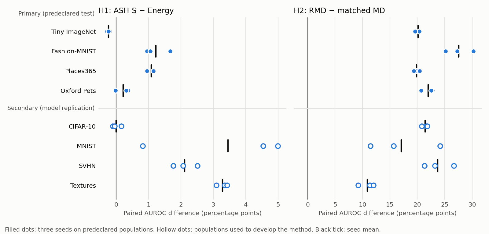

# ASH-S / RMD contrast confirmation

Predeclared test of two exploratory post-hoc methods on four populations where these method × population pairs had never been scored. The [frozen protocol](../../docs/POSTHOC_CONFIRMATION.md) and declaration (SHA-256 `831483f8b068dbdb3a5d1c94bbcd7789f9de16c9a9309600615d92dc401cd331`) were committed before scoring. The same three ID-isolated CIFAR-100 classifiers, their 45,000 training-ID features and their 1,500-row ID threshold role were reused. No OOD row fitted anything.

## Decisions

| Hypothesis | Tiny ImageNet | Fashion-MNIST | Places365 | Oxford Pets | Overall |
|---|---|---|---|---|---|
| H1 ASH-S > Energy | contradicted | supported | supported | mixed | **not confirmed** |
| H2 RMD > matched MD | supported | supported | supported | supported | **confirmed** |

"Supported" means all three seed differences are positive, "contradicted" means all are negative, and "mixed" covers everything else. The rule was fixed before scoring.

## Paired AUROC differences

Each cell is the mean ± sample SD over three training seeds, in percentage points. Seed points are in [contrasts.csv](contrasts.csv).

| Population | Role | ASH-S − Energy | RMD − matched MD | ASH-S − KNN | RMD − KNN | RMD − Energy |
|---|---|---:|---:|---:|---:|---:|
| Tiny ImageNet | primary | -0.24 ± 0.04 | +20.14 ± 0.48 | -1.47 ± 0.13 | -1.23 ± 0.31 | +0.00 ± 0.43 |
| Fashion-MNIST | primary | +1.23 ± 0.39 | +27.56 ± 2.54 | +1.16 ± 0.78 | -2.42 ± 1.17 | -2.35 ± 1.20 |
| Places365 | primary | +1.09 ± 0.12 | +19.89 ± 0.55 | +1.45 ± 0.09 | +3.78 ± 1.00 | +3.41 ± 1.00 |
| Oxford Pets | primary | +0.22 ± 0.21 | +21.99 ± 1.15 | -1.74 ± 0.56 | -5.01 ± 0.60 | -3.05 ± 0.32 |
| CIFAR-10 | replication | -0.00 ± 0.14 | +21.42 ± 0.56 | +1.96 ± 0.61 | -0.48 ± 0.16 | -2.44 ± 0.61 |
| MNIST | replication | +3.45 ± 2.29 | +17.09 ± 6.48 | +3.58 ± 2.43 | -2.94 ± 2.39 | -3.07 ± 5.86 |
| SVHN | replication | +2.11 ± 0.38 | +23.72 ± 2.72 | +1.12 ± 0.83 | -0.58 ± 1.45 | +0.42 ± 2.15 |
| Textures | replication | +3.29 ± 0.17 | +10.86 ± 1.46 | -3.97 ± 1.22 | +0.80 ± 0.59 | +8.06 ± 0.81 |

## Fixed 95% ID-validation operating point

OOD acceptance difference at each method's own frozen 1,500-row ID threshold (lower is better), with the accompanying ID-test acceptance difference. These are not equal-coverage comparisons.

| Population | ASH-S − Energy: OOD | ASH-S − Energy: ID test | RMD − MD: OOD | RMD − MD: ID test |
|---|---:|---:|---:|---:|
| Tiny ImageNet | +0.55 ± 1.08 | +0.15 ± 0.22 | -11.96 ± 0.62 | +0.24 ± 0.55 |
| Fashion-MNIST | -8.94 ± 3.20 | +0.15 ± 0.22 | -28.36 ± 1.28 | +0.24 ± 0.55 |
| Places365 | -1.84 ± 0.98 | +0.15 ± 0.22 | -17.35 ± 1.38 | +0.24 ± 0.55 |
| Oxford Pets | -0.57 ± 1.19 | +0.15 ± 0.22 | -6.11 ± 0.66 | +0.24 ± 0.55 |
| CIFAR-10 | -0.32 ± 0.84 | +0.15 ± 0.22 | -8.97 ± 0.58 | +0.24 ± 0.55 |
| MNIST | -6.51 ± 4.13 | +0.15 ± 0.22 | -7.58 ± 7.99 | +0.24 ± 0.55 |
| SVHN | -9.06 ± 2.63 | +0.15 ± 0.22 | -24.62 ± 0.42 | +0.24 ± 0.55 |
| Textures | -4.75 ± 1.12 | +0.15 ± 0.22 | -12.62 ± 1.36 | +0.24 ± 0.55 |

## AUROC and fixed-95% OOD acceptance by method

Mean ± sample SD over three seeds, in percent. The full AUPR, FPR95-ID and all four targets are in [metrics.csv](metrics.csv) and [summary.json](summary.json).

### Tiny ImageNet (primary)

| Method | AUROC | Fixed95 OOD accepted | Fixed95 ID-test accepted |
|---|---:|---:|---:|
| ASH-P | 78.99 ± 0.31 | 78.71 ± 2.53 | 95.23 ± 0.90 |
| ASH-B | 59.84 ± 0.61 | 96.39 ± 1.02 | 94.64 ± 0.36 |
| ASH-S | 78.70 ± 0.30 | 79.35 ± 1.17 | 95.33 ± 0.68 |
| RMD | 78.95 ± 0.16 | 82.86 ± 1.15 | 95.50 ± 0.49 |
| Matched CPU MD | 58.81 ± 0.45 | 94.82 ± 0.67 | 95.26 ± 0.40 |
| Energy (T=1) | 78.95 ± 0.33 | 78.80 ± 2.25 | 95.18 ± 0.75 |
| Pooled Mahalanobis (saved) | 58.81 ± 0.45 | 94.82 ± 0.67 | 95.26 ± 0.40 |
| KNN-50 | 80.17 ± 0.28 | 78.65 ± 2.75 | 95.53 ± 0.72 |

### Fashion-MNIST (primary)

| Method | AUROC | Fixed95 OOD accepted | Fixed95 ID-test accepted |
|---|---:|---:|---:|
| ASH-P | 90.74 ± 0.30 | 56.64 ± 6.07 | 95.23 ± 0.90 |
| ASH-B | 78.23 ± 2.46 | 86.04 ± 6.55 | 94.64 ± 0.36 |
| ASH-S | 91.64 ± 0.51 | 49.81 ± 4.78 | 95.33 ± 0.68 |
| RMD | 88.07 ± 1.09 | 69.37 ± 1.74 | 95.50 ± 0.49 |
| Matched CPU MD | 60.51 ± 2.72 | 97.72 ± 0.78 | 95.26 ± 0.40 |
| Energy (T=1) | 90.42 ± 0.16 | 58.76 ± 5.65 | 95.18 ± 0.75 |
| Pooled Mahalanobis (saved) | 60.51 ± 2.72 | 97.72 ± 0.78 | 95.26 ± 0.40 |
| KNN-50 | 90.48 ± 0.44 | 54.00 ± 1.20 | 95.53 ± 0.72 |

### Places365 (primary)

| Method | AUROC | Fixed95 OOD accepted | Fixed95 ID-test accepted |
|---|---:|---:|---:|
| ASH-P | 76.10 ± 0.84 | 83.20 ± 1.50 | 95.23 ± 0.90 |
| ASH-B | 65.32 ± 2.04 | 94.30 ± 1.57 | 94.64 ± 0.36 |
| ASH-S | 77.01 ± 0.92 | 81.59 ± 0.15 | 95.33 ± 0.68 |
| RMD | 79.34 ± 0.17 | 77.34 ± 1.16 | 95.50 ± 0.49 |
| Matched CPU MD | 59.45 ± 0.48 | 94.69 ± 0.56 | 95.26 ± 0.40 |
| Energy (T=1) | 75.93 ± 0.85 | 83.43 ± 1.08 | 95.18 ± 0.75 |
| Pooled Mahalanobis (saved) | 59.45 ± 0.48 | 94.69 ± 0.56 | 95.26 ± 0.40 |
| KNN-50 | 75.56 ± 0.84 | 81.62 ± 1.70 | 95.53 ± 0.72 |

### Oxford Pets (primary)

| Method | AUROC | Fixed95 OOD accepted | Fixed95 ID-test accepted |
|---|---:|---:|---:|
| ASH-P | 81.82 ± 0.77 | 76.02 ± 2.21 | 95.23 ± 0.90 |
| ASH-B | 57.81 ± 0.97 | 97.68 ± 1.23 | 94.64 ± 0.36 |
| ASH-S | 81.82 ± 0.64 | 76.19 ± 1.14 | 95.33 ± 0.68 |
| RMD | 78.55 ± 0.69 | 89.77 ± 0.42 | 95.50 ± 0.49 |
| Matched CPU MD | 56.56 ± 0.63 | 95.88 ± 0.49 | 95.26 ± 0.40 |
| Energy (T=1) | 81.60 ± 0.78 | 76.76 ± 2.01 | 95.18 ± 0.75 |
| Pooled Mahalanobis (saved) | 56.56 ± 0.63 | 95.88 ± 0.49 | 95.26 ± 0.40 |
| KNN-50 | 83.56 ± 0.09 | 79.52 ± 1.82 | 95.53 ± 0.72 |

### CIFAR-10 (secondary model replication)

| Method | AUROC | Fixed95 OOD accepted | Fixed95 ID-test accepted |
|---|---:|---:|---:|
| ASH-P | 77.88 ± 0.28 | 82.09 ± 1.44 | 95.23 ± 0.90 |
| ASH-B | 59.64 ± 1.04 | 97.28 ± 0.96 | 94.64 ± 0.36 |
| ASH-S | 77.80 ± 0.21 | 82.08 ± 0.53 | 95.33 ± 0.68 |
| RMD | 75.35 ± 0.75 | 87.58 ± 0.62 | 95.50 ± 0.49 |
| Matched CPU MD | 53.93 ± 1.11 | 96.55 ± 0.10 | 95.26 ± 0.40 |
| Energy (T=1) | 77.80 ± 0.28 | 82.40 ± 1.32 | 95.18 ± 0.75 |
| Pooled Mahalanobis (saved) | 53.93 ± 1.11 | 96.55 ± 0.10 | 95.26 ± 0.40 |
| KNN-50 | 75.84 ± 0.76 | 83.51 ± 2.29 | 95.53 ± 0.72 |

### MNIST (secondary model replication)

| Method | AUROC | Fixed95 OOD accepted | Fixed95 ID-test accepted |
|---|---:|---:|---:|
| ASH-P | 80.13 ± 0.92 | 85.79 ± 3.92 | 95.23 ± 0.90 |
| ASH-B | 66.92 ± 8.04 | 95.89 ± 5.28 | 94.64 ± 0.36 |
| ASH-S | 82.98 ± 0.92 | 80.40 ± 3.62 | 95.33 ± 0.68 |
| RMD | 76.46 ± 5.01 | 89.94 ± 10.00 | 95.50 ± 0.49 |
| Matched CPU MD | 59.36 ± 10.44 | 97.52 ± 2.26 | 95.26 ± 0.40 |
| Energy (T=1) | 79.52 ± 1.39 | 86.91 ± 4.47 | 95.18 ± 0.75 |
| Pooled Mahalanobis (saved) | 59.36 ± 10.44 | 97.52 ± 2.26 | 95.26 ± 0.40 |
| KNN-50 | 79.39 ± 2.64 | 87.78 ± 5.91 | 95.53 ± 0.72 |

### SVHN (secondary model replication)

| Method | AUROC | Fixed95 OOD accepted | Fixed95 ID-test accepted |
|---|---:|---:|---:|
| ASH-P | 87.42 ± 2.85 | 68.25 ± 14.65 | 95.23 ± 0.90 |
| ASH-B | 79.87 ± 4.41 | 86.70 ± 12.72 | 94.64 ± 0.36 |
| ASH-S | 89.07 ± 2.71 | 61.23 ± 13.71 | 95.33 ± 0.68 |
| RMD | 87.38 ± 0.67 | 69.65 ± 2.28 | 95.50 ± 0.49 |
| Matched CPU MD | 63.66 ± 2.06 | 94.27 ± 1.98 | 95.26 ± 0.40 |
| Energy (T=1) | 86.96 ± 2.82 | 70.29 ± 13.15 | 95.18 ± 0.75 |
| Pooled Mahalanobis (saved) | 63.66 ± 2.06 | 94.27 ± 1.98 | 95.26 ± 0.40 |
| KNN-50 | 87.95 ± 2.10 | 61.41 ± 11.12 | 95.53 ± 0.72 |

### Textures (secondary model replication)

| Method | AUROC | Fixed95 OOD accepted | Fixed95 ID-test accepted |
|---|---:|---:|---:|
| ASH-P | 79.48 ± 0.91 | 78.46 ± 2.74 | 95.23 ± 0.90 |
| ASH-B | 71.17 ± 1.14 | 85.12 ± 2.69 | 94.64 ± 0.36 |
| ASH-S | 82.11 ± 0.82 | 74.61 ± 1.60 | 95.33 ± 0.68 |
| RMD | 86.88 ± 0.15 | 60.43 ± 0.84 | 95.50 ± 0.49 |
| Matched CPU MD | 76.02 ± 1.30 | 73.05 ± 1.39 | 95.26 ± 0.40 |
| Energy (T=1) | 78.82 ± 0.95 | 79.36 ± 2.56 | 95.18 ± 0.75 |
| Pooled Mahalanobis (saved) | 76.02 ± 1.30 | 73.05 ± 1.39 | 95.26 ± 0.40 |
| KNN-50 | 86.08 ± 0.44 | 64.10 ± 2.40 | 95.53 ± 0.72 |

## ID side effects of ASH

Original classifier ID-test accuracy 75.80 ± 0.27%. Intermediate shaped-head accuracy: ASH-P 75.70 ± 0.31%, ASH-B 71.85 ± 0.46%, ASH-S 75.69 ± 0.29%. Changed ID-test argmax predictions per seed: ASH-P [149, 160, 167], ASH-B [1290, 1332, 1310], ASH-S [158, 160, 170]. Detection is always paired with the original classifier's predictions.

## Interpretation

**H2 is confirmed, and it is the less informative of the two.** RMD beats matched MD by +19.9 to +27.6 pp AUROC on every primary population and every seed. At fixed 95% it also accepts 6–28 pp fewer OOD images, while ID-test acceptance barely moves (+0.24 ± 0.55 pp). The background subtraction reliably repairs pooled Mahalanobis on these classifiers. The same contrast was already large on the original four populations and on the class-holdout models, however, so this outcome was expected. The more useful comparison is against the simple baselines. There, RMD − Energy is +0.00 ± 0.43 pp on Tiny ImageNet, −2.35 ± 1.20 on Fashion-MNIST, +3.41 ± 1.00 on Places365 and −3.05 ± 0.32 on Oxford Pets. **"RMD fixes MD" does not mean "RMD is a better detector than Energy or KNN".**

**H1 is not confirmed.** ASH-S − Energy is:

| Population | Difference (pp) | Sign pattern |
|---|---:|---|
| Tiny ImageNet | −0.24 ± 0.04 | contradicted (all three seeds negative) |
| Fashion-MNIST | +1.23 ± 0.39 | supported |
| Places365 | +1.09 ± 0.12 | supported |
| Oxford Pets | +0.22 ± 0.21 | mixed |

The exploratory macro gain of +2.18 pp does not transfer uniformly. Where it does appear, it is about half that size. At fixed 95%, ASH-S lowers OOD acceptance clearly only on Fashion-MNIST (−8.94 ± 3.20 pp). On Tiny ImageNet and Pets the difference is within seed variation. The model replication on the development populations reproduces the original pattern with the new classifiers: CIFAR-10 −0.00, MNIST +3.45, SVHN +2.11, Textures +3.29 pp.

**Post-hoc observation (not part of any decision).** ASH-S gains appear where the OOD source differs from CIFAR in low-level statistics: grayscale Fashion-MNIST and MNIST, SVHN digits, Textures, Places365 scenes. The gain shrinks to at most +0.22 pp on the three object-centric natural-photo populations: Tiny ImageNet (−0.24), CIFAR-10 (−0.00) and Oxford Pets (+0.22). That pattern was noticed only after scoring. It is a candidate hypothesis, not a finding. A direct test would predeclare ASH-S ≤ Energy on the same-source class-holdout models, where image statistics are held fixed.

**Big picture.** No method in this test brings fixed-95% OOD acceptance below about 76% on Tiny ImageNet, Places365 or Oxford Pets. Among Energy, KNN-50, ASH-P, ASH-S and RMD, the AUROC spread on a population is 1.5 pp on Tiny ImageNet and at most 5.0 pp (Oxford Pets). Only pooled/matched MD and ASH-B fall far below that band. This agrees with the project-level reading that the representation, not the score function, limits detection here.

**Limits.** All four primary populations had been scored with other methods. Three training seeds make the sign rule a coarse evidence standard. Every population is a single dataset with its own resize and source artefacts. The class-holdout models were not tested.
