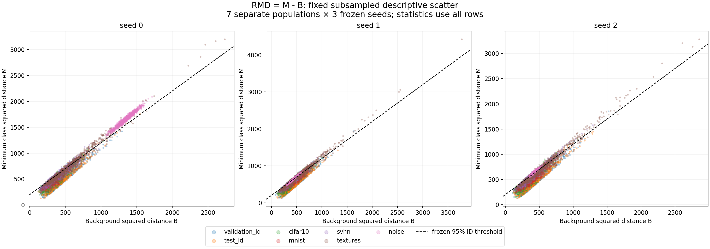
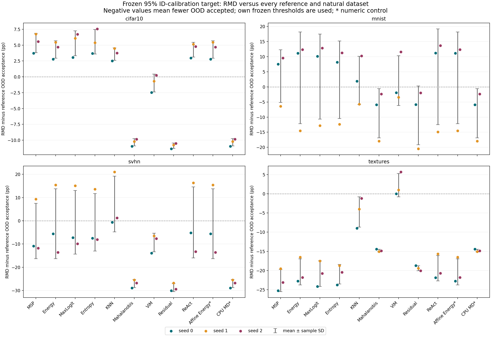

# Frozen RMD diagnostics: signed components and decision transitions

This posthoc analysis describes the already audited three-seed RMD results. No model, detector, hyperparameter, threshold or dataset was fitted/changed. The fixed scope includes every population and RMD × eleven references × four existing targets. Prior raw artifacts/source hashes remain intact.

Values are mean ± sample SD across training seeds 0/1/2. Within-population SD (ddof=0), covariance and every fixed quantile are separately preserved in summary.json. Seed SD is descriptive, not CI; population means/correlations cannot establish a cause of AUROC changes.

## Signed RMD score components

`R = M - B`, where M is the matched CPU minimum class distance and B is the label-agnostic background distance. Higher signed R is more OOD; negative R remains valid. The variance identity `Var(R)=Var(M)+Var(B)-2 Cov(M,B)` was independently verified on all samples.

| Population | n per seed | Mean M | Mean B | Mean R | Pearson(M,B) |
|---|---:|---:|---:|---:|---:|
| validation_id | 5,000 | 501.232 ± 0.553 | 420.571 ± 1.009 | 80.661 ± 0.708 | 0.926 ± 0.004 |
| test_id | 10,000 | 495.916 ± 0.938 | 417.554 ± 0.612 | 78.362 ± 0.451 | 0.922 ± 0.003 |
| cifar10 | 10,000 | 511.270 ± 6.252 | 367.237 ± 5.330 | 144.033 ± 1.977 | 0.943 ± 0.003 |
| mnist | 10,000 | 534.369 ± 61.730 | 388.171 ± 50.066 | 146.198 ± 14.382 | 0.939 ± 0.008 |
| svhn | 26,032 | 565.295 ± 16.652 | 385.147 ± 15.989 | 180.148 ± 1.178 | 0.970 ± 0.006 |
| textures | 1,880 | 745.609 ± 12.232 | 555.920 ± 10.993 | 189.689 ± 1.971 | 0.988 ± 0.001 |
| noise | 10,000 | 978.861 ± 590.679 | 733.169 ± 534.204 | 245.692 ± 57.208 | 0.977 ± 0.016 |

Noise is a synthetic diagnostic and is never included in a natural OOD aggregate. Validation/test ID remain separate. This diagnostic only describes existing scoring populations; it does not add a new training population.

## Signed population mean differences

These are paired differences within the same seed. Both component signs are preserved; delta R equals delta M minus delta B. This identity describes mean score shifts and does not replace rank-based detection metrics.

| Population minus reference | Delta M | Delta B | Delta R |
|---|---:|---:|---:|
| validation_id_minus_test_id | 5.316 ± 1.275 | 3.017 ± 1.621 | 2.299 ± 0.346 |
| cifar10_minus_test_id | 15.354 ± 6.509 | -50.317 ± 5.424 | 65.672 ± 1.959 |
| mnist_minus_test_id | 38.453 ± 62.648 | -29.384 ± 50.612 | 67.837 ± 14.825 |
| svhn_minus_test_id | 69.380 ± 16.139 | -32.407 ± 15.923 | 101.786 ± 0.830 |
| textures_minus_test_id | 249.693 ± 11.715 | 138.366 ± 10.967 | 111.327 ± 1.578 |
| noise_minus_test_id | 482.945 ± 589.913 | 315.614 ± 533.606 | 167.330 ± 56.981 |

## Exhaustive fixed-threshold decision transitions

The primary 95% ID-calibration target is shown below because it was already the fixed primary operating point. Every 80/90/95/99% target is saved in summary.json. All 132 seed/comparison/target settings and per-class ID counts remain available as raw transition codes.

Both methods use their own frozen threshold selected from the same 2,500 reused ID-validation calibration rows. Thus these transitions include threshold differences; they are not a pure ranking effect or a comparison at exactly equal achieved ID-test coverage. Correct/incorrect ID use original classifier predictions, with separate subgroup denominators. OOD populations have no classifier-correctness flag.

| RMD minus reference | Population | Both accept % | RMD only % | Reference only % | Neither % | Acceptance change (pp) |
|---|---|---:|---:|---:|---:|---:|
| RMD − MSP | test_id | 91.190 ± 0.617 | 3.897 ± 0.490 | 3.700 ± 0.035 | 1.213 ± 0.221 | 0.197 ± 0.501 |
| RMD − MSP | correct ID | 96.388 ± 0.107 | 1.250 ± 0.207 | 1.975 ± 0.107 | 0.387 ± 0.108 | -0.726 ± 0.314 |
| RMD − MSP | incorrect ID | 74.950 ± 1.971 | 12.166 ± 1.348 | 9.092 ± 0.206 | 3.792 ± 0.570 | 3.073 ± 1.152 |
| RMD − MSP | cifar10 | 71.857 ± 1.018 | 14.370 ± 0.990 | 9.023 ± 0.735 | 4.750 ± 0.208 | 5.347 ± 1.527 |
| RMD − MSP | mnist | 77.017 ± 8.822 | 11.943 ± 1.386 | 8.397 ± 7.409 | 2.643 ± 2.775 | 3.547 ± 8.706 |
| RMD − MSP | svhn | 50.534 ± 5.351 | 16.913 ± 8.172 | 21.348 ± 3.776 | 11.205 ± 0.861 | -4.436 ± 11.910 |
| RMD − MSP | textures | 50.142 ± 0.354 | 8.191 ± 0.935 | 30.798 ± 1.970 | 10.869 ± 0.983 | -22.606 ± 2.876 |
| RMD − MSP | noise | 0.697 ± 0.580 | 11.847 ± 19.108 | 38.303 ± 53.503 | 49.153 ± 44.459 | -26.457 ± 66.543 |
| RMD − Energy | test_id | 91.000 ± 0.800 | 4.087 ± 0.684 | 4.147 ± 0.130 | 0.767 ± 0.121 | -0.060 ± 0.676 |
| RMD − Energy | correct ID | 95.930 ± 0.220 | 1.707 ± 0.298 | 2.081 ± 0.115 | 0.282 ± 0.055 | -0.373 ± 0.387 |
| RMD − Energy | incorrect ID | 75.599 ± 2.401 | 11.517 ± 1.814 | 10.604 ± 0.270 | 2.280 ± 0.420 | 0.912 ± 1.604 |
| RMD − Energy | cifar10 | 71.370 ± 0.991 | 14.857 ± 0.958 | 10.550 ± 0.718 | 3.223 ± 0.038 | 4.307 ± 1.369 |
| RMD − Energy | mnist | 76.047 ± 4.510 | 12.913 ± 5.944 | 9.933 ± 9.322 | 1.107 ± 0.837 | 2.980 ± 15.159 |
| RMD − Energy | svhn | 45.780 ± 8.042 | 21.667 ± 10.675 | 22.936 ± 4.333 | 9.618 ± 2.054 | -1.269 ± 15.007 |
| RMD − Energy | textures | 45.621 ± 0.617 | 12.713 ± 1.779 | 33.067 ± 1.785 | 8.599 ± 0.818 | -20.355 ± 3.381 |
| RMD − Energy | noise | 0.077 ± 0.064 | 12.467 ± 19.401 | 33.583 ± 57.493 | 53.873 ± 49.349 | -21.117 ± 70.164 |
| RMD − MaxLogit | test_id | 91.037 ± 0.842 | 4.050 ± 0.675 | 3.993 ± 0.032 | 0.920 ± 0.240 | 0.057 ± 0.645 |
| RMD − MaxLogit | correct ID | 96.168 ± 0.159 | 1.470 ± 0.174 | 2.054 ± 0.061 | 0.308 ± 0.122 | -0.585 ± 0.232 |
| RMD − MaxLogit | incorrect ID | 75.012 ± 2.816 | 12.103 ± 2.160 | 10.056 ± 0.274 | 2.829 ± 0.660 | 2.048 ± 2.001 |
| RMD − MaxLogit | cifar10 | 71.027 ± 0.651 | 15.200 ± 1.130 | 9.910 ± 0.911 | 3.863 ± 0.230 | 5.290 ± 1.958 |
| RMD − MaxLogit | mnist | 76.017 ± 4.962 | 12.943 ± 5.217 | 9.560 ± 8.887 | 1.480 ± 1.288 | 3.383 ± 14.071 |
| RMD − MaxLogit | svhn | 46.508 ± 6.905 | 20.938 ± 9.696 | 21.602 ± 4.024 | 10.952 ± 1.208 | -0.663 ± 13.703 |
| RMD − MaxLogit | textures | 47.216 ± 0.427 | 11.117 ± 1.376 | 31.915 ± 1.987 | 9.752 ± 1.210 | -20.798 ± 3.325 |
| RMD − MaxLogit | noise | 0.157 ± 0.163 | 12.387 ± 19.421 | 33.800 ± 57.305 | 53.657 ± 49.150 | -21.413 ± 69.945 |
| RMD − Entropy | test_id | 91.183 ± 0.706 | 3.903 ± 0.509 | 3.870 ± 0.062 | 1.043 ± 0.290 | 0.033 ± 0.506 |
| RMD − Entropy | correct ID | 96.304 ± 0.180 | 1.333 ± 0.078 | 2.032 ± 0.052 | 0.330 ± 0.138 | -0.699 ± 0.123 |
| RMD − Entropy | incorrect ID | 75.188 ± 2.411 | 11.927 ± 1.739 | 9.616 ± 0.383 | 3.268 ± 0.811 | 2.311 ± 1.706 |
| RMD − Entropy | cifar10 | 71.227 ± 0.266 | 15.000 ± 0.946 | 9.463 ± 1.023 | 4.310 ± 0.425 | 5.537 ± 1.940 |
| RMD − Entropy | mnist | 77.293 ± 5.866 | 11.667 ± 4.272 | 9.313 ± 8.575 | 1.727 ± 1.615 | 2.353 ± 12.829 |
| RMD − Entropy | svhn | 47.544 ± 6.001 | 19.902 ± 8.822 | 20.553 ± 3.617 | 12.001 ± 0.688 | -0.650 ± 12.367 |
| RMD − Entropy | textures | 48.085 ± 0.507 | 10.248 ± 0.842 | 31.206 ± 1.790 | 10.461 ± 1.335 | -20.957 ± 2.542 |
| RMD − Entropy | noise | 0.197 ± 0.231 | 12.347 ± 19.452 | 33.763 ± 57.337 | 53.693 ± 49.146 | -21.417 ± 69.980 |
| RMD − KNN | test_id | 92.383 ± 0.432 | 2.703 ± 0.211 | 2.883 ± 0.076 | 2.030 ± 0.321 | -0.180 ± 0.282 |
| RMD − KNN | correct ID | 96.643 ± 0.298 | 0.994 ± 0.129 | 1.650 ± 0.123 | 0.713 ± 0.108 | -0.655 ± 0.082 |
| RMD − KNN | incorrect ID | 79.073 ± 1.522 | 8.042 ± 0.904 | 6.742 ± 0.435 | 6.142 ± 0.939 | 1.300 ± 0.905 |
| RMD − KNN | cifar10 | 76.037 ± 0.917 | 10.190 ± 0.790 | 6.607 ± 0.485 | 7.167 ± 0.201 | 3.583 ± 0.991 |
| RMD − KNN | mnist | 81.057 ± 8.858 | 7.903 ± 2.999 | 5.760 ± 5.654 | 5.280 ± 4.634 | 2.143 ± 7.984 |
| RMD − KNN | svhn | 49.778 ± 6.456 | 17.668 ± 9.323 | 10.464 ± 2.974 | 22.089 ± 0.993 | 7.204 ± 12.005 |
| RMD − KNN | textures | 47.606 ± 2.287 | 10.727 ± 2.355 | 15.461 ± 1.622 | 26.206 ± 2.022 | -4.734 ± 3.936 |
| RMD − KNN | noise | 0.117 ± 0.177 | 12.427 ± 19.474 | 14.597 ± 24.618 | 72.860 ± 20.892 | -2.170 ± 39.076 |
| RMD − Mahalanobis | test_id | 91.680 ± 0.348 | 3.407 ± 0.274 | 3.617 ± 0.215 | 1.297 ± 0.038 | -0.210 ± 0.380 |
| RMD − Mahalanobis | correct ID | 93.824 ± 0.438 | 3.814 ± 0.291 | 1.632 ± 0.080 | 0.730 ± 0.090 | 2.182 ± 0.228 |
| RMD − Mahalanobis | incorrect ID | 84.981 ± 0.502 | 2.134 ± 0.234 | 9.817 ± 0.709 | 3.068 ± 0.141 | -7.683 ± 0.896 |
| RMD − Mahalanobis | cifar10 | 85.093 ± 0.795 | 1.133 ± 0.119 | 11.477 ± 0.684 | 2.297 ± 0.029 | -10.343 ± 0.575 |
| RMD − Mahalanobis | mnist | 88.190 ± 10.344 | 0.770 ± 0.520 | 9.500 ± 8.320 | 1.540 ± 1.854 | -8.730 ± 8.148 |
| RMD − Mahalanobis | svhn | 66.521 ± 3.370 | 0.926 ± 0.444 | 27.955 ± 2.161 | 4.598 ± 1.394 | -27.030 ± 1.742 |
| RMD − Mahalanobis | textures | 52.021 ± 1.508 | 6.312 ± 0.430 | 21.082 ± 0.586 | 20.585 ± 1.439 | -14.770 ± 0.325 |
| RMD − Mahalanobis | noise | 12.533 ± 19.392 | 0.010 ± 0.017 | 54.093 ± 49.545 | 33.363 ± 57.683 | -54.083 ± 49.562 |
| RMD − ViM | test_id | 92.770 ± 0.606 | 2.317 ± 0.365 | 2.503 ± 0.081 | 2.410 ± 0.328 | -0.187 ± 0.442 |
| RMD − ViM | correct ID | 96.189 ± 0.612 | 1.448 ± 0.463 | 1.293 ± 0.147 | 1.069 ± 0.201 | 0.155 ± 0.535 |
| RMD − ViM | incorrect ID | 82.081 ± 0.737 | 5.035 ± 0.048 | 6.286 ± 0.320 | 6.598 ± 0.675 | -1.252 ± 0.305 |
| RMD − ViM | cifar10 | 80.410 ± 0.252 | 5.817 ± 0.728 | 6.793 ± 0.712 | 6.980 ± 0.108 | -0.977 ± 1.396 |
| RMD − ViM | mnist | 81.707 ± 10.649 | 7.253 ± 4.911 | 5.170 ± 4.982 | 5.870 ± 5.466 | 2.083 ± 8.234 |
| RMD − ViM | svhn | 60.768 ± 2.774 | 6.679 ± 0.694 | 16.019 ± 3.365 | 16.535 ± 2.148 | -9.340 ± 3.975 |
| RMD − ViM | textures | 46.401 ± 2.624 | 11.933 ± 1.829 | 9.699 ± 1.242 | 31.968 ± 1.882 | 2.234 ± 3.037 |
| RMD − ViM | noise | 0.340 ± 0.589 | 12.203 ± 18.795 | 0.010 ± 0.017 | 87.447 ± 19.400 | 12.193 ± 18.778 |
| RMD − Residual | test_id | 91.430 ± 0.317 | 3.657 ± 0.390 | 3.940 ± 0.288 | 0.973 ± 0.042 | -0.283 ± 0.609 |
| RMD − Residual | correct ID | 93.402 ± 0.448 | 4.236 ± 0.374 | 1.777 ± 0.167 | 0.585 ± 0.031 | 2.458 ± 0.399 |
| RMD − Residual | incorrect ID | 85.269 ± 0.397 | 1.846 ± 0.420 | 10.697 ± 0.781 | 2.188 ± 0.126 | -8.850 ± 1.141 |
| RMD − Residual | cifar10 | 84.917 ± 0.885 | 1.310 ± 0.214 | 12.183 ± 0.622 | 1.590 ± 0.060 | -10.873 ± 0.429 |
| RMD − Residual | mnist | 88.017 ± 10.104 | 0.943 ± 0.686 | 10.367 ± 9.664 | 0.673 ± 0.506 | -9.423 ± 9.746 |
| RMD − Residual | svhn | 66.428 ± 3.557 | 1.018 ± 0.692 | 29.756 ± 2.377 | 2.798 ± 0.740 | -28.738 ± 1.727 |
| RMD − Residual | textures | 52.411 ± 1.465 | 5.922 ± 0.215 | 25.319 ± 0.613 | 16.348 ± 1.250 | -19.397 ± 0.665 |
| RMD − Residual | noise | 12.533 ± 19.392 | 0.010 ± 0.017 | 54.110 ± 49.551 | 33.347 ± 57.698 | -54.100 ± 49.567 |
| RMD − ReAct | test_id | 90.980 ± 0.747 | 4.107 ± 0.610 | 4.140 ± 0.121 | 0.773 ± 0.126 | -0.033 ± 0.569 |
| RMD − ReAct | correct ID | 95.917 ± 0.193 | 1.721 ± 0.243 | 2.081 ± 0.102 | 0.282 ± 0.068 | -0.360 ± 0.315 |
| RMD − ReAct | incorrect ID | 75.557 ± 2.288 | 11.558 ± 1.674 | 10.577 ± 0.298 | 2.308 ± 0.404 | 0.981 ± 1.397 |
| RMD − ReAct | cifar10 | 71.420 ± 0.823 | 14.807 ± 0.752 | 10.517 ± 0.695 | 3.257 ± 0.035 | 4.290 ± 1.167 |
| RMD − ReAct | mnist | 75.720 ± 3.782 | 13.240 ± 6.461 | 9.930 ± 9.417 | 1.110 ± 0.759 | 3.310 ± 15.837 |
| RMD − ReAct | svhn | 45.513 ± 8.098 | 21.933 ± 10.734 | 22.639 ± 4.560 | 9.915 ± 2.225 | -0.706 ± 15.293 |
| RMD − ReAct | textures | 45.266 ± 0.560 | 13.067 ± 1.776 | 32.465 ± 1.677 | 9.202 ± 0.754 | -19.397 ± 3.307 |
| RMD − ReAct | noise | 0.057 ± 0.031 | 12.487 ± 19.386 | 33.573 ± 57.501 | 53.883 ± 49.378 | -21.087 ± 70.167 |
| RMD − Affine Energy* | test_id | 91.000 ± 0.800 | 4.087 ± 0.684 | 4.147 ± 0.130 | 0.767 ± 0.121 | -0.060 ± 0.676 |
| RMD − Affine Energy* | correct ID | 95.930 ± 0.220 | 1.707 ± 0.298 | 2.081 ± 0.115 | 0.282 ± 0.055 | -0.373 ± 0.387 |
| RMD − Affine Energy* | incorrect ID | 75.599 ± 2.401 | 11.517 ± 1.814 | 10.604 ± 0.270 | 2.280 ± 0.420 | 0.912 ± 1.604 |
| RMD − Affine Energy* | cifar10 | 71.370 ± 0.991 | 14.857 ± 0.958 | 10.550 ± 0.718 | 3.223 ± 0.038 | 4.307 ± 1.369 |
| RMD − Affine Energy* | mnist | 76.047 ± 4.510 | 12.913 ± 5.944 | 9.933 ± 9.322 | 1.107 ± 0.837 | 2.980 ± 15.159 |
| RMD − Affine Energy* | svhn | 45.780 ± 8.042 | 21.667 ± 10.675 | 22.936 ± 4.333 | 9.618 ± 2.054 | -1.269 ± 15.007 |
| RMD − Affine Energy* | textures | 45.621 ± 0.617 | 12.713 ± 1.779 | 33.067 ± 1.785 | 8.599 ± 0.818 | -20.355 ± 3.381 |
| RMD − Affine Energy* | noise | 0.077 ± 0.064 | 12.467 ± 19.401 | 33.583 ± 57.493 | 53.873 ± 49.349 | -21.117 ± 70.164 |
| RMD − CPU MD* | test_id | 91.680 ± 0.348 | 3.407 ± 0.274 | 3.617 ± 0.215 | 1.297 ± 0.038 | -0.210 ± 0.380 |
| RMD − CPU MD* | correct ID | 93.824 ± 0.438 | 3.814 ± 0.291 | 1.632 ± 0.080 | 0.730 ± 0.090 | 2.182 ± 0.228 |
| RMD − CPU MD* | incorrect ID | 84.981 ± 0.502 | 2.134 ± 0.234 | 9.817 ± 0.709 | 3.068 ± 0.141 | -7.683 ± 0.896 |
| RMD − CPU MD* | cifar10 | 85.093 ± 0.795 | 1.133 ± 0.119 | 11.477 ± 0.684 | 2.297 ± 0.029 | -10.343 ± 0.575 |
| RMD − CPU MD* | mnist | 88.190 ± 10.344 | 0.770 ± 0.520 | 9.500 ± 8.320 | 1.540 ± 1.854 | -8.730 ± 8.148 |
| RMD − CPU MD* | svhn | 66.521 ± 3.370 | 0.926 ± 0.444 | 27.955 ± 2.161 | 4.598 ± 1.394 | -27.030 ± 1.742 |
| RMD − CPU MD* | textures | 52.021 ± 1.508 | 6.312 ± 0.430 | 21.082 ± 0.586 | 20.585 ± 1.439 | -14.770 ± 0.325 |
| RMD − CPU MD* | noise | 12.533 ± 19.392 | 0.010 ± 0.017 | 54.093 ± 49.545 | 33.363 ± 57.683 | -54.083 ± 49.562 |

## Scientific figures

The joint scatter uses the predeclared sorted random sample of at most 1,000 rows per population. All statistics and decision counts use full populations. The dashed RMD boundary M=B+threshold is the existing 95%-calibration threshold, not a newly fitted line.



The next figure shows acceptance changes for all natural datasets against every fixed reference, with per-seed points and mean/sample SD. Noise and ID transition tables remain separate; no result is promoted as a selected method.



## Reproduction and evidence

```bash
python tools/run_rmd_diagnostics.py
python tools/audit_rmd_diagnostics.py
python tools/build_rmd_diagnostics_report.py
python tools/audit_rmd_diagnostics_report.py
```

Raw vectors/sampled indices and original ID labels: runs/rmd-diagnostics/seedN/analysis/*_components.npz. Transition codes and [addition,reference,target,ID_class,state,correctness] counts: transitions.npz. Original masks are reused byte-for-byte. Completed audits bind all source/input/raw artifact hashes; completion is recorded separately after summary audit and visual QA.

No causal explanation, significance claim, OOD tuning or fresh-validation coverage guarantee follows from this posthoc diagnostic. A future method study needs a separate declared ID-only development protocol.
