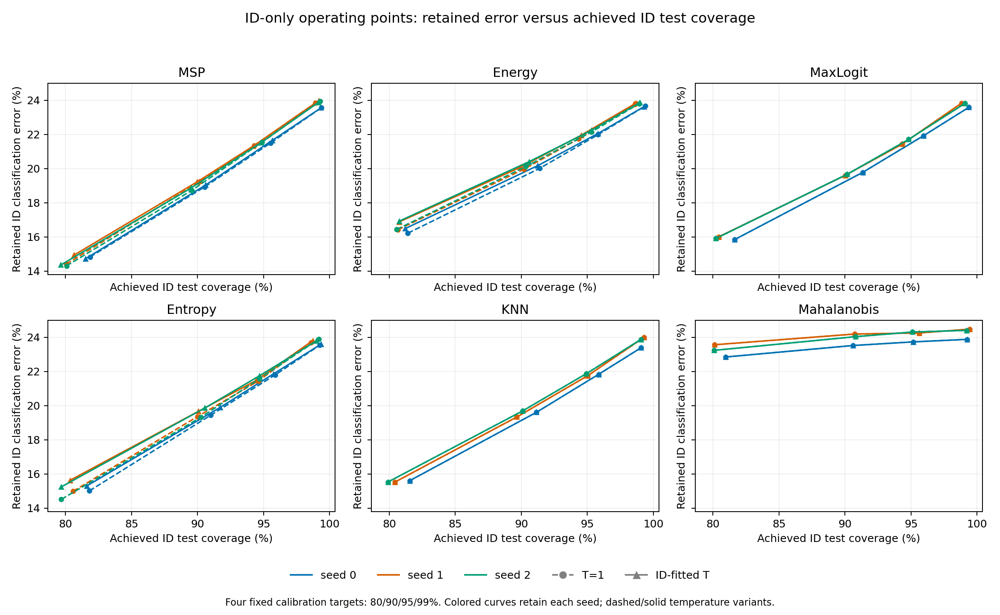
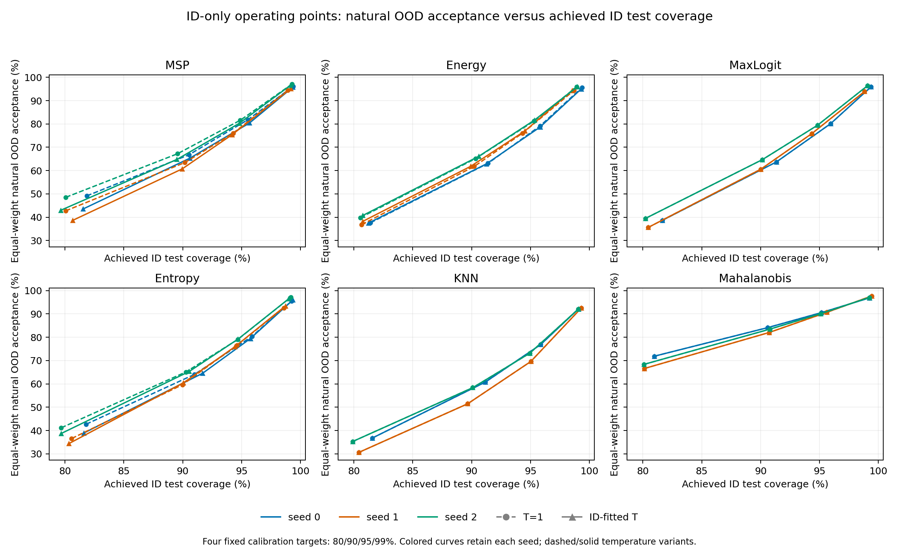

# Fixed ID-only operating points: complete three-seed analysis

All six scores, both matched T=1 and ID-fitted-temperature variants, all three frozen classifiers and all four predeclared ID-calibration targets (80/90/95/99%) are reported. Thresholds use only the same 2,500 ID-validation threshold-calibration rows; there is no new fitting. Both phase-2 validation subsets previously selected checkpoints, so empirical calibration coverage is not a deployment guarantee.

ID retained error risk = incorrect accepted ID / all accepted ID. OOD acceptance = accepted OOD / all OOD for its own population. These are distinct denominators; OOD classification correctness or an assumed deployment mixture is not defined here. Lower retained risk and OOD acceptance are desirable, alongside the separately measured ID coverage.

## All operating points

Each entry is mean ± sample SD across training seeds 0/1/2, in percent. The target is empirical ID-calibration acceptance; achieved ID-test coverage is measured separately. Natural OOD macro averages CIFAR-10, MNIST, SVHN and Textures within each seed, with noise excluded.

| Method | Target (%) | ID coverage T=1 | ID coverage fitted T | ID retained error T=1 | ID retained error fitted T | Natural OOD accepted T=1 | Natural OOD accepted fitted T |
|---|---:|---:|---:|---:|---:|---:|---:|
| MSP | 80 | 80.66 ± 1.03 | 80.60 ± 0.94 | 14.51 ± 0.28 | 14.67 ± 0.29 | 46.79 ± 3.55 | 41.68 ± 2.68 |
| MSP | 90 | 90.09 ± 0.50 | 90.01 ± 0.56 | 18.96 ± 0.26 | 19.03 ± 0.18 | 65.81 ± 2.06 | 63.58 ± 2.50 |
| MSP | 95 | 94.89 ± 0.62 | 94.89 ± 0.73 | 21.46 ± 0.10 | 21.49 ± 0.17 | 79.78 ± 3.25 | 78.70 ± 2.84 |
| MSP | 99 | 99.18 ± 0.23 | 99.22 ± 0.11 | 23.78 ± 0.20 | 23.80 ± 0.22 | 95.85 ± 1.34 | 95.80 ± 0.73 |
| Energy | 80 | 80.87 ± 0.47 | 80.90 ± 0.27 | 16.36 ± 0.12 | 16.76 ± 0.24 | 38.09 ± 1.57 | 38.78 ± 1.72 |
| Energy | 90 | 90.64 ± 0.64 | 90.58 ± 0.67 | 20.03 ± 0.08 | 20.21 ± 0.17 | 63.35 ± 1.72 | 63.58 ± 2.23 |
| Energy | 95 | 95.15 ± 0.75 | 95.21 ± 0.65 | 21.95 ± 0.20 | 22.08 ± 0.15 | 78.83 ± 2.60 | 79.08 ± 2.34 |
| Energy | 99 | 99.00 ± 0.35 | 98.94 ± 0.39 | 23.76 ± 0.09 | 23.75 ± 0.11 | 95.35 ± 0.84 | 95.13 ± 0.83 |
| MaxLogit | 80 | 80.77 ± 0.76 | 80.77 ± 0.76 | 15.91 ± 0.08 | 15.91 ± 0.08 | 37.90 ± 2.06 | 37.90 ± 2.06 |
| MaxLogit | 90 | 90.50 ± 0.73 | 90.50 ± 0.73 | 19.68 ± 0.09 | 19.68 ± 0.09 | 62.99 ± 2.16 | 62.99 ± 2.16 |
| MaxLogit | 95 | 95.03 ± 0.82 | 95.03 ± 0.82 | 21.68 ± 0.24 | 21.68 ± 0.24 | 78.44 ± 2.28 | 78.44 ± 2.28 |
| MaxLogit | 99 | 99.09 ± 0.28 | 99.09 ± 0.28 | 23.74 ± 0.14 | 23.74 ± 0.14 | 95.41 ± 1.32 | 95.41 ± 1.32 |
| Entropy | 80 | 80.68 ± 1.06 | 80.54 ± 0.98 | 14.84 ± 0.28 | 15.40 ± 0.21 | 40.14 ± 3.19 | 37.34 ± 2.56 |
| Entropy | 90 | 90.41 ± 0.53 | 90.76 ± 0.84 | 19.38 ± 0.06 | 19.81 ± 0.12 | 62.94 ± 2.88 | 63.43 ± 2.63 |
| Entropy | 95 | 95.05 ± 0.72 | 94.95 ± 0.69 | 21.61 ± 0.18 | 21.70 ± 0.20 | 78.67 ± 1.93 | 78.18 ± 1.96 |
| Entropy | 99 | 99.00 ± 0.36 | 99.02 ± 0.32 | 23.71 ± 0.18 | 23.73 ± 0.11 | 95.10 ± 2.29 | 95.27 ± 1.64 |
| KNN | 80 | 80.63 ± 0.84 | 80.63 ± 0.84 | 15.56 ± 0.05 | 15.56 ± 0.05 | 34.21 ± 3.19 | 34.21 ± 3.19 |
| KNN | 90 | 90.30 ± 0.77 | 90.30 ± 0.77 | 19.55 ± 0.19 | 19.55 ± 0.19 | 56.86 ± 4.82 | 56.86 ± 4.82 |
| KNN | 95 | 95.27 ± 0.51 | 95.27 ± 0.51 | 21.82 ± 0.06 | 21.82 ± 0.06 | 73.19 ± 3.62 | 73.19 ± 3.62 |
| KNN | 99 | 99.14 ± 0.14 | 99.14 ± 0.14 | 23.76 ± 0.33 | 23.76 ± 0.33 | 92.23 ± 0.25 | 92.23 ± 0.25 |
| Mahalanobis | 80 | 80.38 ± 0.50 | 80.38 ± 0.50 | 23.22 ± 0.36 | 23.22 ± 0.36 | 68.91 ± 2.69 | 68.91 ± 2.69 |
| Mahalanobis | 90 | 90.70 ± 0.11 | 90.70 ± 0.11 | 23.92 ± 0.35 | 23.92 ± 0.35 | 83.21 ± 1.07 | 83.21 ± 1.07 |
| Mahalanobis | 95 | 95.30 ± 0.29 | 95.30 ± 0.29 | 24.10 ± 0.32 | 24.10 ± 0.32 | 90.46 ± 0.33 | 90.46 ± 0.33 |
| Mahalanobis | 99 | 99.29 ± 0.12 | 99.29 ± 0.12 | 24.26 ± 0.33 | 24.26 ± 0.33 | 97.20 ± 0.43 | 97.20 ± 0.43 |

## Paired calibrated-minus-T=1 changes

Changes are percentage points, paired within each seed before mean/sample SD. No method or operating target is selected from these OOD observations.

| Method | Target (%) | ID coverage delta | ID retained error delta | Correct-ID rejection delta | Incorrect-ID rejection delta | Natural OOD acceptance delta |
|---|---:|---:|---:|---:|---:|---:|
| MSP | 80 | -0.06 ± 0.56 | 0.16 ± 0.33 | 0.23 ± 0.32 | -0.49 ± 1.40 | -5.11 ± 0.87 |
| MSP | 90 | -0.07 ± 0.15 | 0.07 ± 0.09 | 0.16 ± 0.10 | -0.21 ± 0.43 | -2.23 ± 0.66 |
| MSP | 95 | 0.00 ± 0.13 | 0.03 ± 0.11 | 0.04 ± 0.01 | -0.14 ± 0.57 | -1.08 ± 0.42 |
| MSP | 99 | 0.04 ± 0.19 | 0.02 ± 0.10 | -0.01 ± 0.06 | -0.11 ± 0.61 | -0.05 ± 0.64 |
| Energy | 80 | 0.03 ± 0.20 | 0.40 ± 0.11 | 0.40 ± 0.10 | -1.36 ± 0.49 | 0.69 ± 0.81 |
| Energy | 90 | -0.06 ± 0.28 | 0.18 ± 0.10 | 0.29 ± 0.19 | -0.63 ± 0.59 | 0.24 ± 0.60 |
| Energy | 95 | 0.07 ± 0.11 | 0.13 ± 0.07 | 0.09 ± 0.03 | -0.56 ± 0.38 | 0.25 ± 0.73 |
| Energy | 99 | -0.06 ± 0.11 | -0.01 ± 0.06 | 0.05 ± 0.04 | 0.10 ± 0.34 | -0.22 ± 0.39 |
| MaxLogit | 80 | 0.00 ± 0.00 | 0.00 ± 0.00 | 0.00 ± 0.00 | 0.00 ± 0.00 | 0.00 ± 0.00 |
| MaxLogit | 90 | 0.00 ± 0.00 | 0.00 ± 0.00 | 0.00 ± 0.00 | 0.00 ± 0.00 | 0.00 ± 0.00 |
| MaxLogit | 95 | 0.00 ± 0.00 | 0.00 ± 0.00 | 0.00 ± 0.00 | 0.00 ± 0.00 | 0.00 ± 0.00 |
| MaxLogit | 99 | 0.00 ± 0.00 | 0.00 ± 0.00 | 0.00 ± 0.00 | 0.00 ± 0.00 | 0.00 ± 0.00 |
| Entropy | 80 | -0.14 ± 0.12 | 0.55 ± 0.23 | 0.74 ± 0.21 | -1.74 ± 0.78 | -2.80 ± 0.86 |
| Entropy | 90 | 0.35 ± 0.31 | 0.43 ± 0.11 | 0.14 ± 0.29 | -1.89 ± 0.61 | 0.49 ± 0.27 |
| Entropy | 95 | -0.10 ± 0.10 | 0.09 ± 0.08 | 0.21 ± 0.00 | -0.25 ± 0.40 | -0.49 ± 0.55 |
| Entropy | 99 | 0.02 ± 0.17 | 0.02 ± 0.11 | 0.00 ± 0.03 | -0.10 ± 0.62 | 0.17 ± 0.78 |
| KNN | 80 | 0.00 ± 0.00 | 0.00 ± 0.00 | 0.00 ± 0.00 | 0.00 ± 0.00 | 0.00 ± 0.00 |
| KNN | 90 | 0.00 ± 0.00 | 0.00 ± 0.00 | 0.00 ± 0.00 | 0.00 ± 0.00 | 0.00 ± 0.00 |
| KNN | 95 | 0.00 ± 0.00 | 0.00 ± 0.00 | 0.00 ± 0.00 | 0.00 ± 0.00 | 0.00 ± 0.00 |
| KNN | 99 | 0.00 ± 0.00 | 0.00 ± 0.00 | 0.00 ± 0.00 | 0.00 ± 0.00 | 0.00 ± 0.00 |
| Mahalanobis | 80 | 0.00 ± 0.00 | 0.00 ± 0.00 | 0.00 ± 0.00 | 0.00 ± 0.00 | 0.00 ± 0.00 |
| Mahalanobis | 90 | 0.00 ± 0.00 | 0.00 ± 0.00 | 0.00 ± 0.00 | 0.00 ± 0.00 | 0.00 ± 0.00 |
| Mahalanobis | 95 | 0.00 ± 0.00 | 0.00 ± 0.00 | 0.00 ± 0.00 | 0.00 ± 0.00 | 0.00 ± 0.00 |
| Mahalanobis | 99 | 0.00 ± 0.00 | 0.00 ± 0.00 | 0.00 ± 0.00 | 0.00 ± 0.00 | 0.00 ± 0.00 |

## Per-population OOD acceptance

All populations retain their original sizes: 10,000 ID test; CIFAR-10 10,000, MNIST 10,000, SVHN 26,032 and Textures 1,880. AP/population mixture is not used to choose thresholds. Each table entry below is OOD acceptance, percent; target refers only to the fixed ID-calibration subset.

| Dataset | Method | Target (%) | T=1 | ID-fitted T | Paired delta (pp) |
|---|---|---:|---:|---:|---:|
| cifar10 | MSP | 80 | 48.58 ± 1.76 | 45.20 ± 1.53 | -3.38 ± 0.73 |
| cifar10 | MSP | 90 | 67.57 ± 1.14 | 66.24 ± 0.85 | -1.32 ± 0.79 |
| cifar10 | MSP | 95 | 80.88 ± 1.19 | 80.37 ± 0.89 | -0.51 ± 0.44 |
| cifar10 | MSP | 99 | 96.12 ± 0.35 | 96.05 ± 0.29 | -0.07 ± 0.59 |
| cifar10 | Energy | 80 | 44.97 ± 0.17 | 46.02 ± 0.20 | 1.05 ± 0.37 |
| cifar10 | Energy | 90 | 68.83 ± 0.47 | 69.25 ± 0.61 | 0.42 ± 0.58 |
| cifar10 | Energy | 95 | 81.92 ± 0.98 | 82.33 ± 0.85 | 0.41 ± 0.17 |
| cifar10 | Energy | 99 | 95.88 ± 0.57 | 95.81 ± 0.39 | -0.06 ± 0.18 |
| cifar10 | MaxLogit | 80 | 44.21 ± 0.82 | 44.21 ± 0.82 | 0.00 ± 0.00 |
| cifar10 | MaxLogit | 90 | 67.83 ± 0.87 | 67.83 ± 0.87 | 0.00 ± 0.00 |
| cifar10 | MaxLogit | 95 | 80.94 ± 1.32 | 80.94 ± 1.32 | 0.00 ± 0.00 |
| cifar10 | MaxLogit | 99 | 95.93 ± 0.43 | 95.93 ± 0.43 | 0.00 ± 0.00 |
| cifar10 | Entropy | 80 | 44.30 ± 1.57 | 43.12 ± 1.01 | -1.19 ± 0.74 |
| cifar10 | Entropy | 90 | 66.37 ± 0.58 | 68.06 ± 1.25 | 1.69 ± 0.67 |
| cifar10 | Entropy | 95 | 80.69 ± 1.27 | 80.84 ± 1.07 | 0.15 ± 0.42 |
| cifar10 | Entropy | 99 | 95.56 ± 1.02 | 95.80 ± 0.64 | 0.24 ± 0.74 |
| cifar10 | KNN | 80 | 45.30 ± 1.20 | 45.30 ± 1.20 | 0.00 ± 0.00 |
| cifar10 | KNN | 90 | 68.13 ± 1.62 | 68.13 ± 1.62 | 0.00 ± 0.00 |
| cifar10 | KNN | 95 | 82.64 ± 0.73 | 82.64 ± 0.73 | 0.00 ± 0.00 |
| cifar10 | KNN | 99 | 96.27 ± 0.95 | 96.27 ± 0.95 | 0.00 ± 0.00 |
| cifar10 | Mahalanobis | 80 | 80.32 ± 0.57 | 80.32 ± 0.57 | 0.00 ± 0.00 |
| cifar10 | Mahalanobis | 90 | 91.85 ± 0.86 | 91.85 ± 0.86 | 0.00 ± 0.00 |
| cifar10 | Mahalanobis | 95 | 96.57 ± 0.13 | 96.57 ± 0.13 | 0.00 ± 0.00 |
| cifar10 | Mahalanobis | 99 | 99.70 ± 0.03 | 99.70 ± 0.03 | 0.00 ± 0.00 |
| mnist | MSP | 80 | 53.36 ± 6.24 | 47.72 ± 4.43 | -5.63 ± 1.90 |
| mnist | MSP | 90 | 72.33 ± 2.35 | 70.97 ± 0.95 | -1.36 ± 1.42 |
| mnist | MSP | 95 | 85.41 ± 1.42 | 85.39 ± 0.47 | -0.02 ± 1.82 |
| mnist | MSP | 99 | 97.97 ± 0.26 | 97.99 ± 0.64 | 0.02 ± 0.48 |
| mnist | Energy | 80 | 42.61 ± 4.46 | 43.48 ± 6.50 | 0.87 ± 2.24 |
| mnist | Energy | 90 | 71.73 ± 7.98 | 71.59 ± 8.86 | -0.14 ± 0.89 |
| mnist | Energy | 95 | 85.98 ± 5.11 | 85.64 ± 6.14 | -0.34 ± 1.05 |
| mnist | Energy | 99 | 97.44 ± 1.53 | 97.17 ± 1.74 | -0.27 ± 0.33 |
| mnist | MaxLogit | 80 | 42.51 ± 2.34 | 42.51 ± 2.34 | 0.00 ± 0.00 |
| mnist | MaxLogit | 90 | 71.29 ± 4.84 | 71.29 ± 4.84 | 0.00 ± 0.00 |
| mnist | MaxLogit | 95 | 85.58 ± 3.95 | 85.58 ± 3.95 | 0.00 ± 0.00 |
| mnist | MaxLogit | 99 | 97.76 ± 0.80 | 97.76 ± 0.80 | 0.00 ± 0.00 |
| mnist | Entropy | 80 | 45.35 ± 4.82 | 41.97 ± 2.55 | -3.38 ± 2.68 |
| mnist | Entropy | 90 | 70.94 ± 1.06 | 72.52 ± 4.02 | 1.59 ± 3.65 |
| mnist | Entropy | 95 | 86.61 ± 2.71 | 86.24 ± 4.16 | -0.37 ± 1.50 |
| mnist | Entropy | 99 | 97.92 ± 0.34 | 97.76 ± 0.89 | -0.16 ± 0.86 |
| mnist | KNN | 80 | 42.84 ± 7.29 | 42.84 ± 7.29 | 0.00 ± 0.00 |
| mnist | KNN | 90 | 70.39 ± 6.27 | 70.39 ± 6.27 | 0.00 ± 0.00 |
| mnist | KNN | 95 | 86.82 ± 4.50 | 86.82 ± 4.50 | 0.00 ± 0.00 |
| mnist | KNN | 99 | 98.59 ± 0.91 | 98.59 ± 0.91 | 0.00 ± 0.00 |
| mnist | Mahalanobis | 80 | 77.73 ± 14.19 | 77.73 ± 14.19 | 0.00 ± 0.00 |
| mnist | Mahalanobis | 90 | 92.36 ± 7.02 | 92.36 ± 7.02 | 0.00 ± 0.00 |
| mnist | Mahalanobis | 95 | 97.69 ± 2.20 | 97.69 ± 2.20 | 0.00 ± 0.00 |
| mnist | Mahalanobis | 99 | 99.96 ± 0.04 | 99.96 ± 0.04 | 0.00 ± 0.00 |
| svhn | MSP | 80 | 37.69 ± 7.60 | 30.71 ± 6.99 | -6.99 ± 0.61 |
| svhn | MSP | 90 | 56.64 ± 7.56 | 52.23 ± 8.85 | -4.42 ± 1.31 |
| svhn | MSP | 95 | 71.88 ± 9.03 | 69.35 ± 9.58 | -2.53 ± 0.66 |
| svhn | MSP | 99 | 93.52 ± 3.90 | 93.56 ± 3.10 | 0.03 ± 0.89 |
| svhn | Energy | 80 | 21.67 ± 6.82 | 21.51 ± 6.96 | -0.15 ± 0.79 |
| svhn | Energy | 90 | 47.77 ± 11.60 | 47.94 ± 12.70 | 0.17 ± 1.39 |
| svhn | Energy | 95 | 68.72 ± 12.36 | 69.53 ± 11.96 | 0.82 ± 1.23 |
| svhn | Energy | 99 | 93.88 ± 3.57 | 93.81 ± 3.51 | -0.07 ± 0.74 |
| svhn | MaxLogit | 80 | 22.66 ± 6.94 | 22.66 ± 6.94 | 0.00 ± 0.00 |
| svhn | MaxLogit | 90 | 48.69 ± 10.88 | 48.69 ± 10.88 | 0.00 ± 0.00 |
| svhn | MaxLogit | 95 | 68.11 ± 10.87 | 68.11 ± 10.87 | 0.00 ± 0.00 |
| svhn | MaxLogit | 99 | 93.21 ± 4.35 | 93.21 ± 4.35 | 0.00 ± 0.00 |
| svhn | Entropy | 80 | 28.41 ± 7.48 | 23.26 ± 7.03 | -5.15 ± 0.86 |
| svhn | Entropy | 90 | 49.78 ± 10.33 | 48.35 ± 11.40 | -1.43 ± 1.10 |
| svhn | Entropy | 95 | 68.10 ± 9.48 | 66.96 ± 10.73 | -1.13 ± 1.70 |
| svhn | Entropy | 99 | 92.18 ± 6.27 | 92.96 ± 5.17 | 0.79 ± 1.12 |
| svhn | KNN | 80 | 22.44 ± 6.44 | 22.44 ± 6.44 | 0.00 ± 0.00 |
| svhn | KNN | 90 | 42.47 ± 10.03 | 42.47 ± 10.03 | 0.00 ± 0.00 |
| svhn | KNN | 95 | 60.24 ± 9.08 | 60.24 ± 9.08 | 0.00 ± 0.00 |
| svhn | KNN | 99 | 88.43 ± 2.06 | 88.43 ± 2.06 | 0.00 ± 0.00 |
| svhn | Mahalanobis | 80 | 72.05 ± 4.27 | 72.05 ± 4.27 | 0.00 ± 0.00 |
| svhn | Mahalanobis | 90 | 87.75 ± 2.48 | 87.75 ± 2.48 | 0.00 ± 0.00 |
| svhn | Mahalanobis | 95 | 94.48 ± 1.70 | 94.48 ± 1.70 | 0.00 ± 0.00 |
| svhn | Mahalanobis | 99 | 99.51 ± 0.29 | 99.51 ± 0.29 | 0.00 ± 0.00 |
| textures | MSP | 80 | 47.54 ± 0.45 | 43.09 ± 0.23 | -4.45 ± 0.35 |
| textures | MSP | 90 | 66.68 ± 0.41 | 64.88 ± 1.03 | -1.81 ± 1.01 |
| textures | MSP | 95 | 80.94 ± 1.74 | 79.68 ± 1.88 | -1.26 ± 0.17 |
| textures | MSP | 99 | 95.80 ± 1.18 | 95.62 ± 0.54 | -0.18 ± 0.63 |
| textures | Energy | 80 | 43.12 ± 1.37 | 44.11 ± 1.88 | 0.99 ± 0.61 |
| textures | Energy | 90 | 65.05 ± 1.94 | 65.55 ± 2.41 | 0.50 ± 0.59 |
| textures | Energy | 95 | 78.69 ± 2.13 | 78.79 ± 1.81 | 0.11 ± 0.89 |
| textures | Energy | 99 | 94.18 ± 1.33 | 93.72 ± 1.63 | -0.46 ± 0.55 |
| textures | MaxLogit | 80 | 42.22 ± 1.32 | 42.22 ± 1.32 | 0.00 ± 0.00 |
| textures | MaxLogit | 90 | 64.15 ± 2.03 | 64.15 ± 2.03 | 0.00 ± 0.00 |
| textures | MaxLogit | 95 | 79.13 ± 2.30 | 79.13 ± 2.30 | 0.00 ± 0.00 |
| textures | MaxLogit | 99 | 94.73 ± 1.57 | 94.73 ± 1.57 | 0.00 ± 0.00 |
| textures | Entropy | 80 | 42.50 ± 0.78 | 41.03 ± 0.75 | -1.47 ± 0.81 |
| textures | Entropy | 90 | 64.66 ± 1.11 | 64.79 ± 2.22 | 0.12 ± 1.12 |
| textures | Entropy | 95 | 79.29 ± 1.73 | 78.67 ± 1.76 | -0.62 ± 0.67 |
| textures | Entropy | 99 | 94.73 ± 2.14 | 94.56 ± 1.78 | -0.18 ± 0.46 |
| textures | KNN | 80 | 26.28 ± 1.99 | 26.28 ± 1.99 | 0.00 ± 0.00 |
| textures | KNN | 90 | 46.44 ± 2.55 | 46.44 ± 2.55 | 0.00 ± 0.00 |
| textures | KNN | 95 | 63.07 ± 3.88 | 63.07 ± 3.88 | 0.00 ± 0.00 |
| textures | KNN | 99 | 85.64 ± 2.56 | 85.64 ± 2.56 | 0.00 ± 0.00 |
| textures | Mahalanobis | 80 | 45.55 ± 2.95 | 45.55 ± 2.95 | 0.00 ± 0.00 |
| textures | Mahalanobis | 90 | 60.89 ± 1.33 | 60.89 ± 1.33 | 0.00 ± 0.00 |
| textures | Mahalanobis | 95 | 73.10 ± 1.53 | 73.10 ± 1.53 | 0.00 ± 0.00 |
| textures | Mahalanobis | 99 | 89.65 ± 1.56 | 89.65 ± 1.56 | 0.00 ± 0.00 |

## Saved evidence and audit

Per-seed results save exact thresholds, calibration ties/counts, correct/incorrect ID contingency counts, OOD counts/score hashes and every sample-level boolean acceptance mask. [per-seed-counts.csv](per-seed-counts.csv) retains all 720 seed/setting/OOD population rows; repeated ID columns are the same setting, not independent observations. summary.json preserves every seed, paired delta and all natural/synthetic summaries. A zero denominator would remain null with the number of defined seeds reported explicitly; no such undefined endpoint occurred here.

Independent audit: 257 original hashes, 6768 count/metric checks, 1008 per-sample acceptance masks, 540 95%-point parity checks, 36 unchanged-control settings and 756 nesting checks. Python sorting and Counter contingency counts independently reconstruct the production NumPy thresholds/counts.

Every 95% point exactly matches the completed phase-2 operational threshold and acceptance. MaxLogit/KNN/Mahalanobis thresholds and decisions are identical across temperature variants. The original baseline and probability-calibration artifacts remain frozen. Natural OOD acceptance is operational validation-threshold acceptance, not benchmark FPR95-ID; achieved ID test coverage need not equal its calibration target.

Three-seed sample SD is descriptive, not a confidence interval or significance test. Probability calibration, ID error rejection and natural OOD rejection are separately measured outcomes. Uniform noise remains a separate synthetic diagnostic and never enters a natural macro.
